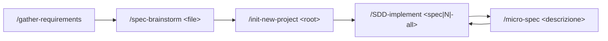
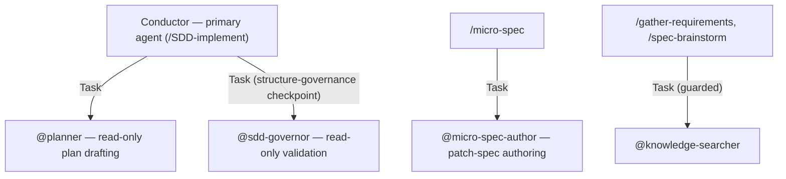

# AGENTS.md — OpenCode SDD Framework (DeepSeek)

Project instructions auto-loaded by OpenCode. Process rules for the whole framework live here;
project mission, tech stack, and roadmap live in `docs/specs/constitution.md` (the **Costituzione
SDD**, generated by `/init-new-project`) — this file links
to it rather than duplicating it.

---

## 0. Costituzione SDD — fonte unica di missione, principi, tech stack e roadmap

La **Costituzione SDD** del progetto è `docs/specs/constitution.md` — **generata da
`/init-new-project`**. Quando presente, è la fonte autorevole per:

- **Mission** e **principi non negoziabili**;
- **Tech Stack** (linguaggio, embedding, grafo, pattern architetturali e vincoli obbligatori);
- **`## Roadmap`** — la checklist delle funzionalità, unica autorità su stato e ordine di
  esecuzione (cfr. §4).

> Se `docs/specs/constitution.md` non esiste, la roadmap **non è inizializzata**: eseguire
> `/init-new-project`. Nessun altro documento locale la sostituisce.

Questo file contiene le **regole di processo** dell'SDD e **non duplica** il contenuto della
Costituzione: in caso di dubbio su *cosa* costruire, vale la Costituzione.

### 0.1 General agent guidelines

- **Think before coding** — leggi le spec e la Costituzione pertinenti prima di agire; se un
  requisito non è documentato, fermati e segnalalo, non inventare.
- **Simplicity first** — YAGNI: nessun componente, entità o dipendenza speculativa.
- **Surgical changes** — modifica solo ciò che il compito richiede; preserva tutto il resto.
- **Goal-driven execution** — ogni lavoro è tracciato da una voce di `## Roadmap` o da una
  Micro-Spec; una voce si chiude solo a ciclo completo (§4).
- **Consult before answering** — prima di rispondere o generare contenuti sul progetto, consulta
  la knowledge base (ricerca semantica + grafo, `scripts/cag_context.py`) e **cita le note usate**;
  senza risultati pertinenti dichiara l'assenza e **non inventa**, e non legge `raw/` (FR-011, BR-1).

### 0.2 Convenzioni di progetto (derivate dal Tech Stack)

- **Linguaggio:** Python 3 per gli script locali (`build_index.py`, `query_index.py`,
  `source_watch.py`); type hints e gestione esplicita degli errori.
- **Configurazione:** percorsi e parametri da `knowledge-config.json` — mai hard-coded.
- **Embedding:** `intfloat/multilingual-e5-small` in-process e locale (nessuna chiave API per
  indicizzare).
- **Grafo:** `graphify` → `graphify-out/graph.json` (dipendenza esterna deliberata, cfr. §1 e
  Costituzione, Principio 8).
- **Assistente:** DeepSeek (predefinito) e GitHub Copilot disponibili (`opencode.json`).
- **Pubblicazione:** Git, ramo `<name>_llm_wiki` via `/publish-llm-wiki`.
- Lingua di spec e Costituzione: **italiano** (§6).

---

## 1. What this project is

This is **not** an application codebase. There is no `package.json`, no build, no test suite. The
"programs" are OpenCode **commands**, **subagents**, and **skills** that drive one pipeline:
**Specification-Driven Development (SDD)**.

```
docs/input/*.md            (functional requirement)
  → docs/specs/*.spec.md   (technical specs)
  → docs/specs/constitution.md   (principles + ## Roadmap checklist)
  → deliverables (code, docs, config, diagrams, …)
```

Command flow — run in this order:



- `/gather-requirements` — interview a business user → `docs/input/functional-requirements.md`
- `/spec-brainstorm <file>` — functional requirement → `docs/specs/*.spec.md`
- `/init-new-project <root>` — specs → `docs/specs/constitution.md` + `AGENTS.md`
- `/SDD-implement <spec|N|-all>` — roadmap → deliverables, one item at a time
- `/micro-spec <descrizione>` — bug / small change → `docs/specs/patch-<slug>.spec.md` + one roadmap item

### The knowledge pipeline (graph-first)

A second pipeline turns the source roots into a knowledge graph, then an artifact that is at once
an Obsidian vault and an OKF v0.1 bundle:

```
raw/ + docs/specs/  →  graphify-out/graph.json  →  graphify-out/wiki/  →  index/index.json
```

- `/generate-llm-wiki` `update` | `check` | `all` | `okf` | `validate` | `query "<q>"` | `report`
  — Phase 0 (change detect via `scripts/source_watch.py`) runs on the primary agent; phases 1–5
  (extract + merge + cluster → Obsidian export → OKF conversion → deepen → conformance gate) run
  in `@second-brain-keeper`.
- `/publish-llm-wiki <name>` — commit `graphify-out/` + `index/` on a `<name>_llm_wiki` branch and
  push.

**Prerequisite:** `graphify` on the PATH — `uv tool install graphifyy` (graphify 0.9.25). This is
a deliberate external dependency (constitution §principio 8). All paths/levers come from
`knowledge-config.json` at the repo root — never hard-code them. `raw/` is the immutable source
root (also denied by `opencode.json` `permission.edit`). When the pipeline has run,
`@knowledge-searcher` can query a real `index/index.json` instead of returning `NO_INDEX`.

---

## 2. The Conductor is the primary agent, not a subagent

`/SDD-implement` runs as the **primary agent** (the main session) and adopts the **Conductor**
role: it orchestrates the plan → produce → validate → publish cycle one roadmap item at a time.
It delegates **only** specialized checkpoints — never the orchestration itself — to subagents via
the Task tool. A subagent cannot spawn further subagents; that is why orchestration stays on the
primary agent.



---

## 3. Runtime capability discovery — by role, never by filename

`/SDD-implement` Phase 0 scans the **frontmatter** of assets under `.opencode/` to build a
capability registry, then binds capabilities by **declared role**, not by hardcoded name:

```
.opencode/agents/*.md          (subagents)
.opencode/commands/*.md        (slash commands — human entrypoints, never auto-invoked)
.opencode/skills/*/SKILL.md    (skills)
opencode.json                  (config / parameter source)
```

No command names an asset by filename. **Adding a new asset under `.opencode/` must never
require editing a command.**

**Fallback.** If the OpenCode runtime does not expose asset frontmatter to `/SDD-implement` at
runtime, use the **Capability Registry** in §7 below — still resolved by role. Keep §7 in sync
whenever an asset is added or its role changes.

---

## 4. `docs/specs/constitution.md` `## Roadmap` is the single source of truth for SDD state

The `## Roadmap` checklist (`- [ ]` pending, `- [x]` done) is the **only** authority on progress
and execution order. `/SDD-implement` processes items in roadmap order and checks an item off
**only after** its full Plan → Produce → Validate → Publish cycle completes. Never track SDD
state anywhere else; never invent a roadmap.

---

## 5. `raw/` is immutable — enforced, not conventional

If a `raw/` directory exists, never modify, rename, move, or delete anything under it — only add.
A new version of a source is a **new file** (`contract-v2.docx`), never an overwrite. Enforcement:
`opencode.json` → `permission.edit` denies every write matching `raw/**`. This is a harness
guarantee, not a code check — there is no CI gate in this project (see the reference repo for
that).

---

## 6. Language convention

- `README.md` — **Italian** (operator-facing).
- Commands, agents, skills — **English**.
- `/gather-requirements`, `/spec-brainstorm`, `/micro-spec` interact in the **user's language**
  (default **Italian**).
- Specs and `constitution.md` — **Italian**.

Match the surrounding file's language when editing.

---

## 7. Capability Registry (fallback for §3)

Resolved by **role**. Filenames are shown for human reference only — `/SDD-implement` must bind
by the role/description, so a renamed or relocated asset still classifies correctly.

### Commands (`.opencode/commands/`) — human entrypoints, never auto-invoked

| Role | Asset |
|---|---|
| Interview a business user → functional requirements document | `gather-requirements.md` |
| Functional requirement → technical specs (+ append roadmap if constitution exists) | `spec-brainstorm.md` |
| Specs → `constitution.md` + `AGENTS.md` | `init-new-project.md` |
| Conductor: execute the roadmap, one item at a time, with governance | `SDD-implement.md` |
| Bug / small change → Micro-Spec patch spec + one roadmap item | `micro-spec.md` |
| *(auxiliary, not SDD pipeline)* Restate requirements, assess risks, draft an implementation plan from an `engineering/prompt/` file — waits for confirmation before writing `engineering/plan/<name>.md`; drafting delegated to `@planner` | `plan.md` |
| *(auxiliary, not SDD pipeline)* Structure a free-form ask into the `tech-plan/the_prompt_engineering.md` framework, grounding every field only in what the user said | `prompt-engineering.md` |
| Knowledge pipeline (graph-first): change-detect → Graphify graph → Obsidian vault → OKF bundle → semantic index. Phase 0 on the primary agent, phases 1–5 delegated | `generate-llm-wiki.md` |
| Publish the knowledge bundle (`graphify-out/` + `index/`) on a dedicated branch | `publish-llm-wiki.md` |

### Subagents (`.opencode/agents/`)

| Role | Asset | Access |
|---|---|---|
| Standalone AI-ready spec authoring (outside the `/spec-brainstorm` flow) | `specification.md` | read / write |
| Product Requirements Document authoring; optional GitHub issues on confirmation | `prd.md` | read / write / bash / webfetch |
| Read-only implementation-plan drafting; presents the plan, never writes it | `planner.md` | **read-only** |
| Read-only control layer: validates any produced artifact against its **declared structure** (spec / template / convention); never generates content. Delegated + embedded modes. | `sdd-governor.md` | **read-only** |
| Authors one Micro-Spec patch spec and appends one roadmap item; never implements, never ticks a roadmap item | `micro-spec-author.md` | write only `docs/specs/patch-*.spec.md` + `docs/specs/constitution.md` |
| Optional: checks a local knowledge index for prior material before a question is asked; returns `NO_INDEX` and degrades to a plain interview when no index exists | `knowledge-searcher.md` | **read-only** |
| Runs phases 1–5 of the knowledge pipeline: Graphify extract/merge/cluster → Obsidian export → OKF conversion (`wiki-to-okf`) → deepen → conformance gate. Writes only under `graphify-out/` + `index/` | `second-brain-keeper.md` | read / write / bash |

### Skills (`.opencode/skills/`)

| Role | Asset |
|---|---|
| Single source of rules for the Micro-Spec technique family: the guardrail (refuse chat-driven edits not issued through a command, route to `/micro-spec`), the four-field Micro-Spec template, the patch-spec skeleton, Append-Only, Error-to-Spec | `sdd-guardrail/SKILL.md` |
| Fill the Prompt Engineering template (`tech-plan/the_prompt_engineering.md`) from a raw ask; grounding rule + escalation ladder; never silently infer missing parts | `prompt-engineering/SKILL.md` |
| The OKF v0.1 spec — frontmatter semantics, reserved filenames (`index.md`/`log.md`), the three conformance rules; bundled `scripts/validate.sh` fallback gate | `okf-open-knowledge-format/SKILL.md` |
| The wiki → OKF conversion workflow applied to `graphify-out/wiki/` | `wiki-to-okf/SKILL.md` |
| Build/query `index/index.json`, the semantic (vector) chunk index over `graphify-out/wiki/` — local embedding model, no API key; `scripts/build_index.py` + `scripts/query_index.py` | `wiki-semantic-search/SKILL.md` |

### Config

| Role | Asset |
|---|---|
| Provider (DeepSeek), default model, `permission` (incl. `raw/**` deny), `instructions` | `opencode.json` |
| Knowledge pipeline: source roots, immutable roots, every graph/bundle/stage path, OKF version, extraction levers, validator path — the single source read by the wiki commands, `second-brain-keeper` and `scripts/source_watch.py` | `knowledge-config.json` |

### Model → role matrix

| Role | Model |
|---|---|
| **All roles** — default, primary agent, commands, every subagent | `deepseek/deepseek-flash` |

Set once as `model` in `opencode.json`; every agent file and the `spec-brainstorm` command
frontmatter pin the same id.

> **Fallback:** `deepseek-flash` is the id asserted by the operator. If it is not available on
> the account, replace it with a DeepSeek model listed by `/models` — the default in
> `opencode.json` plus one frontmatter change per agent / the `spec-brainstorm` command.

### Knowledge index location (for `knowledge-searcher`)

Default: `index/index.json`. `knowledge-searcher` treats its absence as `NO_INDEX` and the
interview commands proceed with plain open questions — there is no knowledge-pipeline dependency
in this project.

---

## 8. Note on this file's lifecycle

`/init-new-project` may (re)write parts of this file from the specs. If OpenCode loads `AGENTS.md`
only once per session, re-open the session after `/init-new-project` for its edits to take effect.


# RTK Token Optimization Rules

## Core Principle

When executing shell commands, you **MUST** prefix all eligible commands with `rtk`. RTK compresses command output and reduces token consumption by 60-90% [citation:14].

## Required Command Mapping

| Original Command | RTK Command |
|-----------------|-------------|
| `ls`, `tree` | `rtk ls` |
| `cat`, `head`, `tail` | `rtk read` |
| `grep`, `rg` | `rtk grep` |
| `find` | `rtk find` |
| `git status` | `rtk git status` |
| `git log` | `rtk git log` |
| `git diff` | `rtk git diff` |
| `cargo build` | `rtk cargo build` |
| `cargo test` | `rtk test cargo test` |
| `npm test` | `rtk test npm test` |
| `npm run build` | `rtk err npm run build` |

## Exceptions

Do NOT use RTK in the following cases:
- Commands that already pipe output (`grep x | head`) [citation:1]
- Commands that produce no output (`cd`, `mkdir`, `rm`)
- When `rtk` binary is not installed (check with `rtk --version`)
