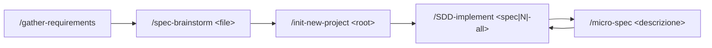

# OpenCode SDD Framework (DeepSeek)

Framework di **Specification-Driven Development (SDD)** per [OpenCode](https://opencode.ai), con
**DeepSeek** come model provider. È la contro-parte OpenCode di un repo Claude-Code-nativo: gli
stessi ruoli e lo stesso flusso della pipeline SDD, riespressi con le primitive di OpenCode
(`.opencode/agents/`, `.opencode/commands/`, `.opencode/skills/`, tool `skill`, delega via Task).

## 1. Cos'è

Non è un codebase applicativo: niente `package.json`, niente build, niente test suite. I
"programmi" sono **comandi**, **subagent** e **skill** OpenCode che guidano una pipeline:

```
docs/input/*.md            (requisito funzionale)
  → docs/specs/*.spec.md   (specifiche tecniche)
  → docs/specs/constitution.md   (principi + checklist ## Roadmap)
  → deliverable (codice, doc, config, diagrammi, …)
```

La costituzione SDD del progetto — **generata da `/init-new-project`** — vive in
`docs/specs/constitution.md`: quando presente raccoglie mission, principi, tech stack e —
soprattutto — la `## Roadmap`, unica fonte di verità sullo stato di avanzamento. Le regole di
processo (Conductor, discovery per ruolo, immutabilità, lingua) stanno in [`AGENTS.md`](AGENTS.md),
caricato automaticamente da OpenCode. Finché la Costituzione non è stata generata, la roadmap **non è
inizializzata**.

## 2. Prerequisiti

- [`opencode`](https://opencode.ai) installato e sul PATH.
- Un account [DeepSeek](https://platform.deepseek.com/) con una chiave API.

## 3. Setup DeepSeek (la chiave non va mai versionata)

Due modi, scegline uno:

```bash
# A) variabile d'ambiente
export DEEPSEEK_API_KEY="la-tua-chiave"
opencode

# B) login OpenCode (salva in ~/.local/share/opencode/auth.json, fuori dal repo)
opencode auth login   # scegli DeepSeek, incolla la chiave
```

- La chiave vive **solo** in ambiente o in `~/.local/share/opencode/auth.json`. **Mai** in un file
  del repo.
- `.env.example` è solo un promemoria del nome della variabile. Se crei un `.env`, è già in
  `.gitignore`.
- `opencode.json` dichiara il provider (`deepseek`, `baseURL` `https://api.deepseek.com/v1`) e il
  modello di default, senza alcun campo segreto.

## 4. Il flusso a 5 comandi



| Comando | Input | Output |
|---|---|---|
| `/gather-requirements` | un'idea di prodotto (anche una riga) | `docs/input/functional-requirements.md` |
| `/spec-brainstorm <file>` | il requisito funzionale | `docs/specs/*.spec.md` (+ append alla roadmap se la constitution esiste) |
| `/init-new-project <root>` | le specifiche | `docs/specs/constitution.md` + `AGENTS.md` |
| `/SDD-implement <spec\|N\|-all>` | la roadmap | i deliverable, un item per volta (plan → produce → validate → publish) |
| `/micro-spec <descrizione>` | un bug / una modifica piccola | `docs/specs/patch-<slug>.spec.md` + una voce di roadmap |

`/SDD-implement` è il **Conductor**: gira come agente primario, orchestra, e delega solo il
checkpoint di structure-governance a `@sdd-governor`. `/micro-spec` delega l'authoring a
`@micro-spec-author` e carica la skill `sdd-guardrail`, che rifiuta le modifiche chieste in chat
fuori da un comando e le instrada qui.

### Comandi ausiliari (non fanno parte della pipeline SDD)

| Comando | Input | Output |
|---|---|---|
| `/plan [file]` | un file in `engineering/prompt/*.md` | `engineering/plan/<stesso-nome>.md` — piano di implementazione, scritto **solo dopo conferma**; drafting delegato a `@planner` (read-only) |
| `/prompt-engineering [richiesta]` | una richiesta libera, non strutturata | `engineering/prompt/<slug>.md` — la richiesta riscritta nel framework `tech-plan/the_prompt_engineering.md`, con ogni campo ancorato solo a quanto detto dall'utente |

## 5. Modelli

| Ruolo | Modello |
|---|---|
| **Tutti i ruoli** — default, agente primario, comandi, ogni subagent | `deepseek/deepseek-flash` |

Modello unico, impostato in `opencode.json` (`"model"`) e ripetuto nel frontmatter di ogni file
in `.opencode/agents/` e del comando `spec-brainstorm`. `/models` elenca i modelli DeepSeek
disponibili sul tuo account.

**Fallback.** `deepseek-flash` è l'ID indicato dall'operatore. Se non è disponibile sul tuo
account, sostituiscilo con un modello DeepSeek elencato da `/models`: il default in
`opencode.json` più una modifica di frontmatter per ogni agente e per `spec-brainstorm`.

## 6. Cosa NON è portato dal repo di riferimento

- **Motore di generazione documenti da template aziendale** (`document-generator`, manipolazione
  OOXML). `sdd-governor` valida qualsiasi artefatto contro la *struttura dichiarata* dalla sua
  spec/template/convenzione, senza motore di clonazione template.
- **CI GitHub Actions** (`knowledge-lint.yml`). L'immutabilità di `raw/` qui è garantita **solo**
  dal blocco `permission.edit` di `opencode.json` (`raw/** → deny`), non da una pipeline CI; lo
  script `scripts/source_watch.py` (portato) resta però disponibile come pre-flight deterministico
  del cambio sorgenti.

## 6b. Pipeline della conoscenza (graph-first)

Trasforma le source root (`raw/`, `docs/specs/`) in un grafo della conoscenza e poi in un
artefatto che è insieme vault Obsidian e bundle **OKF v0.1**.

Esistono **due pipeline separate** che producono lo stesso contratto OKF: questa, basata su
graphify, e quella strutturale basata su Compass descritta in §6c. Una sola KB è attiva per volta
(vedi §6c).

**Prerequisito:** `graphify` sul PATH — `uv tool install graphifyy` (graphify **0.9.25**). È una
dipendenza esterna deliberata (costituzione §principio 8).

```
raw/ + docs/specs/  →  graphify-out/graph.json  →  graphify-out/wiki/  →  index/index.json
```

| Comando | Cosa fa |
|---|---|
| `/generate-llm-wiki [update\|check\|all\|okf\|validate\|query "<q>"\|report]` | Fase 0 (change-detect via `scripts/source_watch.py`) sull'agente primario; fasi 1–5 (extract+merge+cluster → export Obsidian → conversione OKF → deepen → gate di conformità) in `@second-brain-keeper` |
| `/publish-llm-wiki <name>` | commit di `graphify-out/` + `index/` sul branch `<name>_llm_wiki` e push |

- **Unificazione tra le root:** la Fase 1 non incolla più grafi separati con `merge-graphs` (che
  prefissa gli id per root): fonde i grafi per **`id` senza prefissi** — stesso concetto in `raw/`
  e `docs/specs/` → una sola nota. I concetti puri hanno **id deterministici** (slug dell'etichetta:
  minuscolo, spazi → trattini, nessun prefisso). Se un root con codice (`manifest.json`) è
  configurato, viene estratto **prima** (ondata AST) e i documenti riusano gli id reali via id-map.
  Dopo la fusione un **health check** (`diagnose_extraction`) richiede
  `dangling_endpoint_edges: 0` e `missing_endpoint_edges: 0`, altrimenti ci si ferma e si rifà il
  root incriminato.
- Tutti i path e le leve vivono in **`knowledge-config.json`** alla radice — non hard-codarli.
- **`raw/`** è la source root **immutabile** (anche negata da `opencode.json` `permission.edit`);
  una nuova versione di una fonte è un nuovo file, mai una sovrascrittura.
- Il gate OKF è `bash .opencode/skills/okf-open-knowledge-format/scripts/validate.sh graphify-out/wiki`
  (`okflint` non è richiesto). `/publish-llm-wiki` si ferma se il gate non esce 0.
- Quando la pipeline è stata eseguita, `@knowledge-searcher` interroga un `index/index.json` reale
  invece di ritornare `NO_INDEX`.
- **Open technical question:** `extraction_backend` in `knowledge-config.json` è
  `OTQ-resolve-with-opencode` — nel repo di riferimento era `claude-cli`; scegli il backend che
  `graphify extract --help` elenca per questo ambiente al primo run. Fino ad allora l'estrazione
  fallisce con un messaggio chiaro.

## 6c. Pipeline della conoscenza (strutturale, Compass)

Seconda pipeline, affiancata a quella graphify: stesse fasi 0–5, stessi consumatori, stesso bundle
OKF validato dallo **stesso** gate. Cambia il motore: [Compass](https://github.com/crabbuild/compass)
al posto di graphify. È **strutturale e zero-token**: non chiama LLM e non estrae concetti dalla
prosa.

**Prerequisito:** `compass` sul PATH, versione **≥ 0.4.2** (asset di release ufficiale). Se manca o è
più vecchio la pipeline si ferma e chiede l'installazione: non installa da sola e non esegue mai
`compass install` nel repo (scriverebbe `AGENTS.md`, `.agents/`, regole editor).

```
raw/ + docs/specs/  →  compass-out/graph.json  →  compass-out/adapted/graph.json
                    →  compass-out/obsidian/  →  index-compass/index.json
```

| Comando | Cosa fa |
|---|---|
| `/generate-llm-wiki-compass [update\|check\|all\|okf\|validate\|query "<q>"\|report]` | Fase 0 (preflight versione/corpus, change-detect con `scripts/source_watch.py --config knowledge-config.compass.json`) sull'agente primario; fasi 1–5 (build → adapter + contract check → export Obsidian → conversione OKF → deepen → gate → seal) in `@compass-keeper` |
| `/publish-llm-wiki-compass <name>` | commit di `compass-out/` + `index-compass/` sul branch `<name>_compass_wiki` e push |

- Tutti i path e le leve vivono in **`knowledge-config.compass.json`**: la config graphify non viene
  mai letta implicitamente.
- `.compass/config.toml` è **generato** da `scripts/compass_config_gen.py`; `compass init` non si usa
  (fallisce con exit 2 su corpus vuoto).
- Compass 0.4.2 non emette `label`/`source_file`: `scripts/compass_graph_adapter.py` produce
  `compass-out/adapted/graph.json`, e `scripts/compass_graph_check.py` verifica il contratto
  (bloccante) prima dell'OKF.
- Nessun pre-pass di conversione: Compass legge PDF/Office nativamente. Nessuna estrazione
  semantica: il backend opzionale è spento per default.
- Il gate è lo stesso: `bash .opencode/skills/okf-open-knowledge-format/scripts/validate.sh
  compass-out/obsidian`. `compass-out/cache/`, `snapshots/` e `store/` non vengono pubblicati.
- **Una sola KB attiva:** `graph_json`, `bundle_root` e `semantic_index` in `knowledge-config.json`
  puntano alla pipeline che ha completato l'ultimo ciclo con successo. Ogni pipeline lo aggiorna da
  sé in Fase 5 con `python3 scripts/kb_active.py set graphify|compass`. La KB inattiva si interroga
  solo con `--config` esplicito.
- Evidenza misurata su CLI e schema (versione, flag reali, layout, copertura campi) in
  `docs/sdd/compass-verification.md`; mappa degli asset in `docs/sdd/capability-registry.md`.
- **Limite attuale:** con il corpus vuoto (`raw/` e `docs/specs/` contengono solo `.gitkeep`) la
  pipeline si ferma al preflight; serve contenuto reale prima del primo run.

## 7. Verifica

Checklist ripetibile sullo scaffold. **V-01 è bloccante**: finché non dà 0, lo scaffold non è
considerato completo.

### Controlli statici

| ID | Controllo | Metodo | Pass se |
|---|---|---|---|
| V-01 | Nessuna chiave API versionata | ricerca ricorsiva di stringhe forma-chiave (`sk-…`, token esadecimali ≥ 32) su tutti i file tracciati | 0 occorrenze |
| V-02 | `.gitignore` esclude i segreti | lettura `.gitignore` | contiene `.env` e `auth.json` |
| V-03 | Nessuna dipendenza hard da tooling Claude-only | ricerca di `docs/blueprint`, `document-generator`, `graphify`, `okf`, `.claude/`, `.github/workflows` in `.opencode/**` e `AGENTS.md` | nessun match come **dipendenza operativa** (le semplici menzioni in §6 non contano) |
| V-04 | Ogni comando risolve i suoi agenti | per ogni `@<agente>` citato nei comandi, verificare `.opencode/agents/<agente>.md` | tutti presenti |
| V-05 | Discovery per ruolo | `SDD-implement.md` non nomina asset per filename fuori dalla Fase 0 di scan | nessun filename di asset hardcoded |
| V-06 | `AGENTS.md` completo | presenza delle 7 sezioni (What this project is, Conductor, discovery-by-role, roadmap-as-truth, `raw/` immutability, Language, Capability Registry) | tutte presenti |
| V-07 | Capability Registry allineato | il registry in `AGENTS.md` elenca 6 agenti + 5 comandi + 1 skill per ruolo | conteggio e ruoli corretti |
| V-08 | Template byte-identici | `diff` di `docs/templates/template.spec.md` e `template.constitution.md` vs repo di riferimento | identici |
| V-09 | `opencode.json` conforme | presenza `provider.deepseek`, `model` default, `permission.edit` deny `raw/**`, `instructions` | tutti i campi presenti |
| V-10 | Scheletro directory | esistenza `docs/{input,specs,plan,templates}`, `.opencode/{agents,commands,skills}` | tutte presenti |
| V-11 | Nessun `CLAUDE.md` | ricerca file `CLAUDE.md` | assente |
| V-12 | Skill `sdd-guardrail` presente e allineata | esistenza `.opencode/skills/sdd-guardrail/SKILL.md`; sezioni Scope / The guardrail / template 4 campi / skeleton / Append-Only / Error-to-Spec | conforme |

### Smoke (runtime — richiede `opencode` installato)

| ID | Controllo | Metodo | Pass se |
|---|---|---|---|
| S-01 | Il progetto avvia | `DEEPSEEK_API_KEY` esportata, `opencode` nella root | avvio senza errori di config |
| S-02 | DeepSeek risolto | `/models` | l'elenco include `deepseek/deepseek-flash` (o il modello sostitutivo scelto) |
| S-03 | I 5 comandi visibili | elenco comandi nella TUI | compaiono `gather-requirements`, `spec-brainstorm`, `init-new-project`, `SDD-implement`, `micro-spec` |
| S-04 | Le skill visibili | descrizione del tool `skill` | include `sdd-guardrail` |
| S-05 (opzionale, consuma quota) | Flusso minimo | `/gather-requirements` con un'idea di test → `/spec-brainstorm` | vengono creati file sotto `docs/input/` e `docs/specs/` |

## 8. Licenza / uso

Progetto a uso personale. Nessuna licenza specifica.

## 9. Known open items

Punti che si chiudono solo con un `opencode` installato; per ciascuno è già adottato un default e
documentato il fallback.

| # | Domanda aperta | Default adottato | Fallback |
|---|---|---|---|
| 1 | `deepseek/deepseek-flash` è un ID modello valido sul tuo account? | modello unico per tutti i ruoli, asserito dall'operatore | confermare con `/models`; se assente, sostituire con un modello DeepSeek elencato (default in `opencode.json` + frontmatter di ogni agente e di `spec-brainstorm`) |
| 2 | `permission.edit` supporta glob per-path (`raw/**` deny)? | forma `{ "raw/**": "deny", "*": "allow" }` in `opencode.json` | qualunque forma equivalente che renda `raw/**` non scrivibile |
| 3 | `micro-spec-author` può limitare `edit` a `docs/specs/patch-*.spec.md` + `constitution.md`? | vincolo dichiarato nel frontmatter | vincolo solo testuale nel corpo dell'agente (come nel repo di riferimento) |
| 4 | Il runtime espone il frontmatter degli asset a `/SDD-implement` Fase 0? | scan diretto di `.opencode/**` | sezione **Capability Registry** in `AGENTS.md` (per ruolo) |
| 5 | `argument-hint` è un campo valido nel frontmatter comando? | mantenuto (innocuo se ignorato) | resta solo `description` |
| 6 | OpenCode legge `DEEPSEEK_API_KEY` in automatico per il provider `deepseek`? | nessuna interpolazione in `opencode.json` (solo `baseURL`) | aggiungere `provider.deepseek.options.apiKey: "{env:DEEPSEEK_API_KEY}"` — mai il valore letterale |
| 7 | Il tool `skill` inietta il corpo integrale di `SKILL.md`? | corpo scritto come regole dichiarative autoconsistenti | nessuno necessario |
| 8 | `AGENTS.md` è ricaricato durante la sessione dopo `/init-new-project`? | assunto sì | riavviare la sessione OpenCode |

Le verifiche smoke S-01…S-05 sono **differite**: non erano eseguibili al momento della generazione
dello scaffold (nessun `opencode` disponibile). Eseguile al primo avvio.
