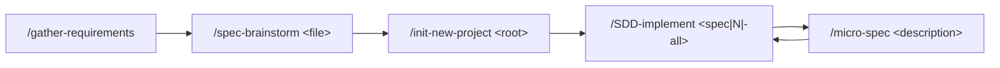

# OpenCode SDD Framework (DeepSeek)

A **Specification-Driven Development (SDD)** framework for [OpenCode](https://opencode.ai), with
**DeepSeek** as the model provider. It is the OpenCode counterpart of a Claude-Code-native repository:
the same roles and the same SDD pipeline flow, re-expressed with the OpenCode primitives
(`.opencode/agents/`, `.opencode/commands/`, `.opencode/skills/`, the `skill` tool, delegation via
Task).

## 1. What it is

This is not an application codebase: the framework contains OpenCode **commands**, **subagents** and
**skills**, plus supporting Python scripts, with stdlib tests for GraphRAG retrieval and traceability.
These components drive a pipeline:

```
docs/input/*.md            (functional requirement)
  → docs/specs/*.spec.md   (technical specifications)
  → docs/specs/constitution.md   (principles + ## Roadmap checklist)
  → deliverables (code, docs, config, diagrams, …)
```

The project's SDD constitution — **generated by `/init-new-project`** — lives in
`docs/specs/constitution.md`: when present it holds the mission, the principles, the tech stack and —
above all — the `## Roadmap`, the single source of truth on progress. The process rules (Conductor,
discovery by role, immutability, language) live in [`AGENTS.md`](AGENTS.md), loaded automatically by
OpenCode. Until the constitution has been generated, the roadmap **is not initialized**.

## 2. Prerequisites

- [`opencode`](https://opencode.ai) installed and on the PATH.
- A [DeepSeek](https://platform.deepseek.com/) account with an API key.

## 3. DeepSeek setup (the key is never committed)

Two ways, pick one:

```bash
# A) environment variable
export DEEPSEEK_API_KEY="your-key"
opencode

# B) OpenCode login (saved to ~/.local/share/opencode/auth.json, outside the repo)
opencode auth login   # pick DeepSeek, paste the key
```

- The key lives **only** in the environment or in `~/.local/share/opencode/auth.json`. **Never** in a
  repository file.
- `.env.example` is only a reminder of the variable name. If you create a `.env`, it is already in
  `.gitignore`.
- `opencode.json` declares the provider (`deepseek`, `baseURL` `https://api.deepseek.com/v1`) and the
  default model, with no secret field.

## 4. The 5-command flow



| Command | Input | Output |
|---|---|---|
| `/gather-requirements` | a product idea (even a single line) | `docs/input/functional-requirements.md` |
| `/spec-brainstorm <file>` | the functional requirement | `docs/specs/*.spec.md` (+ roadmap append if the constitution exists) |
| `/init-new-project <root>` | the specifications | `docs/specs/constitution.md` + `AGENTS.md` |
| `/SDD-implement <spec\|N\|-all>` | the roadmap | the deliverables, one item at a time (plan → produce → validate → publish) |
| `/micro-spec <description>` | a bug / a small change | `docs/specs/patch-<slug>.spec.md` + one roadmap item |

`/SDD-implement` is the **Conductor**: it runs as the primary agent, orchestrates, and delegates only
the structure-governance checkpoint to `@sdd-governor`. `/micro-spec` delegates authoring to
`@micro-spec-author` and loads the `sdd-guardrail` skill, which rejects changes requested in chat
outside a command and routes them here.

### Auxiliary commands (not part of the SDD pipeline)

| Command | Input | Output |
|---|---|---|
| `/plan [file]` | a file in `engineering/prompt/*.md` | `engineering/plan/<same-name>.md` — implementation plan, written **only after confirmation**; drafting delegated to `@planner` (read-only) |
| `/prompt-engineering [request]` | a free-form, unstructured request | `engineering/prompt/<slug>.md` — the request rewritten into the `tech-plan/the_prompt_engineering.md` framework, with every field anchored only to what the user said |

## 5. Models

| Role | Model |
|---|---|
| **All roles** — default, primary agent, commands, every subagent | `deepseek/deepseek-flash` |

A single model, set in `opencode.json` (`"model"`) and repeated in the frontmatter of every file under
`.opencode/agents/` and of the `spec-brainstorm` command. `/models` lists the DeepSeek models available
on your account.

**Fallback.** `deepseek-flash` is the ID supplied by the operator. If it is unavailable on your
account, replace it with a DeepSeek model listed by `/models`: the default in `opencode.json` plus a
frontmatter edit for every agent and for `spec-brainstorm`.

## 6. What is NOT carried over from the reference repository

- **Corporate-template document generation engine** (`document-generator`, OOXML manipulation).
  `sdd-governor` validates any artifact against the *declared structure* of its spec, template or
  convention, with no template-cloning engine.
- **GitHub Actions CI** (`knowledge-lint.yml`). Here the immutability of `raw/` is guaranteed **only**
  by the `permission.edit` block in `opencode.json` (`raw/** → deny`), not by a CI pipeline; the
  portable `scripts/source_watch.py` script nevertheless remains available as a deterministic
  pre-flight check of source changes.

## 6b. Knowledge pipeline (graph-first)

Turns the source roots (`raw/`, `docs/specs/`) into a knowledge graph and then into an artifact that is
at once an Obsidian vault and an **OKF v0.1** bundle.

**Prerequisite:** `graphify` on the PATH — `uv tool install graphifyy` (graphify **0.9.25**). It is a
deliberate external dependency (constitution §principle 8).

```
raw/ + docs/specs/  →  graphify-out/graph.json  →  graphify-out/wiki/  →  index/index.json
```

| Command | What it does |
|---|---|
| `/generate-llm-wiki [update\|check\|all\|okf\|validate\|query "<q>"\|report]` | Phase 0 (change detection via `scripts/source_watch.py`) on the primary agent; phases 1–5 (extract+merge+cluster → Obsidian export → OKF conversion → deepen → conformance gate) in `@second-brain-keeper` |
| `/publish-llm-wiki <name>` | commits `graphify-out/` + `index/` to the `<name>_llm_wiki` branch and pushes |

- **Cross-root unification:** Phase 1 no longer pastes separate graphs with `merge-graphs` (which
  prefixes ids per root): it merges the graphs by **unprefixed `id`** — the same concept in `raw/` and
  `docs/specs/` → a single note. Pure concepts get **deterministic ids** (label slug: lowercase,
  spaces → hyphens, no prefix). If a code root (`manifest.json`) is configured, it is extracted
  **first** (AST pass) and documents reuse the real ids through the id-map. After the merge a
  **health check** (`diagnose_extraction`) requires `dangling_endpoint_edges: 0` and
  `missing_endpoint_edges: 0`, otherwise the run stops and the offending root is re-extracted.
- All paths and levers live in **`knowledge-config.json`** at the root — never hard-code them.
- **`raw/`** is the **immutable** source root (also denied by `opencode.json` `permission.edit`); a new
  version of a source is a new file, never an overwrite.
- The OKF gate is `bash .opencode/skills/okf-open-knowledge-format/scripts/validate.sh graphify-out/wiki`
  (`okflint` is not required). `/publish-llm-wiki` stops if the gate does not exit 0.
- Once the pipeline has run, `@knowledge-searcher` queries a real `index/index.json` instead of
  returning `NO_INDEX`.
- **Open technical question:** `extraction_backend` in `knowledge-config.json` is
  `OTQ-resolve-with-opencode` — in the reference repository it was `claude-cli`; choose the backend
  that `graphify extract --help` lists for this environment at the first run. Until then extraction
  fails with a clear message.

### GraphRAG retrieval and SDD analysis

Retrieval now combines the existing semantic index with a versioned LPG sidecar, explicit mappings,
bounded typed traversal and cited passages. A shared hash manifest replaces the timestamp-based
freshness check. The original Graphify JSON is left unchanged; a legacy import without provenance does
not automatically enable relational expansion.

```bash
python3 scripts/graph_retrieval.py "Which exceptions to the rule?" --max-hops 2 --direction both
python3 scripts/cag_context.py "Which evidence is available?"
python3 scripts/traceability.py
python3 -m unittest discover -s tests -v
```

SDD analysis reads only selected documents and explicit references, without modifying the roadmap.
Without a constitution it answers `not_initialized`. Contracts, rebuild, legacy migration, fallbacks,
reference syntax and limits: [GraphRAG and traceability](docs/graphrag.md).

## 7. Validation

A repeatable checklist over the scaffold. **V-01 is blocking**: until it returns 0, the scaffold is not
considered complete.

### Static checks

| ID | Check | Method | Passes if |
|---|---|---|---|
| V-01 | No committed API key | recursive search for key-shaped strings (`sk-…`, hex tokens ≥ 32) across all tracked files | 0 occurrences |
| V-02 | `.gitignore` excludes secrets | read `.gitignore` | contains `.env` and `auth.json` |
| V-03 | No hard dependency on Claude-only tooling | search for `docs/blueprint`, `document-generator`, `graphify`, `okf`, `.claude/`, `.github/workflows` in `.opencode/**` and `AGENTS.md` | no match as an **operational dependency** (plain mentions in §6 do not count) |
| V-04 | Every command resolves its agents | for every `@<agent>` cited in the commands, check `.opencode/agents/<agent>.md` | all present |
| V-05 | Discovery by role | `SDD-implement.md` names no asset by filename outside the Phase 0 scan | no hardcoded asset filename |
| V-06 | `AGENTS.md` complete | presence of the 7 sections (What this project is, Conductor, discovery-by-role, roadmap-as-truth, `raw/` immutability, Language, Capability Registry) | all present |
| V-07 | Capability Registry aligned | the registry in `AGENTS.md` lists 6 agents + 5 commands + 1 skill by role | counts and roles correct |
| V-08 | Templates byte-identical | `diff` of `docs/templates/template.spec.md` and `template.constitution.md` vs the reference repository | identical |
| V-09 | `opencode.json` conformant | presence of `provider.deepseek`, default `model`, `permission.edit` deny `raw/**`, `instructions` | all fields present |
| V-10 | Directory skeleton | existence of `docs/{input,specs,plan,templates}`, `.opencode/{agents,commands,skills}` | all present |
| V-11 | No `CLAUDE.md` | search for a `CLAUDE.md` file | absent |
| V-12 | `sdd-guardrail` skill present and aligned | existence of `.opencode/skills/sdd-guardrail/SKILL.md`; sections Scope / The guardrail / 4-field template / skeleton / Append-Only / Error-to-Spec | conformant |

### Smoke (runtime — requires `opencode` installed)

| ID | Check | Method | Passes if |
|---|---|---|---|
| S-01 | The project starts | `DEEPSEEK_API_KEY` exported, `opencode` in the root | starts without config errors |
| S-02 | DeepSeek resolved | `/models` | the list includes `deepseek/deepseek-flash` (or the chosen replacement model) |
| S-03 | The 5 commands are visible | command list in the TUI | `gather-requirements`, `spec-brainstorm`, `init-new-project`, `SDD-implement`, `micro-spec` appear |
| S-04 | Skills are visible | description of the `skill` tool | includes `sdd-guardrail` |
| S-05 (optional, consumes quota) | Minimal flow | `/gather-requirements` with a test idea → `/spec-brainstorm` | files are created under `docs/input/` and `docs/specs/` |

## 8. License / usage

Personal-use project. No specific license.

## 9. Known open items

Items that only close with an `opencode` installation; for each one a default is already adopted and
the fallback is documented.

| # | Open question | Adopted default | Fallback |
|---|---|---|---|
| 1 | Is `deepseek/deepseek-flash` a valid model ID on your account? | single model for all roles, asserted by the operator | confirm with `/models`; if absent, replace it with a listed DeepSeek model (default in `opencode.json` + frontmatter of every agent and of `spec-brainstorm`) |
| 2 | Does `permission.edit` support per-path globs (`raw/**` deny)? | the shape `{ "raw/**": "deny", "*": "allow" }` in `opencode.json` | any equivalent shape that makes `raw/**` non-writable |
| 3 | Can `micro-spec-author` restrict `edit` to `docs/specs/patch-*.spec.md` + `constitution.md`? | constraint declared in the frontmatter | textual constraint only, in the agent body (as in the reference repository) |
| 4 | Does the runtime expose asset frontmatter to `/SDD-implement` Phase 0? | direct scan of `.opencode/**` | the **Capability Registry** section in `AGENTS.md` (by role) |
| 5 | Is `argument-hint` a valid field in command frontmatter? | kept (harmless if ignored) | only `description` remains |
| 6 | Does OpenCode read `DEEPSEEK_API_KEY` automatically for the `deepseek` provider? | no interpolation in `opencode.json` (only `baseURL`) | add `provider.deepseek.options.apiKey: "{env:DEEPSEEK_API_KEY}"` — never the literal value |
| 7 | Does the `skill` tool inject the whole `SKILL.md` body? | body written as self-contained declarative rules | none needed |
| 8 | Is `AGENTS.md` reloaded during the session after `/init-new-project`? | assumed yes | restart the OpenCode session |

The smoke checks S-01…S-05 are **deferred**: they were not executable when the scaffold was generated
(no `opencode` available). Run them at the first start.
