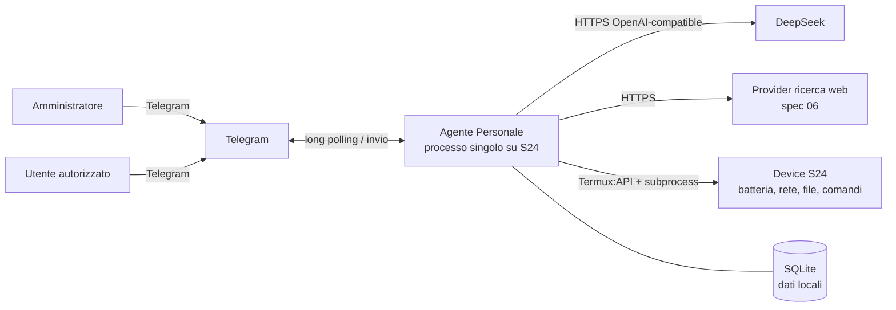
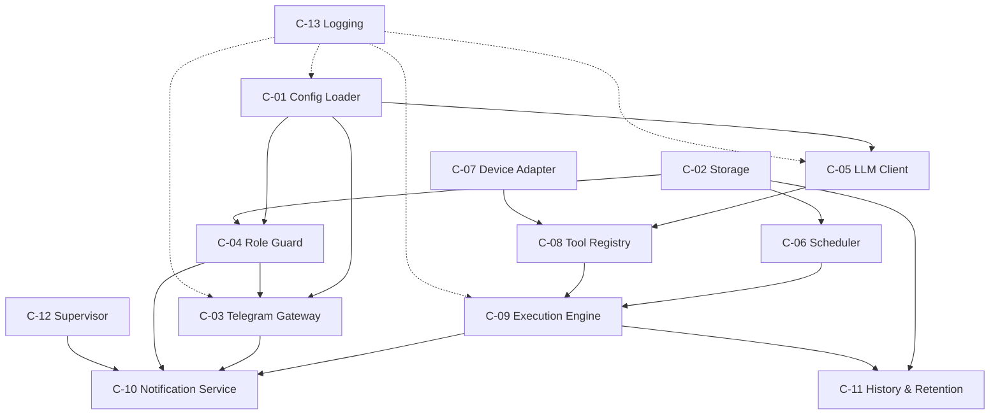
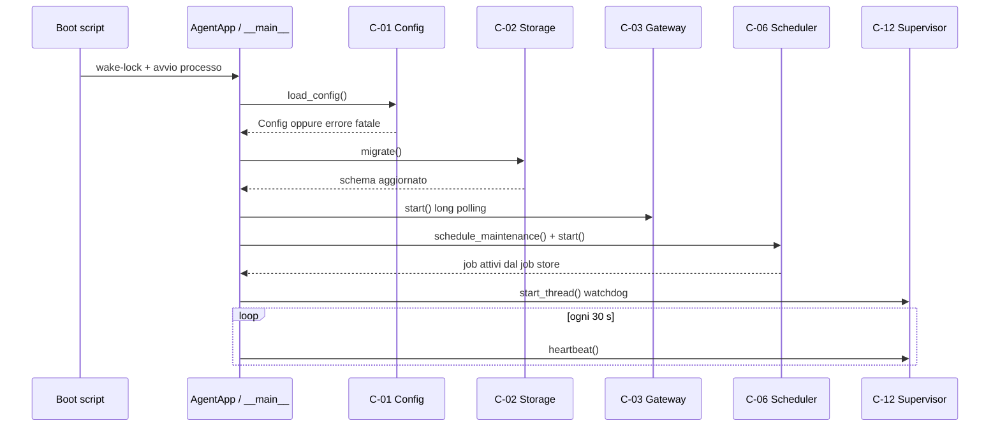
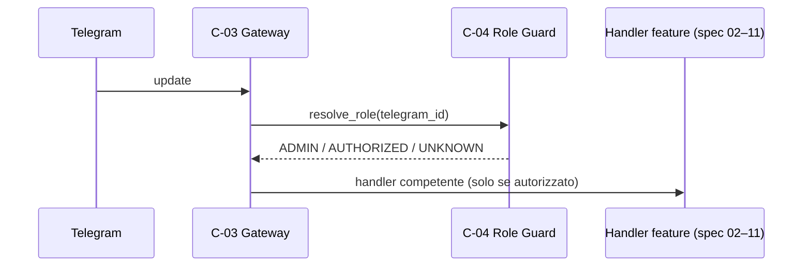
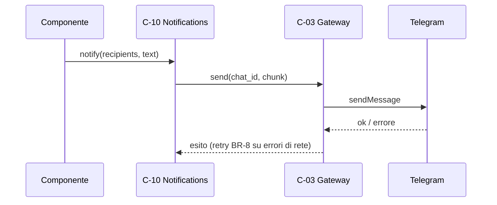
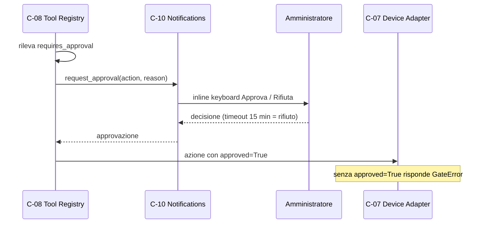
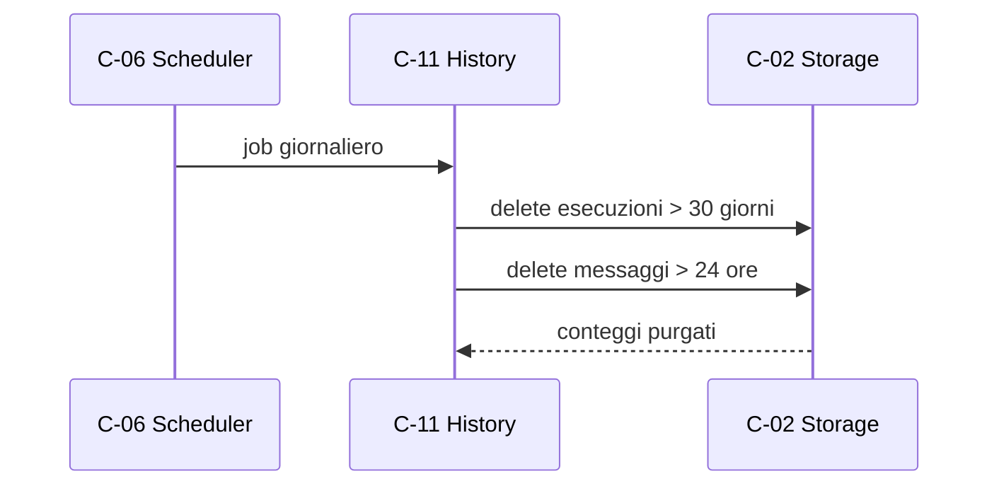
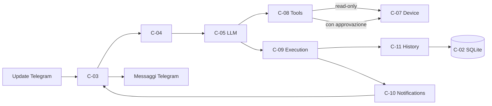
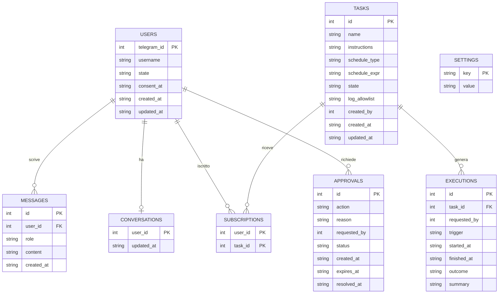

# Architettura 01 — Agent Runtime (fondazione)

- **Spec:** [01-agent-runtime.spec.md](../specs/01-agent-runtime.spec.md)
- **Voce roadmap:** 01 — Agent Runtime (fondazione)
- **Data:** 2026-10-21

> **Assumption (piano 01):** questo documento non ha un template in `docs/templates/`.
> La struttura segue le sezioni della spec 01 — Contesto, Componenti, Flussi, Modello dati,
> Integrazioni — ed è una scelta del piano, non un requisito della spec.

## 1. Contesto

Confini: Telegram solo tramite C-03, DeepSeek solo tramite C-05, SQLite solo tramite C-02,
filesystem e comandi solo tramite C-07, strumenti solo tramite C-08 (constitution, vincoli
architetturali).

## 2. Componenti

| Componente | Modulo | Interfaccia pubblica |
|---|---|---|
| C-01 Config Loader | `agente/config.py` | `load_config(path) -> Config` |
| C-02 Storage | `agente/storage/` | `Database`, repository per entità, `migrate()` |
| C-03 Telegram Gateway | `agente/telegram_gateway.py` | `start()`, `stop()`, `send(chat_id, text, keyboard=None)` |
| C-04 Role Guard | `agente/role_guard.py` | `resolve_role(id)`, `@admin_only`, `@authorized_or_admin` |
| C-05 LLM Client | `agente/llm.py` | `chat(messages, tools=None)`, `summarize(text)`, callback `on_credentials_error`, `LLMCredentialsError.status` |
| C-06 Scheduler | `agente/scheduler.py` | `schedule_task(task, trigger)`, `unschedule_task(id)`, `next_run(id)`, `schedule_liveness(callback, at)` |
| C-07 Device Adapter | `agente/device.py` | `battery_level()`, `is_online()`, `record_last_contact()`, `run_command`, `read_file`, `write_file`, `delete_file` |
| C-08 Tool Registry | `agente/tools.py` | `tools()`, `register()`, flag `read_only`/`requires_approval` |
| C-09 Execution Engine | `agente/execution.py` | `execute(task, trigger, requester)` |
| C-10 Notification Service | `agente/notifications.py` | `notify()`, `alert_admin()`, `request_approval()` |
| C-11 History & Retention | `agente/history.py` | `record()`, `query()`, `purge_expired()`, `reset_conversation()` |
| C-12 Supervisor | `agente/supervisor.py` + `scripts/boot/` | `heartbeat()`, `check()`, `start_thread()`, `stop_thread()`, script di avvio |
| C-13 Logging | `agente/logging_setup.py` | `setup_logging(log_dir)` |

Supporto trasversale (non componenti della spec): `agente/errors.py` (errori tipizzati),
`agente/retry.py` (BR-8, 3 tentativi a 1 minuto).

## 3. Flussi

### 3.1 Avvio

> **Assunzione:** la soglia di stallo del watchdog non è dichiarata dalla spec; il codice usa
> 300 s senza heartbeat. Da validare sul dispositivo.

### 3.2 Messaggio in ingresso

### 3.3 Messaggio in uscita

### 3.4 Azione modificante

> Il gate centralizzato C-27/C-28 è di spec 06: in questa voce C-07 applica solo il flag
> `approved` e rifiuta ogni azione modificante non approvata.

### 3.5 Manutenzione

## 4. Flusso dei dati

## 5. Modello dati

Note: l'amministratore non è una riga di `users`; è definito solo in configurazione
(principio 2 della constitution). `apscheduler_jobs` è creato e gestito dalla libreria nello
stesso file SQLite.

## 6. Integrazioni

| Integrazione | Direzione | Protocollo | Incapsulata in |
|---|---|---|---|
| Telegram Bot API | both | HTTPS, long polling | C-03 |
| DeepSeek API | both | HTTPS, compatibile OpenAI | C-05 |
| Web search provider | receive | HTTPS, adapter pluggable (spec 06) | C-08 (non in questa voce) |
| Termux:API | receive | comando locale | C-07 |
| Android (subprocess/file) | both | locale | C-07 |

## 7. Limiti e gap

- **Vista di deployment omessa:** la spec 01 non la dichiara; nessun diagramma inventato.
- **Validazione su dispositivo:** wake-lock, kill di Android e watchdog reale richiedono l'S24;
  qui sono coperti solo da test simulati.
- **Gate C-27/C-28:** appartiene a spec 06; in questa voce esiste solo il flag `approved`.
- **Web search:** provider e implementazione in spec 06; `web_search` non è registrato.
- **Evento di ripartenza (spec 11):** il messaggio all'admin dopo un riavvio non è emesso da
  questa voce; contenuto e formato sono di spec 11. Follow-up registrato nel piano.
- **Tasto «Autorizza» (spec 08):** C-03 supporta keyboard generiche; il flusso di autorizzazione
  utenti (e quindi il tasto) arriva con spec 08.
- **Deviazioni d'interfaccia dichiarate:** C-04 espone i decoratori come factory
  (`admin_only(guard)`); C-06 richiede il trigger già interpretato da spec 02; C-11 usa parametri
  keyword. Semantica della spec preservata, firme adattate al runtime Python.

## 8. Tracciabilità e verifica

| Criterio | Test |
|---|---|
| AC-01 avvio completo | `tests/test_bootstrap.py` |
| AC-02 config fatale | `tests/test_config.py` |
| AC-03 ruoli e permessi | `tests/test_role_guard.py` |
| AC-04 retry 3×/1 min | `tests/test_retry.py`, `tests/test_llm.py`, `tests/test_telegram_gateway.py` |
| AC-05 ricarica job | `tests/test_scheduler.py` |
| Gate azioni e allowlist | `tests/test_device_gate.py` |
| Storage e schema | `tests/test_storage.py` |
| Notifiche e split | `tests/test_notifications.py` |
| Storico e retention | `tests/test_history.py` |
| Esecuzione, lock, timeout | `tests/test_execution.py` |
| Watchdog C-12 | `tests/test_supervisor.py` |
| Avvisi all'admin (voce 10) | `tests/test_alerts.py`, `tests/test_device_monitor.py`, `tests/test_credentials.py` |
| Riavvio e liveness (voce 11) | `tests/test_boot.py`, `tests/test_liveness.py`, `tests/test_restart.py`, `tests/test_restart_ac.py` |
| Confini di integrazione | `tests/test_boundaries.py` |

Esecuzione: `PYTHONPATH=.deps python3 -m pytest` dalla radice del progetto.

## Aggiornamento 2026-10-24 (voce 05)

- **C-03:** `send(...)` restituisce l'id dell'ultimo messaggio e nasce `delete_message` (retry
  BR-8), usati da C-25 ([architettura 05](05-fr004-domande-libere.md), V-04).
- **Tabelle chat senza FK verso `users`:** la migrazione 004 le ricostruisce per permettere la
  conversazione dell'admin, che non è un record `users` (decisione #7). V-06 della voce 05.
- **C-06 manutenzione:** il job è una coroutine eseguita nell'event loop, dove vive la connessione
  SQLite; nessun cambio di firma per il chiamante. V-10 della voce 05.
- **Ripartizione retention:** C-11 conserva la retention dei messaggi per età, C-24 possiede
  silenzio, reset e purge della conversazione; il job le esegue entrambe.

## Aggiornamento 2026-10-25 (voce 06)

- **C-10:** nasce `send_approval(approval)`, che invia all'admin i bottoni `Approva`/`Rifiuta` per una
  richiesta già creata; `request_approval` resta come wrapper di compatibilità. C-28 possiede il ciclo
  di vita (creazione, attesa, timeout, scarto al riavvio).
- **C-08:** gli handler modificanti ricevono `approved` (default `False`); `web_search` è registrato
  nel catalogo della fondazione ed è read-only.
- **C-01:** `search.provider` ha default `tavily` (D2 della voce 06), con adapter pluggable.
- **C-06:** il job di manutenzione non gestisce le approvazioni; lo scarto delle richieste pendenti
  avviene in `AgentApp.start()` (`recover_pending`).

## Aggiornamento 2026-11-03 (voce 10)

C-05 accetta un callback `on_credentials_error(status, body)` invocato su 401/402/403 prima di
`LLMCredentialsError` (che espone `.status`). C-07 resta l'unico accesso a Termux:API e
`record_last_contact` scrive `last_contact_at`; C-37 (voce 10) scrive `last_online_at` e
`offline_since`. C-10 resta l'unico canale di invio: C-36 compone gli avvisi e chiama `alert_admin`,
solo per l'amministratore.

## Aggiornamento 2026-11-04 (voce 11)

C-06 registra il job quotidiano `liveness:send` con `CronTrigger` nella timezone dello scheduler;
C-01 valida `limits.liveness_at` come `HH:MM`; C-19 espone `last_summary` additivo. Ripartenza,
periodo di assenza e segnale di vita sono di C-39/C-40/C-41 (voce 11); wake-lock, autostart e loop
di riavvio restano in `scripts/boot/`.
