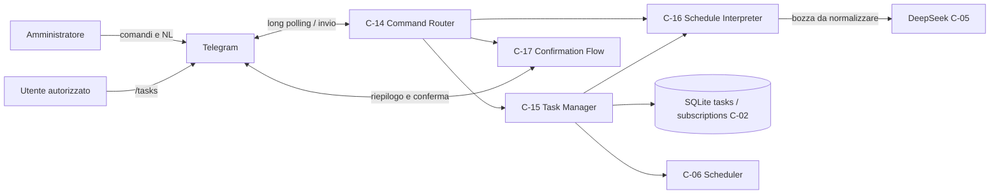
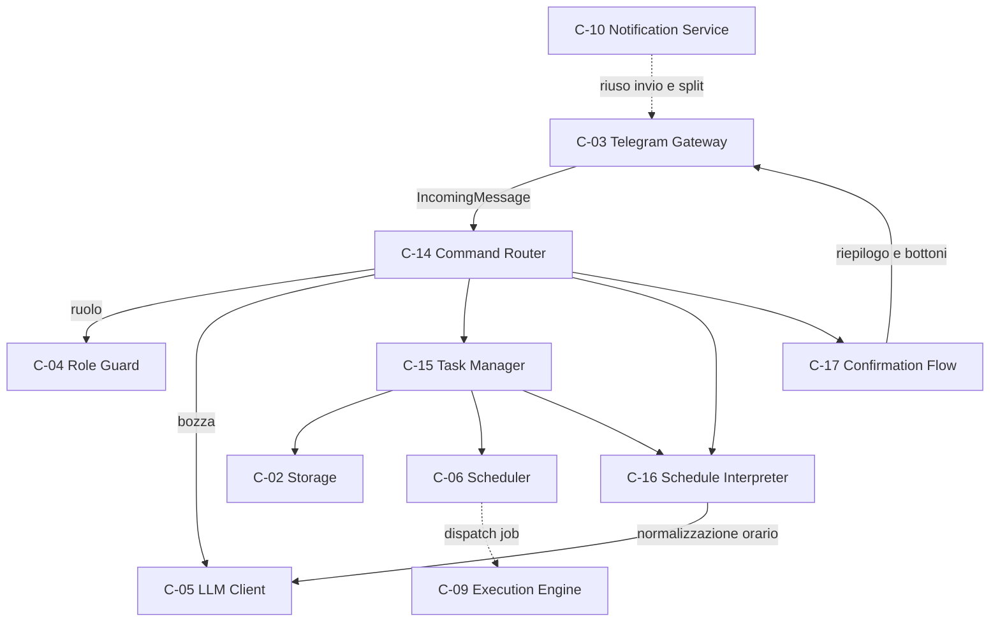
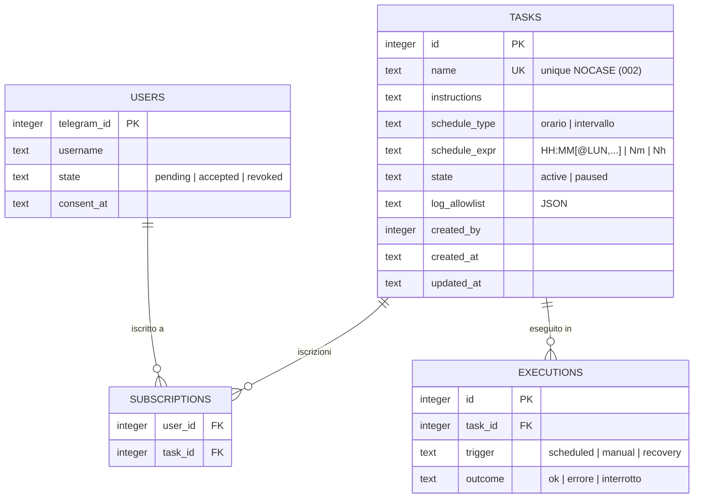
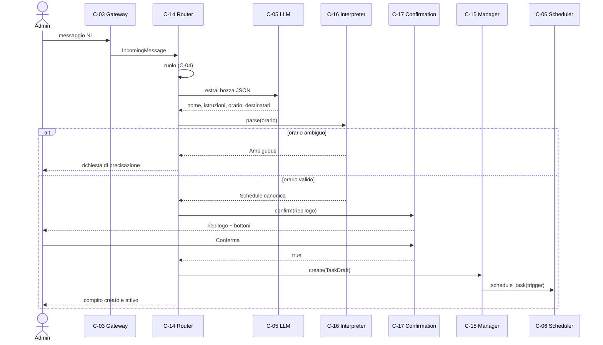
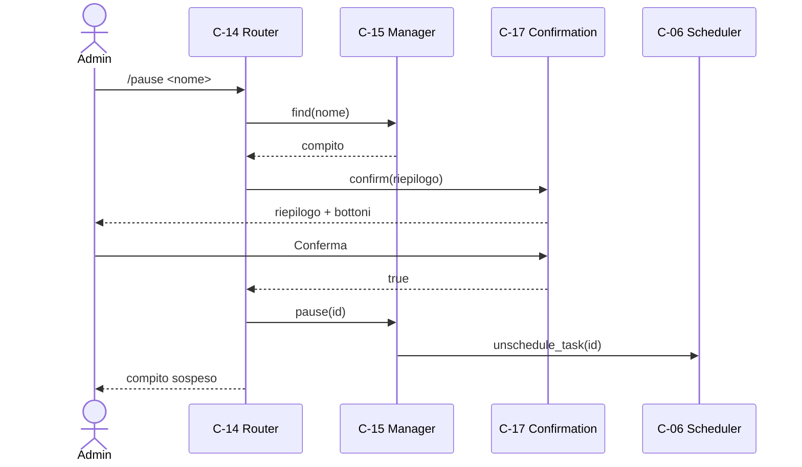
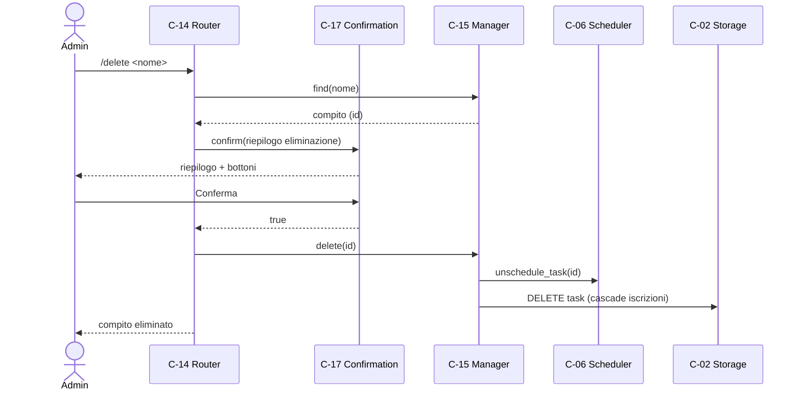
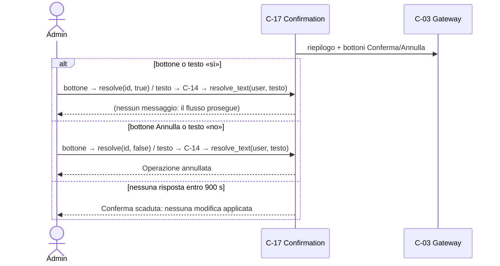

# Architettura 02 — FR-001 Gestione dei compiti

- **Spec:** [02-fr001-gestione-compiti.spec.md](../specs/02-fr001-gestione-compiti.spec.md)
- **Voce roadmap:** 02 — FR-001 Gestione dei compiti
- **Piano:** [02-fr001-gestione-compiti.plan.md](../plan/02-fr001-gestione-compiti.plan.md)
- **Data:** 2026-10-21

> **Assumption (piano 02):** questo documento non ha un template in `docs/templates/`.
> La struttura segue le sezioni della spec 02 — Componenti, Modello di dominio, Modello dati,
> Flussi di dati, Integrazioni — ed è una scelta del piano, non un requisito della spec.

## 1. Contesto



Confini invariati: Telegram solo tramite C-03, DeepSeek solo tramite C-05, SQLite solo tramite
C-02, job solo tramite C-06. Il router non importa la libreria Telegram: riceve messaggi
normalizzati (`IncomingMessage`) da C-03.

## 2. Componenti



Le frecce vanno sempre da chi invoca a chi è invocato. Due dipendenze dichiarate da spec 02 non sono
usate da questa implementazione e sono registrate come gap, non come omissione: **C-15 → C-05** (la
bozza NL è estratta da C-14 prima di C-15) e **C-17 → C-10** (C-17 invia tramite C-03, riusando lo
split dei messaggi di C-10, senza dipendere dal servizio).

Il grafo mostra solo i componenti della fondazione usati da questa feature (spec 02,
§Panoramica): C-01…C-13 non elencati non partecipano al flusso dei compiti. C-09 compare perché
riceve il job da C-06; l'esecuzione end-to-end resta spec 03.

**Comandi e percorsi NL** (esempi rappresentativi; i sinonimi accettati sono elencati in
`command_router.py`, costanti `_NL_MUTATIONS` e `_CONFIRM_WORDS`)

| Ingresso | Ruolo ammesso | Effetto |
|---|---|---|
| messaggio in linguaggio naturale | admin | bozza → interpretazione orario → riepilogo → conferma → creazione |
| «sospendi», «riattiva», «elimina», «rinomina … in …» | admin | riconosciuti in modo deterministico → riepilogo → conferma |
| «mostrami i compiti», «elenca i compiti» | admin, utente autorizzato | elenco |
| `/tasks` | admin, utente autorizzato | elenco (admin: tutti; utente: iscritti) |
| `/pause <nome>`, `/resume <nome>` | admin | riepilogo → conferma → sospensione/riattivazione |
| `/delete <nome>`, `/rename <nome> <nuovo>` | admin | riepilogo → conferma → eliminazione/rinomina |
| `/help`, `/start`, comando sconosciuto | chiunque sia riconosciuto | testo di aiuto |

| Componente | Modulo | Responsabilità |
|---|---|---|
| C-14 Command Router | `command_router.py` | Riconosce comandi slash e messaggi NL; applica il ruolo; orchestra riepilogo e conferma |
| C-15 Task Manager | `task_manager.py` | CRUD, validazioni, iscrizioni ai destinatari, registrazione dei job |
| C-16 Schedule Interpreter | `schedule_interpreter.py` | Interpreta orario/intervallo, rileva ambiguità, valida l'espressione canonica |
| C-17 Confirmation Flow | `confirmation.py` | Riepilogo, conferma esplicita, scadenza 900 s, annullo |
| C-03 ingresso | `telegram_gateway.py` | Normalizza update e bottoni in `IncomingMessage`; esegue l'handler in background |

## 3. Modello di dominio

- **Compito (`Task`):** `id`, `nome`, `istruzioni`, `schedule`, `destinatari`, `stato`,
  `allowlist_log` (nome di dominio; colonna `log_allowlist` nel database).
- **Schedule:** tipo `orario` con espressione `HH:MM` (giornaliero) o `HH:MM@LUN,MAR` (giorni
  specifici), oppure tipo `intervallo` con espressione `Nm` / `Nh`. Timezone: quella del telefono,
  letta a runtime.
- **Destinatari:** utenti `accepted` iscritti al compito; l'amministratore è sempre destinatario e
  non è un record utente (constitution, decisione #7), quindi non compare in `subscriptions`.
- **Stato compito:** valori persistiti `active` | `paused` (BR-15); nella spec sono «attivo» e
  «sospeso», il codice usa le costanti inglesi del CHECK di `001_init.sql`.
- **Bozza (`TaskDraft`)** e **delta (`TaskDelta`)** sono gli ingressi tipizzati di C-15.
- **Punto di applicazione della conferma:** BR-1 è applicato da C-14 prima di ogni chiamata di
  scrittura (`command_router.py`, flussi `/pause`, `/resume`, `/delete`, `/rename`, creazione). C-15
  espone primitive successive alla conferma e non ri-verifica l'approvazione: l'interfaccia
  dichiarata di C-17 è `confirm(summary) -> bool`, che non produce un gettone riusabile da C-15.
  Deviazione registrata come P-A-08 (piano 02 e §7 di questo documento).

## 4. Modello dati



Migrazione 002: indice univoco `idx_tasks_name_nocase ON tasks(name COLLATE NOCASE)`. Il confronto
per nome usato dai comandi è applicativo (`str.casefold`, copre l'Unicode) con l'indice come rete di
sicurezza; indice implicito su `name` garantito dal vincolo `UNIQUE`.

Il diagramma ER è una **vista parziale** dello schema `001_init.sql`: mostra le entità e le colonne
che questa feature legge o scrive. Colonne non rilevanti qui (`users.created_at/updated_at`,
`executions.requested_by/started_at/finished_at/summary`) sono omesse, non inesistenti.

## 5. Flussi di dati

Mappatura dei flussi dichiarati da spec 02 §Flussi di dati:

| Flusso spec 02 | Sezione | Nota |
|---|---|---|
| 1. Creazione (NL) | 5.1 | implementato |
| 2. Creazione (comando rapido) | — | **non implementato per decisione D4** (nessun comando di creazione); lacuna accettata dall'operatore il 2026-10-21, spec 02 non modificata |
| 3. Modifica (`/pause`, NL) | 5.3 | implementato: comandi rapidi e verbi imperativi in NL, riconosciuti senza LLM |
| 4. Eliminazione | 5.4 | implementato |
| 5. Elenco (`/tasks`) | 5.2 | implementato |

Il flusso 5.5 descrive la conferma, trasversale ai flussi 1, 3 e 4.

### 5.1 Creazione in linguaggio naturale



### 5.2 Elenco

```mermaid
sequenceDiagram
    actor Utente
    participant C03 as C-03 Gateway
    participant C14 as C-14 Router
    participant C15 as C-15 Manager
    participant C02 as C-02 Storage

    Utente->>C03: /tasks
    C03->>C14: IncomingMessage
    C14->>C15: list(ruolo, user_id)
    C15->>C02: tasks (+ subscriptions)
    C02-->>C15: righe
    C15-->>C14: TaskView
    C14-->>Utente: elenco (admin: tutti; utente: iscritti)
```

### 5.3 Modifica (pausa, ripresa, rinomina)



La ripresa riregistra il job con nuovo ancoraggio dell'intervallo; la rinomina non tocca il job ma
mantiene il nome come chiave univoca dei comandi. La modifica in linguaggio naturale è riconosciuta
in modo deterministico (verbo imperativo in apertura: «sospendi», «riattiva», «elimina», «rinomina
… in …»), così un testo di creazione come «ogni giorno elimina i file» non viene interpretato come
eliminazione.

### 5.4 Eliminazione



### 5.5 Conferma, annullo e scadenza



Il consumatore di C-03 gira in un task separato: l'attesa della conferma non blocca il polling, così
il bottone o il testo «sì» possono arrivare mentre il flusso è in attesa.

## 6. Integrazioni

| Integrazione | Confine | Uso in questa feature |
|---|---|---|
| Telegram | C-03 | Ricezione messaggi e bottoni (`IncomingMessage`), invio riepiloghi e risposte |
| DeepSeek | C-05 | Estrazione della bozza dal testo NL; normalizzazione di orari non riconosciuti |
| SQLite | C-02 | `tasks`, `subscriptions`; migrazione 002 per l'unicità del nome |
| APScheduler | C-06 | `CronTrigger` per orari, `IntervalTrigger` ancorato alla registrazione per intervalli |
| APScheduler dispatching | C-06 → C-09 | Il job carica il compito e lo esegue solo se `active`; l'esecuzione end-to-end resta spec 03 |

## 7. Decisioni e assunzioni

| # | Contenuto | Fonte |
|---|---|---|
| — | Prefisso `P-A-` = assunzione del piano 02, per non collidere con le assunzioni A-01/A-02 di spec 02 | Piano 02 |
| D1 | Intervalli ancorati all'istante di creazione (o di ripresa) | Operatore, 2026-10-21 |
| D2 | Intervallo minimo 1 minuto (`limits.min_interval_minutes`) | Operatore, 2026-10-21 |
| D3 | Nomi univoci senza distinzione di maiuscole; `/rename` disponibile | Operatore, 2026-10-21 |
| D4 | Nessun comando di creazione: creazione solo in linguaggio naturale | Operatore, 2026-10-21 |
| D5 | Scadenza conferma = `limits.approval_timeout_s` (900 s, BR-3) | Operatore, 2026-10-21 |
| D6 | Conferma con bottoni inline e fallback testuale «sì»/«no» | Operatore, 2026-10-21 |
| P-A-01 | Il router non importa la libreria Telegram; input normalizzato da C-03 | Piano 02 |
| P-A-02 | Conferme in memoria: un riavvio le annulla senza scritture (fail-safe) | Piano 02 |
| P-A-03 | Ambiguità e validazione delle espressioni sono deterministiche, mai delegate al LLM | Piano 02 |
| P-A-04 | Destinatari assenti → solo admin; destinatario non `accepted` → rifiuto esplicito | Piano 02 |
| P-A-05 | Limite BR-16 controllato su creazione e ripresa | Piano 02 |
| P-A-06 | `/tasks` per utente autorizzato elenca solo i compiti a cui è iscritto | Piano 02 |
| P-A-07 | Messaggi e rifiuti in italiano, default dichiarato da BR-14 | Piano 02 |
| P-A-08 | BR-1 applicato da C-14 prima delle primitive di scrittura di C-15; C-15 non ri-verifica la conferma perché l'interfaccia dichiarata di C-17 (`confirm(summary) -> bool`) non produce un gettone riusabile | Operatore, 2026-10-21 (approvata al gate di pubblicazione) |

**Deviazioni di firma rispetto alla spec 02** (dichiarate, non silenziose):

- C-14: `route(update, role) -> Action` diventa `route(message: IncomingMessage) -> Action`. Il ruolo
  è risolto dentro il router con C-04; `IncomingMessage` è il record normalizzato da C-03, così il
  router non importa la libreria Telegram (P-A-01).
- C-17: `confirm(summary) -> bool` diventa `confirm(*, requested_by, chat_id, summary) -> bool`.
  Servono il destinatario della conferma (solo admin, BR-12) e la chat di risposta.
- C-15: `create(draft)` / `update(id, delta)` / `pause(id)` / `resume(id)` / `delete(id)` /
  `list(role, user_id)` sono mantenuti; si aggiunge `rename(id, name)` per la decisione D3.

## 8. Tracciabilità e verifica

| Criterio | Comportamento verificato | Test |
|---|---|---|
| AC-01 | Riepilogo (nome, istruzioni, orario, destinatari) prima di ogni scrittura; salvataggio solo dopo conferma | `tests/test_tasks_ac.py::test_ac01_summary_then_save_only_after_confirmation` |
| AC-02 | Orario ambiguo → richiesta di precisazione, nessun compito creato | `tests/test_tasks_ac.py::test_ac02_ambiguous_time_is_asked_not_assumed`, `tests/test_schedule_interpreter.py` |
| AC-03 | Utente autorizzato → rifiuto, nessun compito, nessuna chiamata LLM | `tests/test_tasks_ac.py::test_ac03_authorized_user_is_refused_without_side_effects` |
| AC-04 | `/pause <nome>` → stato `paused` e job rimosso; ripresa riregistra il job | `tests/test_tasks_ac.py::test_ac04_pause_stops_execution_until_resume`, `tests/test_task_manager.py` |
| BR-1 | Conferma, annullo, fallback testuale, scadenza 900 s | `tests/test_confirmation.py` |
| BR-12 | Ruoli: comandi e NL di modifica/creazione riservati all'admin | `tests/test_command_router.py` |
| BR-14 | Ambiguità mai assunta; timezone del telefono | `tests/test_schedule_interpreter.py` |
| BR-15 | Stati `active`/`paused` vincolati | `tests/test_task_manager.py`, `tests/test_storage.py::test_invalid_state_is_rejected` |
| BR-16 | Limite di 10 compiti attivi su creazione e ripresa | `tests/test_task_manager.py` |
| Confini | Nessun import Telegram/SQLite/APScheduler fuori dai rispettivi confini | `tests/test_boundaries.py` |

Suite completa: `PYTHONPATH=src:.deps python3 -m pytest` (139 test, 2026-10-21; il venv non è
creabile su questo dispositivo, dipendenze installate con `pip --target .deps`).

**Checkpoint di struttura:** eseguito in modalità delegata con l'agente di governance dichiarato nel
piano; esito riportato nella delivery history (vedi [docs/delivery-history.md](../delivery-history.md)).
Struttura applicabile: sezioni derivate da spec 02; sezioni obbligatorie presenti; vista di
deployment assente perché non dichiarata dalla spec.

## 9. Fuori scope (rimandato alle spec competenti)

- Esecuzione end-to-end, delivery ai destinatari, recupero della mancata occorrenza: spec 03.
- Ri-registrazione dei job all'avvio (boot recovery): spec 11.
- Gate C-27/C-28 e approvazioni a 15 minuti: spec 06. C-17 è il flusso BR-1 delle modifiche ai
  compiti, distinto dal gate delle azioni.
- Autorizzazione e revoca utenti, consenso privacy: spec 08.
- Lettura log e semantica dell'allowlist: spec 07.
- Storico esecuzioni e query: spec 09.
- Vista di deployment: la spec 02 non la dichiara → omessa (gap registrato nel piano).
