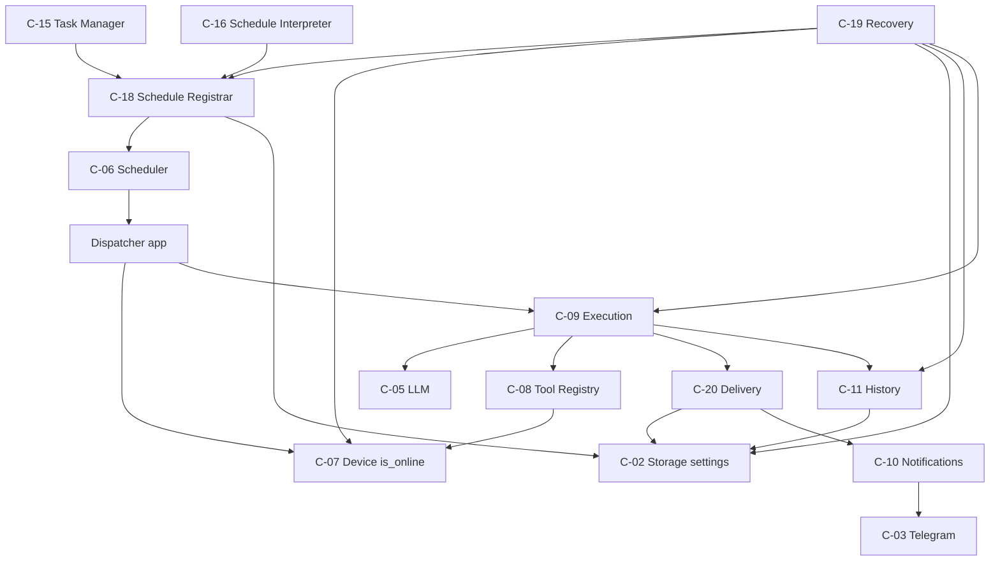
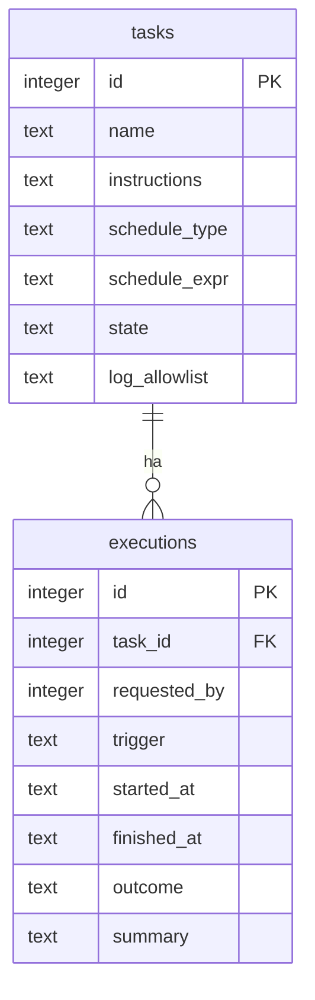
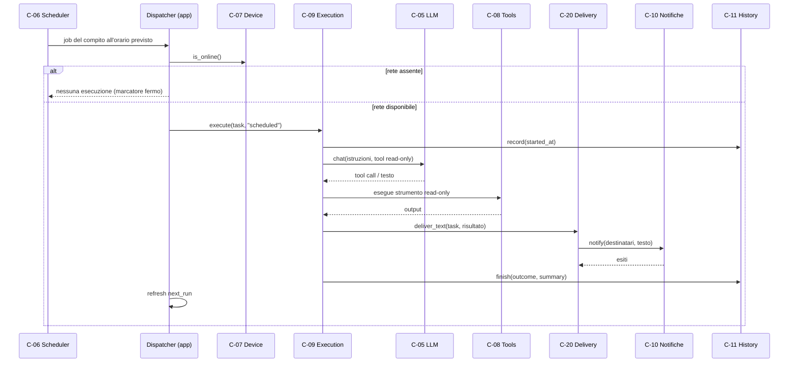
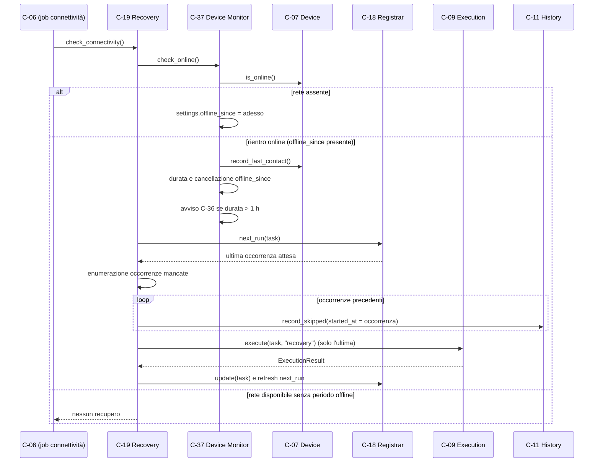
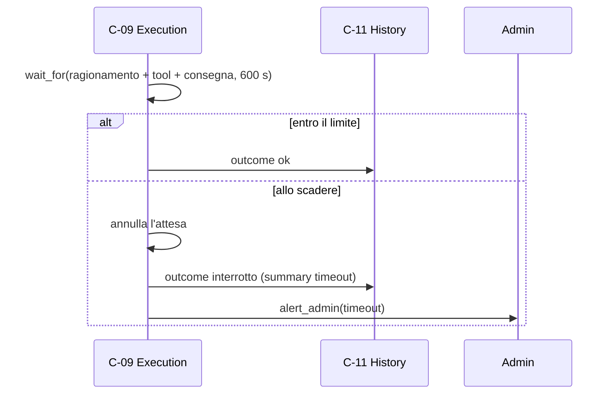
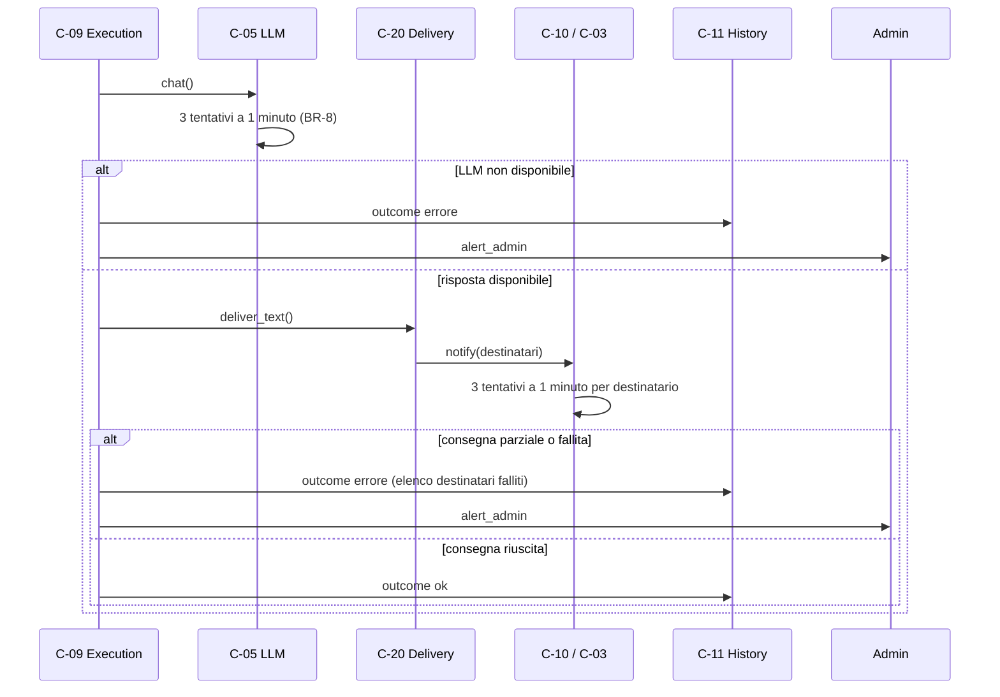

# Architettura 03 — FR-002 Esecuzione programmata

- **Spec:** [03-fr002-esecuzione-programmata.spec.md](../specs/03-fr002-esecuzione-programmata.spec.md)
- **Voce roadmap:** `03 — FR-002 Esecuzione programmata`
- **Piano:** [03-fr002-esecuzione-programmata.plan.md](../plan/03-fr002-esecuzione-programmata.plan.md)
- **Constitution:** [constitution.md](../specs/constitution.md)
- **Data:** 2026-10-24
- **Struttura dichiarata:** sezioni di spec 03 + blocco metadata e stile di
  [02-fr001-gestione-compiti.md](02-fr001-gestione-compiti.md) e §Checkpoint del
  [piano 03](../plan/03-fr002-esecuzione-programmata.plan.md).

> **Assunzione P-A-10:** nel progetto non esiste un template per documenti di architettura; la
> struttura è derivata dalla spec, dal piano e dal documento 02.

## 1. Contesto e obiettivi

FR-002 richiede che ogni compito attivo sia eseguito automaticamente all'orario o all'intervallo
previsto, nel fuso del telefono (BR-14), usando DeepSeek e gli strumenti necessari, con consegna del
risultato ai destinatari e registrazione nello storico.

Vincoli applicati: timeout di esecuzione 10 minuti (BR-4), recupero **una sola volta** dell'ultima
occasione mancata (BR-5), 3 tentativi a 1 minuto per gli errori transitori (BR-8), un solo
amministratore definito in configurazione (principio 2, decisione #7) con permessi per ruolo
applicati da C-04 (BR-12), nessuna azione modificante senza approvazione (BR-2), risultati solo a
destinatari autorizzati (BR-12), lettura log solo da allowlist (BR-13), massimo 10 compiti attivi
(BR-16).

Dipendenze consegnate: item 01 (C-01…C-13, schema `001_init.sql`) e item 02 (C-14…C-17, C-16
espressioni canoniche, `trigger_for()`, migrazione 002, dispatcher job→C-09).

## 2. Componenti

I tre componenti nuovi si appoggiano alla fondazione; nessuno introduce un servizio separato
(principio 7).

### C-18 — Schedule Registrar

- **Responsabilità:** tradurre lo `Schedule` canonico di un compito in un job APScheduler tramite
  C-16/C-06, con la timezone del telefono, e persistere il marcatore `next_run` usato dal recupero.
- **Interfaccia pubblica:** `register(task)`, `update(task)`, `unregister(task_id)`, più
  `refresh(task_id)`, `sync(tasks)` e `next_run(task_id)` per il recupero e l'avvio.
- **Input:** `Task` persistito. **Output:** job attivo e marcatore `next_run:<task_id>` aggiornato.
- **Dipendenze:** C-06 (meccanica dei job), C-16 (validazione dell'espressione), C-02 (settings).
- **Error handling:** espressione non valida → `ScheduleError` prima della scrittura; errore dello
  scheduler o del salvataggio del marcatore → job rimosso e marcatore cancellato, nessuno stato
  parziale.
- **Osservabilità:** log `job registrato|aggiornato` con `task_id`, `job_id`, `next_run`; log
  `job annullato` con `task_id`.
- **Sicurezza:** nessuna esecuzione privilegiata: il job invoca solo C-09.

### C-19 — Recovery Handler

- **Responsabilità:** rilevare le occorrenze mancate dall'ultimo `next_run` persistito ed eseguirne
  **solo l'ultima**; le precedenti sono registrate come `saltata`. Dal 2026-11-03 il periodo offline
  e il rientro sono tracciati da C-37 (voce 10): C-19 delega e conserva solo il recupero.
- **Interfaccia pubblica:** `recover_missed() -> list[ExecutionResult]` (asincrona: C-09 è
  asincrono, deviazione dichiarata in §13) e `check_connectivity()` per il job periodico.
- **Input:** marcatore `next_run:<task_id>` in `settings`; `OnlineStatus` da C-37; ora del telefono.
  **Output:** esecuzioni di recupero (`trigger='recovery'`), righe `saltata`, marcatore avanzato.
- **Dipendenze:** C-02, C-06 (tramite C-18), C-09, C-11, C-37.
- **Error handling:** nessun marcatore → nessun recupero (fail-safe); più occorrenze → ultima
  eseguita, precedenti `saltata`; rete assente o non leggibile → recupero rinviato; `LockHeldError` → recupero
  rinviato e marcatore avanzato (l'occorrenza è coperta dall'esecuzione in corso, spec 04 C-22);
  schedulazione illeggibile → log e compito saltato.
- **Osservabilità:** log `recupero occorrenza` con `task_id`, istante e numero di occorrenze saltate.
  I log di inizio periodo offline e di rientro sono emessi da C-37 (voce 10).
- **Sicurezza:** legge solo lo stato di rete; l'esito passa da C-09 con le sue regole.

### C-20 — Delivery Service

- **Responsabilità:** calcolare i destinatari del compito (admin implicito + utenti iscritti ancora
  `accepted` al momento dell'invio) e consegnare il risultato tramite C-10.
- **Interfaccia pubblica:** `deliver(task, result)`; `deliver_text(task, text)` usata da C-09 per
  tenere la consegna dentro il timeout BR-4 (deviazione dichiarata in §13).
- **Input:** compito e testo del risultato. **Output:** `DeliveryReport(sent, failed)` e invii.
- **Dipendenze:** C-02 (iscrizioni, utenti), C-10 (trasporto, split, retry BR-8).
- **Error handling:** invio fallito a un destinatario → retry del trasporto; se persiste, il
  destinatario finisce in `failed`, gli altri ricevono comunque il risultato; risultato vuoto →
  `ValueError` (esito `errore`).
- **Osservabilità:** log destinatari esclusi (non autorizzati) e `consegna completata` con conteggi
  inviati/falliti.
- **Sicurezza:** nessun invio a utenti revocati o sconosciuti (BR-12); l'admin non è un record
  `users` e resta destinatario implicito (decisione #7).

### C-09 — Execution Engine (estensione di questa voce)

- **Responsabilità:** eseguire il compito end-to-end: lock per compito, contesto, loop LLM/tool
  (solo read-only), timeout BR-4, consegna tramite C-20, registrazione dell'esito. I retry restano
  dentro C-05 e C-10/C-03 (D5).
- **Interfaccia pubblica:** `execute(task, trigger, requester) -> ExecutionResult` invariata;
  `ExecutionResult.text` aggiunto per la consegna (V-02).
- **Input:** `Task` caricato dal dispatcher, innesco `scheduled|manual|recovery`, richiedente
  opzionale. **Output:** risultato con esito `ok|errore|interrotto`, testo e summary.
- **Dipendenze:** C-05, C-08, C-07 (tramite tool), C-10 (tramite C-20), C-11.
- **Error handling:** timeout → `interrotto` + avviso; eccezione o strumento modificante richiesto →
  `errore` + avviso; consegna parziale → `errore` con elenco destinatari; lock già detenuto →
  `LockHeldError` senza seconda esecuzione.
- **Osservabilità:** log inizio/fine, tool invocati, durata, esito; nessun segreto.
- **Sicurezza:** gli strumenti modificanti non vengono mai eseguiti senza il gate C-27/C-28; le
  letture passano da C-07 con l'allowlist del compito.

### Componenti riusati

| Componente | Ruolo in questa voce |
|---|---|
| C-02 Storage | repository, migrazione 003, marcatori in `settings` |
| C-03 Telegram | trasporto degli invii, retry BR-8 |
| C-05 LLM | ragionamento e tool calling, retry BR-8, credenziali |
| C-06 Scheduler | job store persistente, avvio in pausa, `next_run`, job di manutenzione e connettività |
| C-07 Device | `is_online()`, `record_last_contact()`, lettura file con allowlist |
| C-08 Tool Registry | schemi read-only al modello, policy di approvazione |
| C-09 Execution | lock, contesto, LLM, tool, timeout, esito, chiamata a C-20 |
| C-10 Notifiche | invio risultati, avviso admin, split e retry |
| C-11 History | registrazione esiti, inclusi `saltata` |
| C-15 Task Manager | chiama C-18 invece di C-06 diretto |
| C-16 Schedule Interpreter | espressioni canoniche e validazione |

## 3. Riparto di responsabilità

| Componente | Possiede | Delega | Perché non è duplicazione |
|---|---|---|---|
| C-18 | politica di registrazione e marcatore `next_run` | C-06 per `add_job`/`remove_job`/`next_run` | C-06 è il meccanismo APScheduler; C-18 rende il job recuperabile. C-15 non parla più direttamente con C-06 |
| C-19 | rilevamento occorrenze, semantica «una volta, ultima», marcatura `saltata` | C-09 per l'esecuzione, C-11 per lo storico | C-39 (spec 11) orchestrerà l'avvio e dovrà chiamare C-19, non reimplementarlo |
| C-20 | destinatari del risultato e report per destinatario | C-10 per l'invio | C-10 è trasporto e messaggistica; C-20 è politica dei destinatari |
| C-09 | lock, contesto, loop LLM/tool, timeout, esito | C-05, C-08, C-10 (tramite C-20), C-11 | confini già dichiarati da spec 01 |

Il marcatore avanzato dopo ogni occorrenza rende il recupero idempotente: una seconda chiamata di
C-19, da qualunque percorso (watcher o boot di spec 11), non trova occorrenze da rieseguire.

## 4. Modello di dominio

- **Esecuzione:** `id`, `task_id`, `requested_by` (`null` per programmata e recupero), `trigger`,
  `started_at`, `finished_at`, `outcome`, `summary`.
- **Innesco:** `scheduled` | `manual` | `recovery`. `manual` è già ammesso dal modello di spec 01
  (lancio manuale, spec 04); in questa voce C-06 usa `scheduled` e C-19 usa `recovery`.
- **Esito:** `ok` | `errore` | `interrotto` | `saltata`.
- **Occorrenza saltata:** riga con `trigger='scheduled'`, `started_at = finished_at` pari
  all'istante dell'occorrenza mancata, `outcome='saltata'`, summary esplicito. Non è un'esecuzione
  avvenuta: documenta un'occorrenza persa (D1, emendamento BR-15).

## 5. Modello dati

Tabella `executions` (spec 01) con il CHECK esteso dalla migrazione 003; nessun'altra tabella
cambia. La migrazione ricostruisce la tabella perché SQLite non modifica un CHECK: copia integrale
delle righe, `DROP`, rinomina, ricreazione di `idx_executions_task_started`.

Marcatori di stato in `settings` (chiave/valore, nessuno schema dedicato):

| Chiave | Scritta da | Letta da | Significato |
|---|---|---|---|
| `next_run:<task_id>` | C-18 | C-19 | prossima occorrenza attesa; se nel passato è da recuperare |
| `offline_since` | C-37 | C-37; C-19 solo tramite `OnlineStatus` | inizio dell'ultimo periodo offline |
| `last_online_at` | C-37 | spec 11 | ultimo contatto di rete, nome autoritativo |
| `last_contact_at` | C-07 (`record_last_contact`) | nessuno in `src/` (solo test) | compatibilità con la fondazione |

**Divergenza di naming riconciliata dalla voce 10 (2026-11-03):** `last_online_at` è il nome
autoritativo per spec 10/11; `last_contact_at` resta scritto per compatibilità e non ha lettori in
`src/`. C-37 è l'unico scrittore di entrambi i valori e di `offline_since`.

Il nome `next_run:<task_id>` è un'assunzione (P-A-01): la spec 03 dichiara solo «`next_run` per i
compiti». Non si introduce un secondo nome per l'ultimo contatto: si riusa `last_contact_at`
(P-A-02).

## 6. Flussi di dati

### 6.1 Esecuzione programmata (flusso 1)

Il dispatcher carica il `Task` dal repository e lo passa a C-09 (V-10); C-09 non rilegge il compito
per conto proprio. Se la rete manca l'occorrenza non viene eseguita e il marcatore resta fermo: la
recupera C-19 al rientro.

### 6.2 Recupero (flusso 2)

All'avvio la stessa sequenza avviene prima di riattivare i job: scheduler in pausa → seed dei
marcatori dai job persistiti → `recover_missed()` → `resume()`. Così un riavvio non duplica
un'esecuzione e un'esecuzione persa viene recuperata una volta (AC-02).

### 6.3 Timeout (flusso 3)

### 6.4 Retry (flusso 4)

Nessun retry esterno sull'intera esecuzione (D5): i retry sono dentro C-05 e C-10/C-03, così non si
producono esecuzioni da 30 minuti né doppi invii.

## 7. Integrazioni

| Integrazione | Direzione | Uso in questa voce |
|---|---|---|
| APScheduler (`AsyncIOScheduler`, job store SQLite) | interno | trigger, persistenza job, avvio in pausa, job connettività |
| Telegram Bot API | uscita | consegna risultati e avvisi admin, con retry |
| DeepSeek (API compatibile OpenAI) | uscita | ragionamento e tool calling |
| Termux:API (`termux-wifi-connectioninfo`) | locale | stato online/offline via C-07 |
| SQLite | locale | marcatori, storico, iscrizioni |

`web_search` non è disponibile in questa voce: il provider è di spec 06. Gli strumenti modificanti
restano dietro il gate C-27/C-28, anch'esso di spec 06.

## 8. Sicurezza

- Nessuna azione modificante viene eseguita: solo gli strumenti `read_only` sono esposti a C-05;
  la richiesta di uno strumento non read-only produce esito `errore` e avviso admin (fail-safe,
  principio 1) finché il gate C-27/C-28 non esiste.
- I risultati vanno solo all'admin e agli utenti `accepted` iscritti al compito; i revocati sono
  esclusi al momento dell'invio, non solo alla creazione (BR-12).
- La lettura dei log passa l'allowlist del compito a C-07; la validazione dei percorsi resta di
  spec 07 (BR-13).
- Nessun segreto nei log; i messaggi di errore riportano tipo e testo dell'eccezione, non le chiavi.
- Il recupero non esegue nulla senza marcatore e non riesegue un'occorrenza già consumata.

## 9. Requisiti non funzionali

| Requisito | Implementazione |
|---|---|
| Durata massima 10 minuti (BR-4) | `asyncio.wait_for` su ragionamento + tool + consegna; allo scadere `interrotto` + avviso admin |
| Retry 3×1 minuto (BR-8) | in C-05 e C-10/C-03; nessun retry esterno |
| Recupero una volta (BR-5) | sola ultima occorrenza; marcatore avanzato |
| Volume ≤ 10 compiti attivi (BR-16) | invariato, C-15 |
| Osservabilità | log strutturati di trigger, esecuzione, recupero, consegna, avvisi |
| Fuso del telefono (BR-14) | trigger senza timezone forzata, quindi nel fuso del telefono; gli istanti di storico sono UTC ISO con offset, coerentemente con la fondazione (spec 01) |
| Connessione | verifica periodica ogni `limits.connectivity_check_s` (default 60 s), in thread |

## 10. Rischi e assunzioni

Rischi residui: doppio recupero con il futuro C-39 (mitigato dal marcatore avanzato e dal riparto in
§3), molte occorrenze mancate (tetto P-A-03), retry dentro il timeout (P-A-09), consegna parziale
(esito `errore` + elenco), lock in memoria perso al riavvio finché C-22 non è consegnato (mitigato da
`max_instances=1` e `coalesce=True`), divergenza di naming `last_contact_at`/`last_online_at` tra
spec 01 e spec 10/11 (riportata, non riconciliata qui).

Assunzioni di piano: P-A-01…P-A-11 in [piano 03](../plan/03-fr002-esecuzione-programmata.plan.md).
In sintesi: chiavi `settings`, tetto 1000 occorrenze, ri-ancoraggio dell'intervallo dopo un recupero,
watcher `connectivity:check`, esito `errore` su consegna parziale, campo `ExecutionResult.text`, loop
tool massimo 5 cicli e output troncato a 20.000 caratteri, timeout che include la consegna, struttura
documentale derivata dalla spec, seed dei marcatori dai job persistiti all'avvio senza
ri-registrazione (P-A-11).

## 11. Domande aperte di spec 03

Le due domande della spec sono state chiuse dall'operatore il 2026-10-24 e sono vincolanti:

1. **Definizione di «offline».** Offline = rete assente rilevata da C-07; il processo spento è
   coperto dal recupero all'avvio di questa voce, mentre messaggio di ripartenza e liveness restano a
   spec 11 (D2). Residuo dichiarato: spec 11 dovrà usare C-19 e non un secondo meccanismo.
2. **Rappresentazione delle occorrenze mancate.** Nuovo esito `saltata` (D1), con emendamento di
   BR-15 (constitution §9), del modello dati di spec 01 e di spec 09, fatti contestualmente. Il
   documento di input `docs/input/functional-requirements.md` non è emendato: non è una fonte di
   implementazione, la fonte vincolante è constitution + spec 01.

## 12. Fuori scope

- Riavvio, messaggio di ripartenza, liveness e watchdog dell'avvio (spec 11).
- Gate C-27/C-28, `web_search`, approvazioni con timeout delle azioni (spec 06).
- Semantica dell'allowlist e riassunto dei log (spec 07).
- Politica e soglie degli avvisi admin (spec 10): qui si emettono solo gli avvisi richiesti dai
  flussi 3 e 4.
- Lock persistente per compito C-22 (spec 04).
- Query e presentazione dello storico (spec 09).
- Chat e domande libere (spec 05), autorizzazione e revoca utenti (spec 08).

Nessuna vista di deployment: la spec 03 non la dichiara.

## 13. Deviazioni dichiarate

| # | Deviazione | Motivo |
|---|---|---|
| V-01 | `RecoveryHandler.recover_missed()` è `async` e restituisce `list[ExecutionResult]` | C-09 è asincrono; la firma della spec non indica il contesto di esecuzione |
| V-02 | `ExecutionResult` espone `text` oltre a `summary` | C-20 deve inviare il testo completo; `summary` resta troncato per lo storico |
| V-03 | C-09 usa `DeliveryService.deliver_text()`; `deliver(task, result)` resta l'interfaccia pubblica | tenere la consegna dentro il timeout BR-4 |
| V-04 | Gli handler di C-08 ricevono `(task, arguments)` | il tool `read_logs` ha bisogno dell'allowlist del compito, che è per-esecuzione |
| V-05 | Il timeout annulla l'attesa ma non una chiamata HTTP già in corso in un thread | limite della fondazione (`asyncio.to_thread`); dichiarato in P-A-09 |
| V-06 | `start(paused=True)` e `resume()` aggiunti a C-06 | necessari per recuperare prima di riattivare i job (AC-02) |
| V-07 | C-15 riceve C-18 invece di C-06 | riparto di responsabilità di spec 03 (C-18) |
| V-08 | C-18 espone anche `refresh`, `sync` e `next_run` oltre a `register/update/unregister` | servono al recupero e all'avvio; le tre operazioni della spec restano l'interfaccia principale |
| V-09 | C-19 espone `check_connectivity()` oltre a `recover_missed()` | l'interfaccia della spec non dichiara come viene rilevato il rientro online; il job C-06 ha bisogno di un entry point |
| V-10 | Il dispatcher carica il `Task` e lo passa a C-09 | C-06 consegna solo l'id del job; C-09 non apre il repository per il compito |
| V-11 | C-09 è esteso con tool loop read-only, chiamata a C-20 e `DeliveryError` | necessari ai flussi 1 e 4; l'interfaccia `execute(task, trigger, requester)` resta quella di spec 01 |

> **Aggiornamento 2026-10-24 (voce 04):** `deliver_text` e `deliver` accettano ora anche il parametro
> opzionale `requested_by`, usato dal lancio manuale per inviare il risultato al solo richiedente
> ([architettura 04](04-fr003-lancio-manuale.md), V-03). Il percorso programmato non passa il
> parametro e mantiene la semantica descritta qui.

## 14. Tracciabilità

| Requisito / criterio | Evidenza |
|---|---|
| AC-01 esecuzione programmata con consegna | `tests/test_scheduled_ac.py::test_ac01_scheduled_task_delivers_to_all_recipients` |
| AC-02 recupero una sola volta | `tests/test_scheduled_ac.py::test_ac02_offline_missed_occurrence_recovered_once`, `::test_ac02_start_recovers_before_resuming_jobs`, `tests/test_recovery.py` |
| AC-03 timeout, esito e avviso | `tests/test_scheduled_ac.py::test_ac03_timeout_marks_interrupted_and_alerts_admin`, `tests/test_execution.py::test_timeout_marks_interrupted_and_alerts_admin` |
| BR-4 durata massima | `tests/test_execution.py::test_timeout_marks_interrupted_and_alerts_admin` |
| BR-5 recupero e occorrenze saltate | `tests/test_recovery.py::test_only_last_occurrence_is_recovered`, `::test_recovery_is_idempotent` |
| BR-8 retry (delegati) | `tests/test_llm.py`, `tests/test_telegram_gateway.py`, `tests/test_delivery.py::test_partial_failure_is_reported` |
| BR-14 timezone | `tests/test_schedule_registrar.py::test_trigger_uses_the_phone_timezone`, `tests/test_schedule_registrar.py::test_register_creates_job_and_persists_next_run` |
| BR-2 strumenti modificanti | `tests/test_execution.py::test_modifying_tool_is_refused_fail_safe` |
| BR-12 destinatari autorizzati | `tests/test_delivery.py::test_recipients_are_admin_and_accepted_subscribers` |
| BR-13 allowlist | `tests/test_execution.py::test_read_only_tool_is_executed_and_result_is_delivered`, `tests/test_device_gate.py` |
| BR-16 limite compiti | `tests/test_task_manager.py::test_active_task_limit_is_enforced` |
| Migrazione `saltata` e preservazione dati | `tests/test_storage.py::test_skipped_outcome_is_accepted`, `::test_migration_003_preserves_existing_executions` |
| Avvisi offline/batteria (voce 10) | `tests/test_device_monitor.py`, `tests/test_alerts_ac.py` |
| Confini di integrazione | `tests/test_boundaries.py` |

## Aggiornamento 2026-10-25 (voce 06)

Il gate C-27/C-28 è consegnato: C-09 espone al modello anche gli strumenti modificanti e li esegue
tramite C-27 solo dopo approvazione dell'admin. Un rifiuto, un timeout o un errore di ricerca sono
esiti di tool e il compito prosegue (V-08/V-12 della voce 06); BR-4 resta invariato e racchiude
l'attesa, che al timeout diventa `rejected` (V-05). La frase «solo read-only esposti» del §8 valeva
prima del gate.

## Aggiornamento 2026-11-04 (voce 11)

C-19 espone `last_summary` (`RecoveryStats`) senza cambiare il ritorno di `recover_missed` e
`check_connectivity`: conteggi di recuperate, fallite, saltate e rinviate, azzerati a ogni ingresso.
C-39 (voce 11) legge il riepilogo per il messaggio di ripartenza; un `AgenteError` dal recupero di
avvio fa fallire l'avvio e il loop esterno riavvia. Recupero, BR-5 e idempotenza restano invariati.
