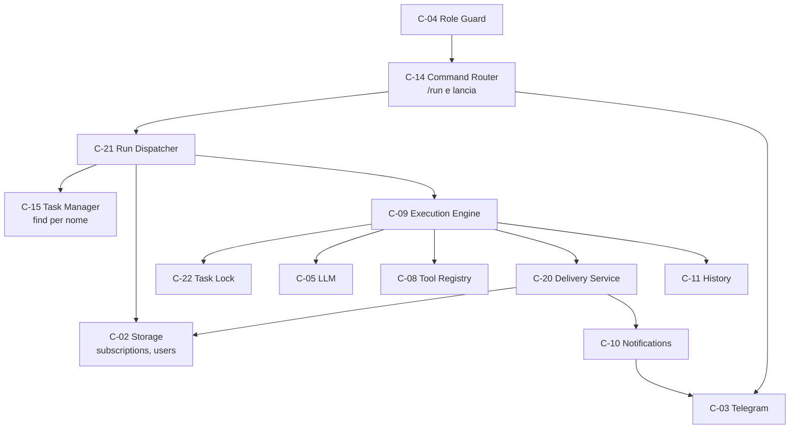
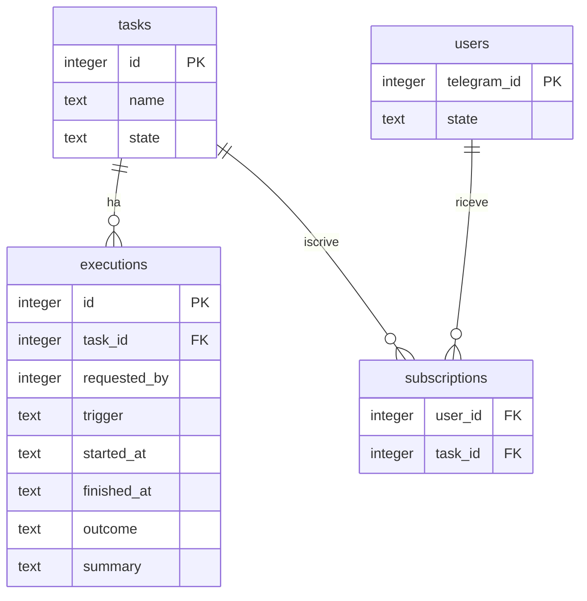
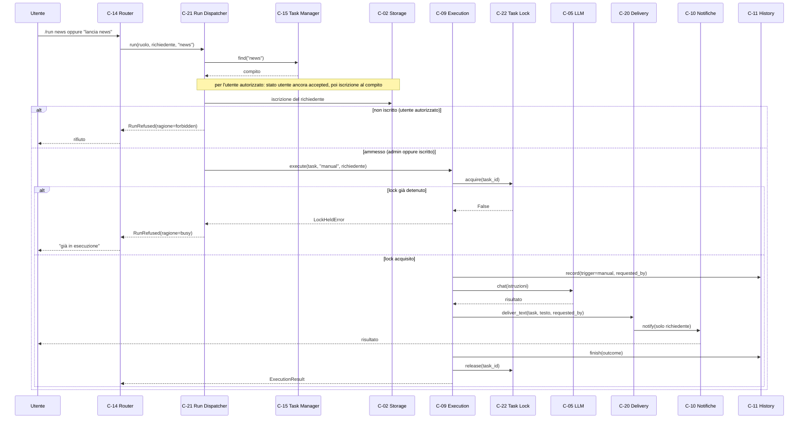
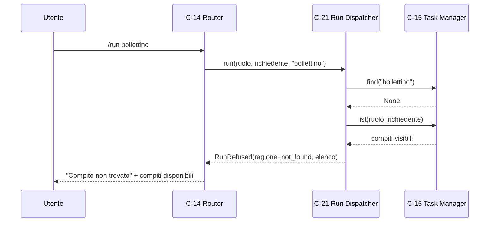
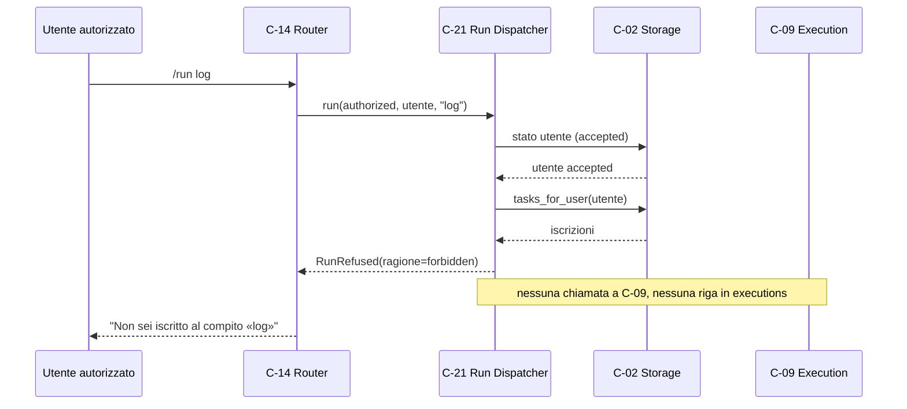

# Architettura 04 — FR-003 Lancio manuale

- **Spec:** [04-fr003-lancio-manuale.spec.md](../specs/04-fr003-lancio-manuale.spec.md)
- **Voce roadmap:** `04 — FR-003 Lancio manuale`
- **Piano:** [04-fr003-lancio-manuale.plan.md](../plan/04-fr003-lancio-manuale.plan.md)
- **Constitution:** [constitution.md](../specs/constitution.md)
- **Data:** 2026-10-24
- **Struttura dichiarata:** sezioni di spec 04 + blocco metadata e stile di
  [02-fr001-gestione-compiti.md](02-fr001-gestione-compiti.md) e
  [03-fr002-esecuzione-programmata.md](03-fr002-esecuzione-programmata.md).

> **Assunzione P-A-07:** nel progetto esistono `docs/templates/template.spec.md` e
> `template.constitution.md`, ma **nessun template per documenti di architettura**; la struttura è
> derivata dalla spec, dal piano e dai documenti 02/03.

## 1. Contesto e obiettivi

FR-003 richiede che l'amministratore o un utente autorizzato possa **eseguire subito** un compito
esistente scrivendo `/run <nome>` o «lancia <nome>». Il risultato va **solo a chi ha fatto la
richiesta**; un utente autorizzato può lanciare solo i compiti a cui è iscritto, altrimenti riceve un
rifiuto; l'esecuzione è registrata nello storico.

Vincoli applicati: una sola esecuzione per compito alla volta (decisione #9, AC-03), stesso timeout
di 10 minuti e stessi retry 3×1 minuto dell'esecuzione programmata (BR-4, BR-8), permessi per ruolo
(BR-12), nessuna azione modificante senza approvazione (BR-2, gate a spec 06).

Dipendenze consegnate: item 01 (C-01…C-13, schema `001_init.sql`), item 02 (C-14…C-17, ricerca per
nome senza distinzione di maiuscole), item 03 (C-18/C-19/C-20, C-09 con timeout e consegna, esito
`saltata`).

## 2. Componenti

I due componenti nuovi si appoggiano alla fondazione; nessuno introduce un servizio separato
(principio 7).

### C-21 — Run Dispatcher

- **Responsabilità:** verificare che il compito esista, che il richiedente sia autorizzato a
  eseguirlo e invocare C-09 con `trigger='manual'` e `requester`; comporre i messaggi di rifiuto.
- **Interfaccia pubblica:** `run(requester_role, requester_id, task_name) -> ExecutionResult`
  (asincrona, V-01). I rifiuti precedono l'esecuzione e sono eccezioni tipizzate `RunRefused`
  (`reason` + messaggio utente, **P-A-01**), perché il tipo di ritorno dichiarato copre il solo
  successo.
- **Input:** ruolo già risolto da C-04 e nome del compito, entrambi forniti da C-14.
  **Output:** `ExecutionResult` dell'esecuzione manuale.
- **Dipendenze:** C-15 (ricerca per nome), C-02 (iscrizioni e stato utente), C-09 (esecuzione).
  Le dipendenze dichiarate C-04 e C-11 sono deleghe: il ruolo arriva già risolto da C-14, la
  registrazione dell'esecuzione è di C-09. C-14 è la dipendenza per i messaggi all'utente.
- **Error handling:** ruolo `UNKNOWN` → rifiuto; nome assente → messaggio d'uso; compito
  inesistente → rifiuto con elenco dei compiti visibili al richiedente; utente revocato o non
  iscritto → rifiuto senza esecuzione; compito sospeso → admin esegue, utente autorizzato
  rifiutato (D2); `LockHeldError` → rifiuto per compito già in esecuzione (AC-03).
- **Osservabilità:** log `compito lanciato manualmente` con `task_id`, `requester_id`, `outcome`;
  il rifiuto è registrato da C-14 con `reason`, perché è C-14 a inviare il messaggio.
- **Sicurezza:** admin su qualsiasi compito, utente autorizzato solo sui compiti iscritti (BR-12);
  lo stato `accepted` è ri-verificato al momento del lancio; il controllo dell'iscrizione precede
  quello sullo stato, così non si rivela lo stato di un compito altrui.

### C-22 — Task Lock

- **Responsabilità:** serializzare le esecuzioni per `task_id`: una sola esecuzione attiva per
  compito, qualunque sia l'innesco (decisione #9).
- **Interfaccia pubblica:** `acquire(task_id) -> bool`, `release(task_id)`, `held(task_id) -> bool`
  (V-04).
- **Input:** `task_id`. **Output:** esito dell'acquisizione.
- **Dipendenze:** nessuna, per decisione D1: lock in memoria, nessuno stato persistito (V-05).
- **Error handling:** lock già detenuto → `acquire` restituisce `False`; C-09 traduce in
  `LockHeldError`, C-21 in rifiuto con messaggio. `release` è idempotente.
- **Osservabilità:** log `lock acquisito` / `lock rilasciato` / `lock già detenuto` con `task_id`.
- **Sicurezza:** previene duplicati e sovrapposizioni; non concede permessi, non esegue nulla.

### Estensioni di componenti esistenti

- **C-09 Execution Engine:** acquisisce C-22 prima di registrare l'esecuzione e lo rilascia sempre
  (`finally`, anche su errore e timeout); propaga il richiedente fino alla consegna
  (`execute(..., requester)` → `_work(task, requested_by)` → `_deliver(...)` → C-20);
  `is_running()` delega a C-22.
- **C-20 Delivery Service:** `deliver_text(task, text, *, requested_by=None)` (V-03). Con
  `requested_by` valorizzato i destinatari sono **solo** il richiedente, se admin o utente ancora
  `accepted`; senza, la politica di spec 03 resta invariata (admin + iscritti `accepted`).
- **C-14 Command Router:** riconosce `/run <nome>` e la forma NL `lancia <nome>` (V-06, D3; verbo
  unico **P-A-03**) prima del ramo di creazione; inoltra a C-21 e invia al richiedente rifiuto o
  riga di stato.

### Componenti riusati

| Componente | Ruolo in questa voce |
|---|---|
| C-02 Storage | compiti, iscrizioni, utenti, esecuzioni |
| C-03 Telegram | comandi in ingresso, risultati in uscita |
| C-04 Role Guard | ruolo del mittente (admin / autorizzato / sconosciuto) |
| C-05 LLM | ragionamento dell'esecuzione manuale, retry BR-8 |
| C-08 Tool Registry | strumenti read-only esposti al modello |
| C-09 Execution Engine | lock, contesto, timeout BR-4, esito, consegna |
| C-10 Notifiche | invio del risultato e avvisi admin |
| C-11 History | registrazione dell'esecuzione `manual` |
| C-14 Command Router | parsing di comando e NL, messaggi |
| C-15 Task Manager | ricerca per nome senza distinzione di maiuscole |
| C-20 Delivery Service | destinatario unico del risultato manuale |

## 3. Riparto di responsabilità

| Componente | Possiede | Delega | Perché non è duplicazione |
|---|---|---|---|
| C-21 | ammissibilità del lancio (esistenza, permesso, iscrizione, stato, occupazione) | C-15 per la ricerca, C-02 per iscrizioni, C-09 per l'esecuzione, C-14 per i messaggi | C-14 riconosce la richiesta; C-21 decide se è lecita. C-09 non decide chi può lanciare: riceve e propaga il richiedente fino alla consegna, senza autorizzare |
| C-22 | esclusione per compito | — | un unico lock per tutti gli inneschi: scheduled, manual, recovery |
| C-09 | contesto, LLM, tool, timeout, esito, uso del lock | C-05, C-08, C-11, C-20, C-22 | il lock non è reimplementato: la politica sta in C-22 |
| C-20 | destinatari del risultato | C-10 per l'invio | C-09 non decide a chi consegnare; C-21 non invia il risultato |
| C-14 | parsing `/run` e `lancia`, messaggi all'utente | C-21 | il router non verifica iscrizioni e non esegue compiti |

**Punto unico del lock.** Spec 01 assegna il lock a C-09; il flusso 1 di spec 04 mostra
l'acquisizione in C-21. Le due letture convivono così: C-22 è il componente di lock, **C-09 è
l'unico punto che lo acquisisce** (V-02), C-21 traduce l'occupazione in rifiuto. Un solo punto di
acquisizione evita doppi lock e lascia la verifica dei permessi in C-21.

## 4. Modello di dominio

- **Esecuzione manuale:** come l'esecuzione di spec 03, con `trigger='manual'` e `requested_by`
  valorizzato col richiedente.
- **Iscrizione:** relazione utente ↔ compito (spec 08) usata per l'autorizzazione; l'admin non è un
  record `users` e non ha iscrizioni.
- **Compito sospeso:** `state='paused'` blocca le occorrenze programmate; l'admin può comunque
  lanciarlo a mano (D2) e lo stato non cambia per effetto del lancio.

## 5. Modello dati

Nessuna tabella nuova e nessuna migrazione: si usano `executions` (spec 01/03) e `subscriptions`.

Nei chiamanti attuali `requested_by` è valorizzato solo per `trigger='manual'`; per programmata e
recupero resta `NULL`. È un'invariante applicativa dei chiamanti, non imposta da C-09: il motore
registra il richiedente che riceve e lo propaga alla consegna.

## 6. Flussi di dati

### 6.1 Lancio (flusso 1)

L'acquisizione e il rilascio sono in C-09 e non in C-21 (V-02): il lock vale per tutti gli inneschi
e il percorso programmato non deve duplicarlo. Se l'esito è `errore` o `interrotto` il richiedente
riceve una riga di stato da C-14 (P-A-06), perché in quel caso non esiste un risultato da
consegnare.

### 6.2 Compito inesistente (flusso 2)

L'elenco è quello dei compiti visibili al richiedente: tutti per l'admin, quelli a cui è iscritto
per l'utente autorizzato (P-A-04). Un compito sospeso compare nell'elenco ma il suo lancio resta
rifiutato per l'utente autorizzato (D2).

### 6.3 Non iscritto (flusso 3)

## 7. Integrazioni

| Integrazione | Direzione | Uso in questa voce |
|---|---|---|
| Telegram Bot API | ingresso/uscita | comando e forma NL in ingresso, rifiuti, esito negativo e risultato in uscita |
| DeepSeek (API compatibile OpenAI) | uscita | stesso motore di spec 03: ragionamento e tool calling |
| SQLite | locale | compiti, iscrizioni, utenti; le esecuzioni manuali aggiungono righe in `executions` (nessuna tabella o migrazione nuova) |

`web_search` e gli strumenti modificanti restano fuori: provider e gate C-27/C-28 sono di
spec 06.

## 8. Sicurezza

- L'utente autorizzato esegue **solo** i compiti a cui è iscritto (BR-12); l'admin esegue qualsiasi
  compito. Il ruolo è risolto da C-04 e non è mai dedotto dal testo del messaggio.
- Lo stato `accepted` è ri-verificato al momento del lancio: una revoca intervenuta dopo la
  risoluzione del ruolo blocca comunque l'esecuzione (P-A-05).
- Il risultato manuale va **solo al richiedente**: C-20 ignora gli iscritti al compito quando
  `requested_by` è valorizzato, e rifiuta un richiedente non più `accepted`.
- Un compito sospeso non è eseguibile da un utente autorizzato (D2); nessuna transizione implicita
  di stato.
- Le azioni modificanti restano soggette al gate C-27/C-28 (BR-2, spec 06): in questa voce gli
  strumenti non read-only vengono rifiutati con esito `errore`.
- Nessun segreto nei log; i messaggi di errore riportano tipo e testo dell'eccezione, non le chiavi.

## 9. Requisiti non funzionali

| Requisito | Implementazione |
|---|---|
| Durata massima 10 minuti (BR-4) | stesso `asyncio.wait_for` di C-09, valido anche per `trigger='manual'` |
| Retry 3×1 minuto (BR-8) | dentro C-05 e C-10/C-03; nessun retry esterno |
| Una sola esecuzione per compito (decisione #9) | C-22, lock unico per tutti gli inneschi, rilascio in `finally` |
| Osservabilità | log di lancio, rifiuto, acquisizione/rilascio lock, consegna |
| Fuso del telefono (BR-14) | nessun calcolo di orario: il lancio è immediato; gli istanti di storico restano UTC ISO come nella fondazione |

## 10. Rischi e assunzioni

Rischi residui: lock in memoria perso al riavvio (nessun lock orfano, perché il riavvio termina
l'esecuzione; nessun coordinamento con un secondo processo, escluso dal Tech Stack); nome del
compito non univoco (mitigato dalla ricerca case-insensitive e dall'unicità già imposta da spec 02);
messaggi non dichiarati dalla spec (assunzione P-A-02, modificabili senza impatto sul codice);
riga di stato su esito negativo (P-A-06, non un requisito).

Assunzioni di piano: P-A-01…P-A-10 in [piano 04](../plan/04-fr003-lancio-manuale.plan.md). In
sintesi: rifiuti come eccezioni tipizzate, testi dei messaggi, verbo NL unico, elenco dei compiti
disponibili, ri-verifica dell'iscrizione al lancio, riga di stato su esito negativo, struttura
documentale derivata, nessun controllo di rete nel lancio, lock in memoria, compito sospeso
lanciabile dall'admin senza cambio di stato.

## 11. Domande aperte di spec 04

Le due domande della spec sono state chiuse dall'operatore il 2026-10-24 e sono vincolanti:

1. **Persistenza del lock.** Lock **solo in memoria** (D1): il processo è unico e un riavvio
   termina l'esecuzione in corso, quindi non esiste stato da serializzare. C-22 non dipende da
   C-02 (V-05).
2. **Compito sospeso.** L'admin può lanciarlo, l'utente autorizzato riceve un rifiuto (D2); lo
   stato resta `paused` e continua a bloccare solo le occorrenze programmate. È una deroga
   dichiarata a spec 02 AC-04 per il solo lancio manuale dell'admin (V-07); **spec 02 non è
   emendata**: la deroga è registrata qui e nel piano, e vale solo per questo percorso.

## 12. Fuori scope

- Gate C-27/C-28, `web_search` e approvazioni con timeout (spec 06).
- Politica e soglie degli avvisi all'admin (spec 10): qui restano gli avvisi già emessi da C-09;
  la riga di stato al richiedente è un'assunzione di questa voce.
- Query e presentazione dello storico (spec 09): l'esecuzione manuale è registrata e interrogabile
  con i filtri esistenti.
- Autorizzazione, revoca e iscrizioni degli utenti (spec 08): C-21 le legge soltanto.
- Chat e domande libere (spec 05), riavvio e liveness (spec 11).
- Lock persistente: escluso da D1.

Nessuna vista di deployment: la spec 04 non la dichiara.

## 13. Deviazioni dichiarate

| # | Deviazione | Motivo |
|---|---|---|
| V-01 | `RunDispatcher.run()` è `async` | C-09 è asincrono; la spec non indica il contesto di esecuzione |
| V-02 | Il lock è acquisito da C-09 (tramite C-22), non da C-21 come nel flusso 1 | un solo punto di acquisizione per tutti gli inneschi; AC-03 resta un rifiuto di C-21 |
| V-03 | C-20 accetta `requested_by` oltre a `(task, text)` | destinatario unico del risultato manuale; il percorso programmato resta invariato (nota in doc 03 §13 V-03) |
| V-04 | C-22 espone `held(task_id)` oltre a `acquire`/`release` | serve a `is_running()` di C-09 e ai test |
| V-05 | C-22 non usa C-02 e non persiste lo stato del lock | decisione D1: processo unico, riavvio senza esecuzioni in corso |
| V-06 | Il riconoscimento di `/run` e `lancia <nome>` sta in C-14, non in C-21 | C-14 è già il punto unico di parsing; C-21 riceve il nome estratto |
| V-07 | L'admin può lanciare un compito `paused` (D2), deroga a spec 02 AC-04 | domanda aperta di spec 04 chiusa dall'operatore; la deroga vale solo per il lancio manuale dell'admin |

## 14. Tracciabilità

| Requisito / criterio | Evidenza |
|---|---|
| AC-01 risultato solo al richiedente | `tests/test_manual_run_ac.py::test_ac01_subscriber_gets_the_result_alone`, `::test_ac01_admin_result_does_not_reach_the_subscribers` |
| AC-02 non iscritto rifiutato, nessuna esecuzione | `tests/test_manual_run_ac.py::test_ac02_unsubscribed_user_is_refused`, `tests/test_run_dispatcher.py::test_unsubscribed_user_is_refused` |
| AC-03 compito già in esecuzione rifiutato | `tests/test_manual_run_ac.py::test_ac03_manual_launch_refused_while_scheduled_runs`, `tests/test_run_dispatcher.py::test_busy_task_is_refused`, `tests/test_execution.py::test_one_execution_per_task_at_a_time` |
| Compito inesistente con elenco dei disponibili | `tests/test_run_dispatcher.py::test_unknown_task_lists_the_available_ones`, `::test_admin_unknown_task_lists_every_task`, `tests/test_command_router.py::test_run_on_an_unknown_task_lists_the_available_ones` |
| Compito sospeso (D2) | `tests/test_run_dispatcher.py::test_admin_may_run_a_paused_task`, `::test_authorized_user_is_refused_on_a_paused_task` |
| `/run` e NL `lancia`, precedenza sulla creazione (D3) | `tests/test_command_router.py::test_run_command_and_natural_language_launch`, `::test_natural_launch_is_not_treated_as_creation`, `::test_run_without_name_shows_usage` |
| C-22 lock (D1) | `tests/test_task_lock.py::test_second_acquire_is_refused`, `::test_release_is_idempotent`, `tests/test_execution.py::test_lock_is_released_after_an_error` |
| BR-12 destinatari, iscrizioni, revoca al lancio | `tests/test_delivery.py::test_manual_result_goes_only_to_the_requester`, `::test_manual_result_to_a_revoked_requester_is_refused`, `tests/test_run_dispatcher.py::test_revoked_user_is_refused_at_launch` |
| BR-4 timeout anche su percorso manuale | `tests/test_execution.py::test_manual_timeout_is_interrupted` |
| BR-8 retry (delegati) | `tests/test_llm.py`, `tests/test_telegram_gateway.py` |
| `requested_by` e innesco registrati | `tests/test_manual_run_ac.py::test_ac01_subscriber_gets_the_result_alone`, `tests/test_execution.py::test_manual_result_is_delivered_only_to_the_requester` |
| Confini di integrazione | `tests/test_boundaries.py` |
| A-01 di spec 04 (una sola esecuzione per compito) | realizzata da C-22 (§3, §9); `tests/test_task_lock.py`, `tests/test_execution.py::test_one_execution_per_task_at_a_time` |
| Fonti documentali di spec 04 (FR-003, BR-4/8/12, §8, §9) | `docs/input/functional-requirements.md`; non aggiungono requisiti oltre alla spec |
| Valutazione di confidenza «Alta» di spec 04 | nessun impatto architetturale: AC-01…AC-03 sono coperti e verificati |

## Aggiornamento 2026-10-25 (voce 06)

Il gate C-27/C-28 è consegnato: anche il lancio manuale può eseguire azioni modificanti, sempre dopo
approvazione dell'admin e dentro il timeout BR-4. Un rifiuto non interrompe l'esecuzione: è un esito
di tool (V-08 della voce 06). La descrizione «solo read-only» nelle sezioni precedenti valeva prima
del gate.
