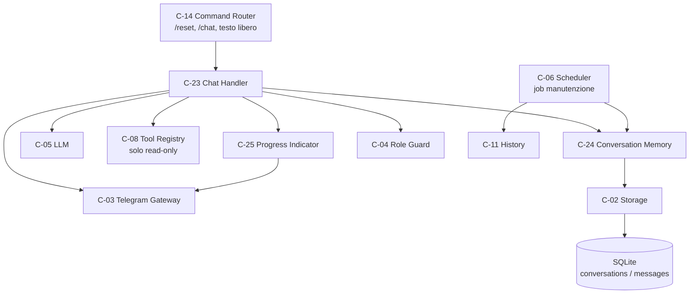
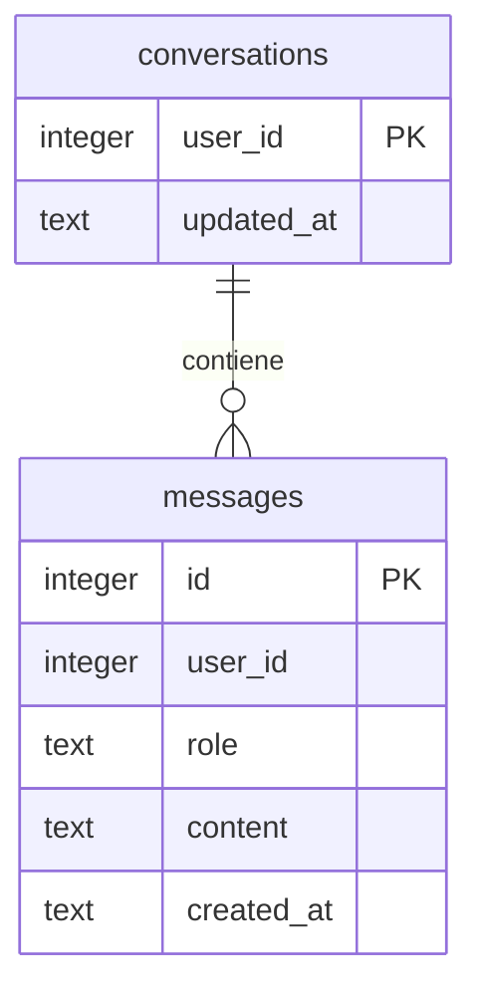
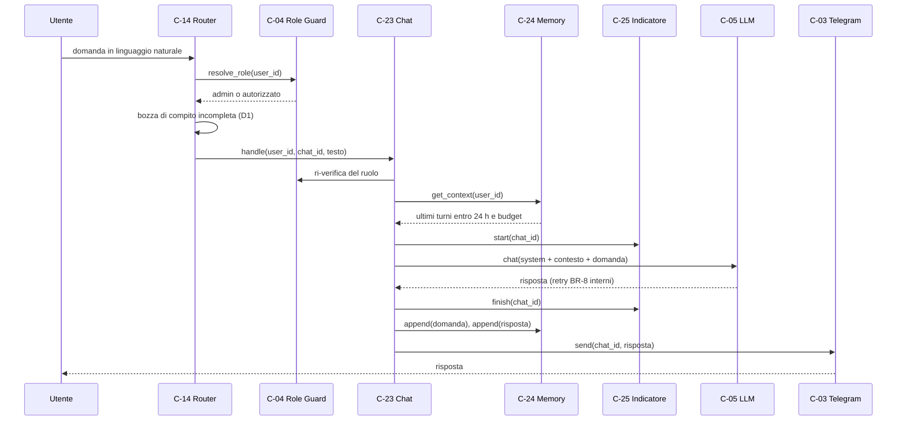
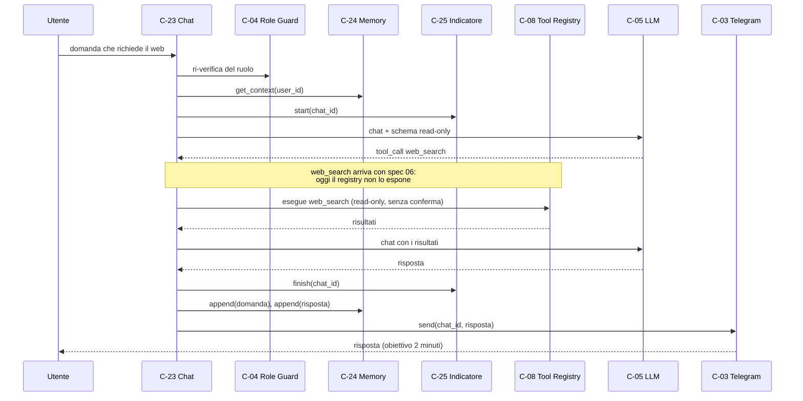
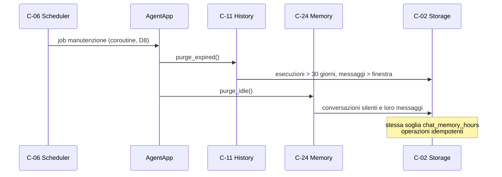
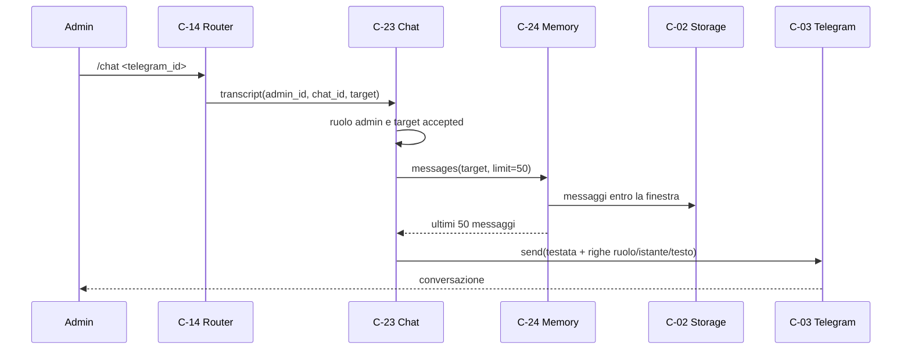

# Architettura 05 — FR-004 Domande libere (chat)

- **Spec:** [05-fr004-domande-libere.spec.md](../specs/05-fr004-domande-libere.spec.md)
- **Voce roadmap:** `05 — FR-004 Domande libere`
- **Piano:** [05-fr004-domande-libere.plan.md](../plan/05-fr004-domande-libere.plan.md)
- **Constitution:** [constitution.md](../specs/constitution.md)
- **Data:** 2026-10-24
- **Struttura dichiarata:** sezioni di spec 05 + blocco metadata, sezioni e stile dei documenti
  [02-fr001-gestione-compiti.md](02-fr001-gestione-compiti.md),
  [03-fr002-esecuzione-programmata.md](03-fr002-esecuzione-programmata.md) e
  [04-fr003-lancio-manuale.md](04-fr003-lancio-manuale.md).

> **Assunzione P-A-01:** nel progetto esistono `docs/templates/template.spec.md` e
> `template.constitution.md`, ma **nessun template per documenti di architettura**; la struttura è
> derivata dalla spec, dal piano e dai documenti 02–04.

## 1. Contesto e obiettivi

FR-004 richiede che l'amministratore e gli utenti autorizzati possano **fare domande qualsiasi** in
linguaggio naturale, al volo. L'agente risponde usando gli strumenti di sola lettura quando servono
(la ricerca web arriva con spec 06), ricorda la conversazione con quell'utente, la azzera dopo
**24 ore di silenzio** o con `/reset` (BR-6) e permette all'amministratore di **rileggere** le chat
degli utenti autorizzati (BR-12).

Tempi dichiarati (BR-17): risposta semplice entro **30 secondi**, con ricerca web fino a **2 minuti**
mostrando «sto cercando…». Per decisione D7 i due valori restano **limiti-obiettivo**: i retry BR-8
di C-05 (3 tentativi a 1 minuto) e quelli di C-03 sull'invio della risposta possono estenderli e non
vengono interrotti da un timeout complessivo in C-23.

Vincoli applicati: solo admin e utenti `accepted` usano la chat (BR-12); nessuna azione modificante
senza il gate C-27/C-28 (BR-2, spec 06); memoria a 24 ore (BR-6); contesto entro il budget token
(A-01, decisione #10); un solo processo e un solo file SQLite (Tech Stack).

Dipendenze consegnate: item 01 (C-02 con `conversations`/`messages`, C-03, C-04, C-05, C-06, C-08,
C-11, migrazioni 001–003), item 02 (C-14, forme NL, C-17), item 04 (precedenza di `/run` e
«lancia» sul ramo di creazione). Dipendenze non consegnate: item 06 (`web_search`), item 07
(allowlist dei log), item 08 (utenti e privacy).

## 2. Componenti

Tre componenti nuovi, tutti in-process; nessun servizio separato (principio 7).

### C-23 — Chat Handler

- **Responsabilità:** ricevere una domanda già riconosciuta da C-14, costruire il contesto con C-24,
  interrogare C-05 (con tool loop read-only su C-08), mostrare l'indicatore C-25 durante l'attesa,
  registrare i turni e inviare la risposta; gestire `/reset` e la rilettura admin.
- **Interfaccia pubblica:**
  - `handle(user_id, chat_id, text) -> ChatReply` (asincrona, V-01);
  - `reset(user_id, chat_id) -> ChatReply`;
  - `transcript(requester_id, chat_id, target_id) -> ChatReply`;
  - `list_authorized(requester_id, chat_id) -> ChatReply`;
  - `ChatReply(kind, text)` con `kind` in `answered`, `reset`, `transcript`, `rejected`, `error`,
    `ignored`.
- **Input:** messaggio utente e `chat_id` da C-14; ruolo risolto da C-04. **Output:** `ChatReply`;
  la risposta testuale è inviata **solo** da C-23 tramite C-03 (V-01).
- **Dipendenze:** C-04 (ruolo), C-24 (contesto e memoria), C-05 (risposta), C-08 (strumenti), C-25
  (indicatore), C-03 (invio). C-02 è letto per lo stato dell'utente nella rilettura admin; la spec lo
  raggiunge tramite C-24, qui serve anche per verificare che il bersaglio sia ancora `accepted`.
- **Error handling:** `LLMError` (dopo i retry di C-05) → messaggio «Non riesco a rispondere in questo
  momento: riprova tra poco.», nessun turno in memoria (P-A-15); `TelegramError` in uscita → log,
  la risposta non viene duplicata; tool sconosciuto o modificante → esito di tool al modello, mai
  esecuzione (P-A-08); superati 3 cicli di tool → `LLMError` interno e messaggio di errore generico
  all'utente (P-A-17).
- **Limiti del tool loop:** gli output degli strumenti sono troncati a 20.000 caratteri, come in C-09.
- **Osservabilità:** log `risposta chat inviata` con `user_id`, `duration_ms`, `chars`; log del
  fallimento con il tipo di errore; log `chat riletta dall'admin` con numero di messaggi.
- **Sicurezza:** ruolo da C-04 a ogni richiesta; `unknown`/`revocato` non arrivano a C-23; solo gli
  strumenti `read_only` sono esposti (BR-2); nessun segreto nei log.

### C-24 — Conversation Memory

- **Responsabilità:** persistere i messaggi per utente; fornire il contesto entro la finestra di
  24 ore e il budget; azzerare la memoria con `/reset`; eliminare le conversazioni inattive.
- **Interfaccia pubblica:** `get_context(user_id) -> list[Message]`, `append(user_id, message)`,
  `reset(user_id) -> int`, `purge_idle() -> PurgeStats`, `messages(user_id, limit=50) -> list[Message]`
  (V-02).
- **Input/Output:** messaggi (`user_id`, `role`, `content`, `created_at`).
- **Dipendenze:** C-02 (SQLite). Il budget viene da `deepseek.max_context_tokens` (C-01) e usa la
  stessa stima di C-05 (~4 caratteri/token); C-05 resta la rete di sicurezza globale (§3). La spec
  dichiara C-05 come dipendenza per il budget: la lettura da configurazione è la deviazione V-13.
- **Error handling:** contesto oltre budget → taglio dei turni più vecchi, almeno l'ultimo (A-01);
  `updated_at` assente o illeggibile → conversazione considerata silente, contesto vuoto; ruolo non
  ammesso o messaggio vuoto → `ValueError`.
- **Osservabilità:** log `turno registrato`, `conversazione azzerata`, `conversazioni inattive rimosse`
  con i conteggi.
- **Sicurezza:** le chat sono leggibili dall'admin (BR-12); nessuna copia esterna; il reset cancella
  tutto per quell'utente e non tocca compiti, iscrizioni o esecuzioni (P-A-10).

### C-25 — Progress Indicator

- **Responsabilità:** inviare «sto cercando…» quando l'elaborazione supera la soglia breve e
  rimuovere il messaggio alla risposta.
- **Interfaccia pubblica:** `start(chat_id)`, `finish(chat_id)` (asincrone, V-03).
- **Dipendenze:** C-03 (invio e cancellazione). **Error handling:** invio o cancellazione falliti →
  log, nessuna propagazione. La cancellazione parte in background: i retry BR-8 di C-03 possono
durare fino a due minuti e non devono ritardare la risposta (P-A-12). Se C-03 non restituisce l'id
del messaggio, l'indicatore resta senza possibilità di rimozione e il fatto è loggato.
- **Osservabilità:** log `indicatore inviato`; `indicatore non inviato`, `indicatore non rimosso`,
  `indicatore senza id` con `chat_id`.
- **Sicurezza:** nessun dato dell'utente nel testo dell'indicatore.

### Estensioni di componenti esistenti

- **C-14 Command Router:** riconosce `/reset` (→ C-23) e `/chat <telegram_id>` (admin); per il testo
  libero applica D1 — bozza di compito completa → flusso di creazione di spec 02, altrimenti C-23.
  Per l'utente autorizzato una bozza completa resta un tentativo di creazione e riceve il rifiuto di
  spec 02 AC-03 (P-A-19). C-14 non invia mai la risposta della chat; l'aiuto elenca `/reset` e `/chat`.
- **C-03 Telegram Gateway:** `send(...) -> int | None` restituisce l'id dell'ultimo messaggio inviato
  (V-04) e nasce `delete_message(chat_id, message_id)` con retry BR-8 e classificazione degli errori.
- **C-02 Storage:** `ConversationRepository` acquisisce `messages_for_user(user_id, since, limit)`,
  `delete_all_for_user(user_id)`, `delete_idle(cutoff)`; nessuna nuova tabella.
- **C-06 Scheduler:** il job di manutenzione diventa una coroutine eseguita nell'event loop e attende
  il callback se è una coroutine (V-10).
- **C-11 History:** mantiene la retention dei messaggi per età (spec 01); la semantica della
  conversazione (silenzio, reset, purge) passa a C-24. Il job chiama entrambe le operazioni (§3).

### Componenti riusati

| Componente | Ruolo in questa voce |
|---|---|
| C-02 Storage | conversazioni, messaggi, utenti; migrazione 004 |
| C-03 Telegram | ricezione domande, invio risposte, indicatore, cancellazione |
| C-04 Role Guard | admin / autorizzato / sconosciuto a ogni richiesta |
| C-05 LLM Client | risposta NL, retry BR-8, troncamento globale |
| C-06 Scheduler | job giornaliero di manutenzione |
| C-08 Tool Registry | strumenti read-only esposti alla chat |
| C-10 Notification | **non usato dalla chat**: la spec elenca C-03 come dipendenza di C-23 e la risposta non è una notifica a destinatari; C-10 resta per risultati dei compiti, avvisi e conferme |
| C-11 History | retention esecuzioni e messaggi per età |
| C-14 Command Router | parsing di comandi e NL, precedenza della creazione |

### Componenti non ancora disponibili

- **`web_search` (spec 06):** consegnato dalla voce 06 (vedi aggiornamento in coda).
- **Allowlist per la chat (spec 07):** il contesto dei tool ha `log_allowlist` vuota; `read_logs` è
  sempre rifiutato da C-07. Scelta confermata da spec 07 (D6/V-06): nessuna autorizzazione per la
  chat, nemmeno per l'admin.

## 3. Riparto di responsabilità

| Componente | Possiede | Delega | Perché non è duplicazione |
|---|---|---|---|
| C-23 | contesto, prompt, tool loop, `/reset`, errori, **invio della risposta** | C-24, C-05, C-08, C-25, C-03 | C-14 sceglie il ramo e non invia; C-23 non gestisce compiti né iscrizioni |
| C-24 | finestra (silenzio + età messaggio), troncamento della conversazione, reset, purge | C-02 | C-11 conserva la retention dei messaggi per età; C-24 possiede la semantica della conversazione |
| C-25 | soglia, invio e cancellazione dell'indicatore | C-03 | C-23 non conosce soglie né id dei messaggi |
| C-14 | parsing di `/reset`, `/chat` e testo libero; precedenza della creazione (D1) | C-23, C-15/C-16/C-17, C-21 | il router non costruisce contesto e non chiama il LLM per la chat |
| C-03 | invio, id del messaggio, cancellazione | Telegram Bot API | C-25 non importa la libreria Telegram |
| C-06 | esecuzione giornaliera del job | C-11, C-24 | un solo job, due operazioni idempotenti |

**Retention dei messaggi — due criteri, una soglia.** C-11 elimina per `created_at` i messaggi più
vecchi della finestra; C-24 applica la stessa finestra al contesto e cancella per `updated_at` le
conversazioni silenti con i loro messaggi. Un messaggio fuori finestra non entra mai nel contesto e
una conversazione senza turni recenti è inattiva: i due criteri non divergono.

**Troncamento — due punti, responsabilità diverse.** C-24 limita la **conversazione** al budget;
C-05 limita la **richiesta al modello** (prompt di sistema e tool schema inclusi). Se il budget non
basta nemmeno per il prompt, è C-05 a tagliare per ultimo (P-A-06).

**`/reset` rispetto a `HistoryService.reset_conversation`.** Il metodo di C-11 cancella i messaggi
più vecchi della finestra, non l'intera conversazione: non è AC-03. C-24 implementa il reset totale
ed è l'unico punto usato da `/reset`; il metodo di C-11 resta per compatibilità con spec 01.

## 4. Modello di dominio

- **Conversazione:** una per `user_id`, con `updated_at` pari all'ultimo turno **dell'utente**
  (P-A-05). L'admin ha una conversazione pur non essendo un record `users`.
- **Messaggio:** `role` (`user`/`assistant`/`tool`), `content`, `created_at`; in memoria si
  registrano solo `user` e `assistant`, il ruolo `tool` resta nel dialogo interno con il modello.
- **Finestra di memoria:** 24 ore (`limits.chat_memory_hours`), applicata sia al silenzio della
  conversazione sia all'età dei singoli messaggi (V-09).
- **Turno registrato:** coppia domanda/risposta aggiunta solo dopo una risposta riuscita (P-A-15).

## 5. Modello dati

Nessuna tabella nuova. La migrazione 004 ricostruisce `conversations` e `messages` **senza FK verso
`users`** (V-06): l'admin non è un record `users` (spec 01) ma deve poter conversare. Dati, id,
`sqlite_sequence` e l'indice `idx_messages_user_created` sono preservati (P-A-11).

`user_id` non ha più un vincolo verso `users`: può essere l'id dell'admin (da configurazione) o di un
utente `accepted`. Gli utenti non vengono mai cancellati, solo revocati, quindi la perdita di
`ON DELETE CASCADE` non ha effetti pratici. L'indice `(user_id, created_at)` copre contesto, purge e
rilettura admin.

## 6. Flussi di dati

### 6.1 Domanda semplice (flusso 1)

Sotto la soglia di `limits.chat_progress_s` C-25 non invia nulla; oltre, invia «sto cercando…» e lo
elimina al `finish`. Non esiste un timeout rigido (D7/V-08): la latenza di BR-17 è un obiettivo e i
retry di C-05 possono superarla, con l'indicatore a coprire l'attesa.

### 6.2 Domanda con ricerca web (flusso 2 — dichiarato da spec 06, non consegnato)

Il tool loop è implementato e coperto dai test con uno strumento read-only finto; la ricerca web
reale è il gap dichiarato di AC-06 (D6).

### 6.3 Reset per silenzio (flusso 3)

### 6.4 Rilettura admin (flusso 4)

`/chat` senza argomento elenca gli utenti `accepted` con il loro id (P-A-03/P-A-04). Dopo `/reset` o
dopo 24 ore di silenzio non c'è nulla da mostrare (P-A-09).

## 7. Concorrenza e serializzazione

Questa sezione descrive solo il «come»; proprietà e requisiti sono in §3 e §10.

- **Un task per update.** C-03 crea un task per ogni messaggio: due messaggi ravvicinati dello stesso
  utente arriverebbero in parallelo. C-23 serializza le **domande** con un `asyncio.Lock` per
  `user_id` (P-A-16): gli scambi restano ordinati (domanda, risposta, domanda, risposta). Utenti
  diversi procedono in parallelo.
- **`/reset` durante una risposta.** `reset` non attende il lock della domanda: incrementa la
  generazione della conversazione e cancella subito. Una risposta in volo confronta la generazione
  prima di registrare i turni e, se è cambiata, non li scrive: la conversazione non «risorge» dopo
  il reset (AC-03). Il testo della risposta già in volo viene comunque inviato.
- **LLM non bloccante.** `llm.chat` è sincrona e include i retry BR-8: viene eseguita con
  `asyncio.to_thread`, come in C-09. Senza questo passaggio l'event loop si fermerebbe e la soglia di
  C-25 non scatterebbe.
- **Indicatore per chat.** Lo stato di C-25 è per `chat_id`; ogni `start` chiude l'indicatore
  precedente e apre una nuova generazione. `finish` annulla il timer se la soglia non è scattata,
  altrimenti elimina il messaggio della generazione corrente. Invio e cancellazione sono best effort.
- **Un solo processo.** Nessun lock distribuito: il Tech Stack dichiara un solo processo e un solo
  file SQLite; WAL e `timeout` di connessione restano quelli di C-02.

## 8. Integrazioni

| Integrazione | Direzione | Uso in questa voce |
|---|---|---|
| Telegram Bot API | ingresso/uscita | domande, risposte, indicatore, cancellazione, `/chat` |
| DeepSeek (API compatibile OpenAI) | uscita | risposta NL, tool calling read-only, retry BR-8 |
| SQLite | locale | conversazioni, messaggi, utenti; migrazione 004 |
| Web search | — | **non consegnata**: provider e `web_search` sono di spec 06 |

## 9. Sicurezza

- Solo admin e utenti `accepted` usano la chat (BR-12); il ruolo è risolto da C-04 a ogni richiesta,
  mai dedotto dal testo. Sconosciuti e revocati non arrivano a C-23.
- La rilettura è riservata all'admin; il bersaglio deve essere `accepted` (o l'admin stesso). Dopo
  `/reset` o oltre la finestra non ci sono messaggi da leggere.
- Gli strumenti esposti sono **solo read-only**; un tool modificante non viene eseguito e il modello
  riceve un rifiuto esplicito. Il gate C-27/C-28 resta l'unico punto di approvazione (spec 06).
- In chat `log_allowlist` è vuota: `read_logs` è sempre rifiutato da C-07; spec 07 (D6/V-06) ha
  confermato che la chat resta senza autorizzazione alla lettura dei log.
- I messaggi restano sul telefono (SQLite, permessi `600`); transitano da DeepSeek e Telegram secondo
  l'informativa privacy di spec 08. Nessun segreto nei log.

## 10. Requisiti non funzionali

| Requisito | Implementazione |
|---|---|
| Memoria 24 ore (BR-6) | finestra `limits.chat_memory_hours` su silenzio e età messaggio; `/reset` totale |
| Risposta ≤ 30 s, ≤ 2 min con web (BR-17) | limiti-obiettivo (D7/V-08): nessun abort, retry BR-8 attivi, C-25 durante l'attesa |
| Contesto entro budget (A-01, decisione #10) | C-24 tronca la conversazione a `deepseek.max_context_tokens`; C-05 taglia globalmente se serve |
| Indicatore (BR-17) | soglia `limits.chat_progress_s` (default 2 s), messaggio eliminato alla risposta |
| Rilettura admin (BR-12) | ultimi 50 messaggi entro la finestra, ordine cronologico |
| Osservabilità | log di risposta con latenza, reset, purge, rilettura, indicatore |
| Un solo processo / SQLite | nessun lock distribuito; job di manutenzione nell'event loop (D8) |
| Fuso e lingua (BR-14) | risposta nella lingua dell'utente; istanti UTC ISO come nella fondazione |

## 11. Rischi e assunzioni

Rischi residui: una domanda dell'admin può essere interpretata come bozza di compito completa (o
viceversa) — la creazione passa comunque da riepilogo e conferma, e una richiesta incompleta riceve
una risposta di chat (D1/P-A-19); ogni messaggio di un utente autorizzato costa un'estrazione di
bozza prima della chat; l'indicatore può restare orfano se la cancellazione fallisce o se C-03 non restituisce l'id (best
effort, P-A-12); i retry BR-8 di C-05 e di C-03 sull'invio possono superare i 30 s dichiarati (V-08)
e un `/reset` concorrente a una risposta viene gestito con la generazione della conversazione (§7); AC-06 non è verificabile senza
`web_search` (D6); la latenza reale non è misurabile in unit test (P-A-18); la migrazione 004 perde
`ON DELETE CASCADE` (nessun utente viene cancellato).

Assunzioni di piano: P-A-01…P-A-19 in [piano 05](../plan/05-fr004-domande-libere.plan.md). In
sintesi: struttura documentale derivata; prompt di sistema; testi dei messaggi; limite di 50 messaggi
nella rilettura; `/chat <telegram_id>`; silenzio misurato sull'ultimo messaggio utente; budget di
contesto; job di manutenzione unico; contratto dei tool in chat; rilettura limitata alla memoria;
reset totale; migrazione con dati; indicatore best effort; `/chat` distinto dagli altri comandi;
rilettura della propria chat da parte dell'admin; ordine append/invio; serializzazione per utente;
3 cicli di tool; latenza misurata sul dispositivo; bozza completa come tentativo di creazione anche
per l'utente autorizzato.

## 12. Domande aperte di spec 05

Le due domande della spec sono state chiuse dall'operatore il 2026-10-24 e sono vincolanti:

1. **Soglia di «sto cercando…».** 2 secondi, configurabile con `limits.chat_progress_s`; alla
   risposta il messaggio viene eliminato in background, senza ritardare l'invio (D5).
2. **Retention dei messaggi per la rilettura admin.** 24 ore, la stessa finestra della memoria:
   `/reset` cancella subito, oltre la finestra non c'è nulla da leggere (D4). **Spec 01 non è
   emendata nei valori**: la nota di continuità in spec 01 §Note di implementazione (2026-10-24)
   registra la migrazione 004, l'interfaccia C-03 e la correttezza del job di manutenzione.

I conflitti con altre fonti sono risolti da D1 (spec 02 D4: creazione solo NL), D2/V-06 (admin non
record `users`), D7/V-08 (BR-17 vs BR-8) e D6 (AC-06 vs spec 06).

## 13. Fuori scope

- `web_search`, provider di ricerca e gate C-27/C-28 (spec 06); AC-06 resta parzialmente validato.
- Allowlist dei log per la chat (spec 07): il contesto dei tool resta senza allowlist.
- Gestione utenti, revoca e consenso privacy (spec 08): C-23 legge lo stato, non lo modifica.
- Storico delle esecuzioni e query per ruolo (spec 09): `/chat` legge i messaggi.
- Avvisi e soglie (spec 10); riavvio, liveness e messaggio di ripartenza (spec 11).
- Retention dei messaggi oltre le 24 ore: esclusa da D4.
- Vista di deployment: la spec 05 non la dichiara; gap registrato.

## 14. Deviazioni dichiarate

| # | Deviazione | Fonte | Motivo |
|---|---|---|---|
| V-01 | `ChatHandler.handle(user_id, chat_id, text)` è asincrona e restituisce `ChatReply`; l'invio avviene dentro C-23 | spec 05 C-23 | servono `chat_id` e invio via C-03; C-14 riceve solo l'esito, un solo punto di invio |
| V-02 | C-24 espone anche `messages(user_id, limit=50)` | spec 05 C-24 | serve al flusso 4, che la spec attribuisce a C-24 senza interfaccia |
| V-03 | C-25 `start`/`finish` sono asincrone e ricevono `chat_id` | spec 05 C-25 | invio e cancellazione sono operazioni di rete |
| V-04 | C-03 `send` restituisce l'id e nasce `delete_message` | **spec 01 C-03** | senza id non si può rimuovere l'indicatore; nota in spec 01 e architettura 01 |
| V-05 | `/reset` è riconosciuto da C-14 e inoltrato a C-23 | spec 05 C-23 | C-14 è il punto unico di parsing; C-23 possiede l'operazione |
| V-06 | Migrazione 004: tabelle chat senza FK verso `users` | **spec 01 §Modello dati e `001_init.sql`** | l'admin non è un record `users` ma deve conversare |
| V-07 | Il testo libero va in chat se la bozza non è completa; per l'utente autorizzato una bozza completa è un tentativo di creazione e riceve il rifiuto | spec 02 D4 e AC-03 + spec 05 | concilia creazione solo NL e chat; un tentativo di creazione incompleto di un utente autorizzato diventa una domanda di chat (P-A-19) |
| V-08 | Nessun timeout rigido a 30 s / 2 min | spec 05 / constitution BR-17 | BR-17 e BR-8 sono incompatibili; retry attivi, nota interpretativa in constitution |
| V-09 | Contesto filtrato per età del messaggio e silenzio della conversazione | spec 05 C-24 | allinea «silenzio» alla retention dei messaggi di C-11 |
| V-10 | Job di manutenzione come coroutine nell'event loop | **spec 01 C-06** | il job sincrono girava in un thread del pool con SQLite non thread-safe |
| V-11 | Nuovo comando admin `/chat <telegram_id>` | spec 05 flusso 4 | la spec richiede la rilettura ma non il comando |
| V-12 | Nuova leva `limits.chat_progress_s` (default 2 s) | spec 05 C-25 | la soglia era una domanda aperta; D5 la fissa e la rende configurabile |
| V-13 | Il budget di contesto di C-24 viene da `deepseek.max_context_tokens` (C-01), non da una chiamata a C-05 | spec 05 C-24 | il valore esiste già in configurazione; C-05 resta la rete di sicurezza globale e la stima è la stessa |

## 15. Tracciabilità

| Requisito / criterio | Evidenza |
|---|---|
| AC-01 memoria fra due domande | `tests/test_chat_ac.py::test_ac01_second_question_uses_the_previous_turn`, `tests/test_chat.py::test_second_question_carries_the_previous_turn` |
| AC-02 silenzio di 24 ore | `tests/test_chat_ac.py::test_ac02_silence_resets_the_context`, `tests/test_chat_memory.py::test_silence_resets_the_context`, `::test_context_excludes_messages_older_than_the_window` |
| AC-03 `/reset` | `tests/test_chat_ac.py::test_ac03_reset_starts_from_scratch`, `tests/test_chat_memory.py::test_reset_deletes_every_message_of_the_user`, `tests/test_chat.py::test_reset_clears_the_conversation`, `::test_reset_during_an_answer_does_not_resurrect_the_memory` |
| AC-04 rilettura admin | `tests/test_chat_ac.py::test_ac04_admin_reads_an_authorized_user_chat`, `::test_ac04_authorized_user_cannot_read_chats`, `tests/test_chat.py::test_admin_reads_the_messages_of_an_authorized_user`, `::test_authorized_user_cannot_read_chats` |
| AC-05 risposta semplice (latenza: dispositivo, P-A-18) | `tests/test_chat_ac.py::test_ac05_simple_question_gets_an_answer_without_indicator`; assenza di un timeout **complessivo** in C-23 verificata per struttura (nessun `wait_for` in `chat.py`); C-05 mantiene il timeout HTTP per singolo tentativo |
| AC-06 indicatore; ricerca web gap spec 06 | `tests/test_chat_ac.py::test_ac06_slow_answer_shows_and_removes_the_indicator`, `tests/test_progress.py` |
| BR-2 nessuna azione modificante | `tests/test_chat.py::test_modifying_tool_is_never_executed` |
| BR-6 memoria e reset | `tests/test_chat_memory.py::test_purge_idle_removes_idle_conversations`, `::test_context_excludes_messages_older_than_the_window` |
| BR-8 retry | `tests/test_llm.py`, `tests/test_telegram_gateway.py` |
| BR-12 permessi e rilettura | `tests/test_chat_ac.py::test_ac04_authorized_user_cannot_read_chats`, `tests/test_command_router.py::test_revoked_user_is_ignored`, `tests/test_chat.py::test_unknown_user_is_ignored` |
| BR-14 lingua | `tests/test_chat.py::test_system_prompt_follows_user_language` |
| BR-17 latenza-obiettivo | `tests/test_chat_ac.py::test_ac05_simple_question_gets_an_answer_without_indicator`, `::test_ac06_slow_answer_shows_and_removes_the_indicator`; misura reale su dispositivo |
| Troncamento del contesto (A-01, V-09) | `tests/test_chat_memory.py::test_context_is_truncated_to_the_budget` |
| Migrazione 004 e memoria admin | `tests/test_storage.py::test_chat_tables_have_no_user_fk`, `::test_migration_004_preserves_ids_and_index`, `::test_migration_004_keeps_sqlite_sequence`, `tests/test_chat_memory.py::test_admin_can_have_a_conversation` |
| Concorrenza (P-A-16, §7) | `tests/test_chat.py::test_two_questions_of_the_same_user_are_serialized`, `::test_reset_during_an_answer_does_not_resurrect_the_memory`, `tests/test_progress.py::test_new_request_closes_the_previous_indicator`, `::test_finish_does_not_wait_for_a_slow_delete` |
| Precedenza creazione/chat (D1, P-A-19) | `tests/test_command_router.py::test_admin_incomplete_draft_falls_back_to_chat`, `::test_admin_complete_draft_still_creates_a_task`, `::test_authorized_user_incomplete_draft_goes_to_chat`, `tests/test_tasks_ac.py::test_ac03_authorized_user_is_refused_without_side_effects` |
| Manutenzione a runtime (D8) | `tests/test_scheduler.py::test_maintenance_job_runs_in_the_event_loop` (job nell'event loop, callback sincrono e coroutine) |
| Wiring dell'app (C-23/C-24/C-25 e manutenzione) | `tests/test_chat_ac.py::test_app_wiring_answers_a_chat_and_runs_maintenance` |
| Confini di integrazione | `tests/test_boundaries.py` |

## Aggiornamento 2026-10-25 (voce 06)

`web_search` è consegnato: AC-06 è chiuso e il test `tests/test_approval_ac.py::test_ac06_web_search_closes_the_gap`
copre indicatore, risultati e assenza di conferma. La chat espone anche gli strumenti modificanti: C-23
li invoca tramite C-27 e solo dopo approvazione dell'admin (V-10 della voce 06); il prompt di sistema è
stato aggiornato. La frase «solo strumenti read-only esposti» del §2/§9 valeva prima del gate.

## Aggiornamento 2026-10-29 (voce 07)

La nota lasciata aperta («finché spec 07 non definisce un'autorizzazione per la chat») è chiusa:
spec 07 ha scelto di non autorizzare la lettura dei log in chat. `ChatToolContext.log_allowlist`
resta vuota, `read_logs` produce un rifiuto e C-23 lo traduce in testo perché cattura già
`AgenteError`; `chat.py` non è stato modificato. Per i compiti la lettura passa da C-29/C-30 con
l'allowlist del compito, coda limitata e avviso all'admin sui percorsi rifiutati.
