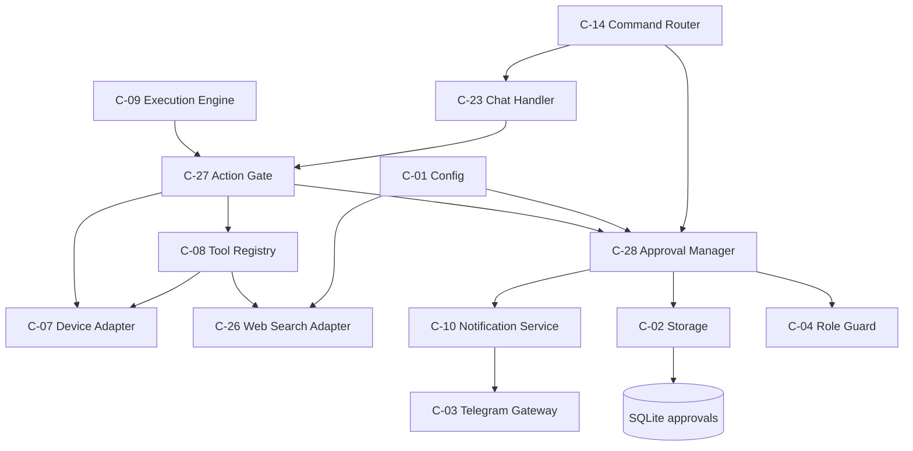
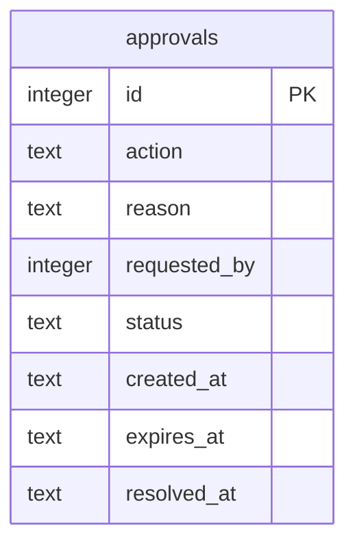
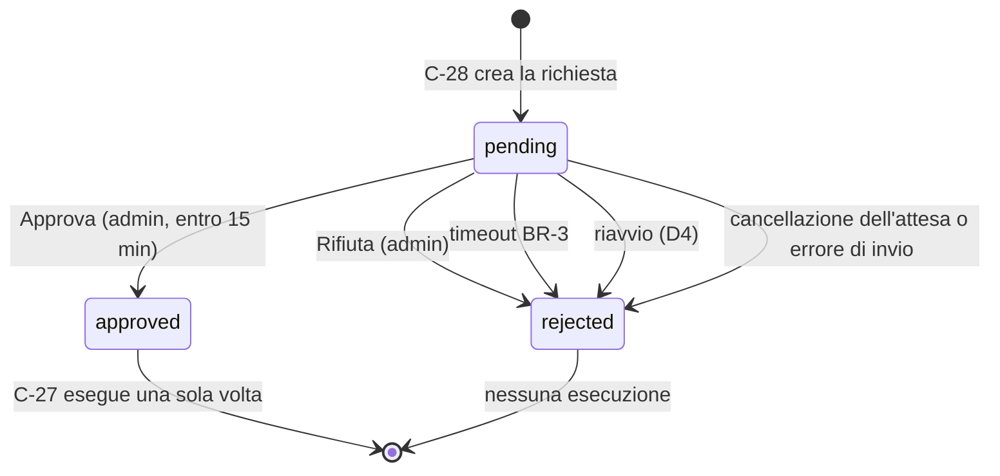
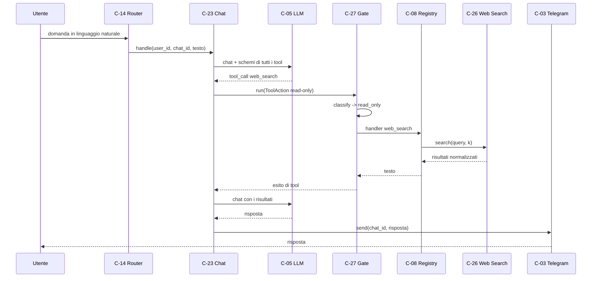
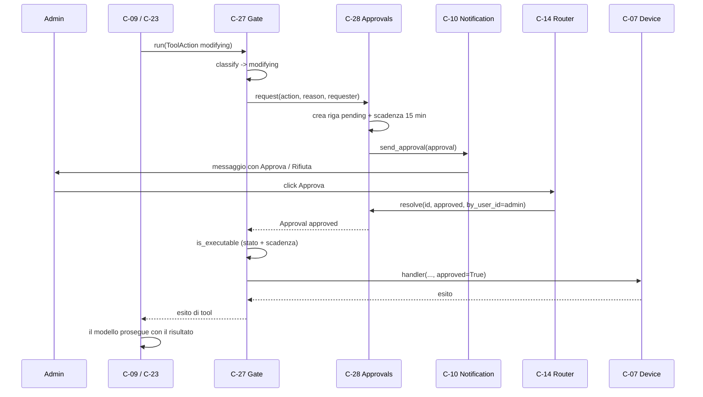
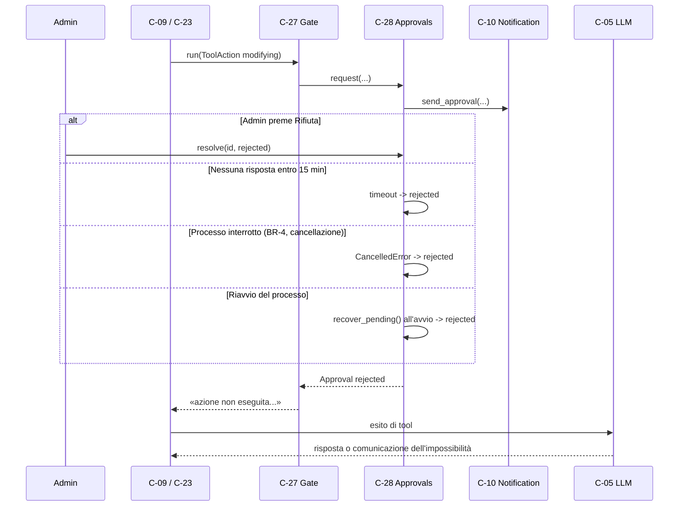
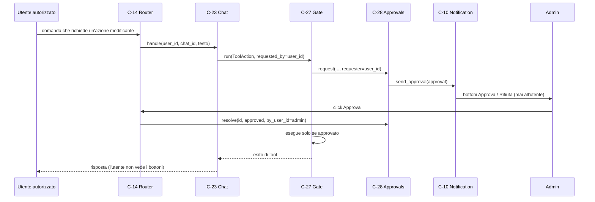

# Architettura 06 — FR-005 Ricerca web e conferma

- **Spec:** [06-fr005-ricerca-web-conferma.spec.md](../specs/06-fr005-ricerca-web-conferma.spec.md)
- **Voce roadmap:** `06 — FR-005 Ricerca web e conferma`
- **Piano:** [06-fr005-ricerca-web-conferma.plan.md](../plan/06-fr005-ricerca-web-conferma.plan.md)
- **Constitution:** [constitution.md](../specs/constitution.md)
- **Data:** 2026-10-25
- **Struttura dichiarata:** sezioni di spec 06 + blocco metadata, sezioni e stile dei documenti
  [03-fr002-esecuzione-programmata.md](03-fr002-esecuzione-programmata.md),
  [04-fr003-lancio-manuale.md](04-fr003-lancio-manuale.md) e
  [05-fr004-domande-libere.md](05-fr004-domande-libere.md).

> **Assunzione P-A-01:** nel progetto esistono `docs/templates/template.spec.md` e
> `template.constitution.md`, ma **nessun template per documenti di architettura**; la struttura è
> derivata dalla spec, dal piano e dai documenti 03–05.

## 1. Contesto e obiettivi

FR-005 richiede che l'agente usi gli strumenti necessari — in particolare la **ricerca web** —
garantendo che nessuna azione che modifica il telefono avvenga senza approvazione dell'amministratore.
Le azioni di sola lettura e la ricerca web sono eseguite senza conferma (A4, BR-2); per un'azione
modificante l'agente si ferma, invia all'admin cosa vuole fare e perché con i pulsanti **Approva /
Rifiuta**, e prosegue solo dopo l'approvazione. Una richiesta senza risposta entro **15 minuti** è
considerata rifiutata (BR-3). La conferma va **sempre e solo all'admin**, anche quando la richiesta
nasce da un utente autorizzato (A5).

Vincoli applicati: processo singolo e un solo file SQLite (Tech Stack); nessuna azione modificante
senza gate (principio 1); retry BR-8 su LLM, Telegram e provider di ricerca; timeout di esecuzione
BR-4 (10 minuti) che racchiude anche i tool; risposta chat ≤ 30 s / ≤ 2 min con ricerca web come
**obiettivo** (BR-17, nota interpretativa in constitution).

Dipendenze consegnate: item 01 (C-01 `search`, C-02 `approvals`, C-03 callback, C-04, C-07, C-08,
C-10 `request_approval`), item 03 (C-09 con tool loop e BR-4), item 05 (C-23 con tool loop e
`ChatToolContext`, C-25). Dipendenze non consegnate: item 07 (allowlist log), item 08 (utenti e
privacy), item 10 (avvisi).

## 2. Componenti

Tre componenti nuovi e in-process; nessun servizio separato (principio 7).

### C-26 — Web Search Adapter

- **Responsabilità:** eseguire ricerche web tramite un provider configurabile e normalizzare i
  risultati per il modello.
- **Interfaccia pubblica:** `search(query, k) -> list[Result]`, con
  `Result(title, url, snippet)` e `format_results(results) -> str`.
- **Input/Output:** query e numero di risultati; lista di titolo, URL ed estratto.
- **Dipendenze:** C-01 (`search.provider`, `search.api_key`), `httpx`, retry BR-8.
- **Error handling:** provider assente, non supportato o senza chiave → `SearchError` esplicito al
  momento dell'uso; rete/429/5xx → retry BR-8 e poi `SearchError`; 401/403 → `SearchError` senza
  retry; risposta malformata → `SearchError`; risposta valida senza risultati → lista vuota.
- **Osservabilità:** log `ricerca web completata` con provider, query, k, numero di risultati e
  latenza; `ricerca web non raggiungibile` con il tipo di errore; warning di indisponibilità alla
  costruzione. La chiave non compare mai.
- **Sicurezza:** read-only, nessuna conferma (BR-2/A4); chiave dal file dei segreti `600`.

### C-27 — Action Gate

- **Responsabilità:** classificare ogni azione come read-only o modificante; per le modificanti
  bloccare l'esecuzione finché non c'è approvazione; eseguire via C-08/C-07.
- **Interfaccia pubblica:** `classify(action) -> Gate`, `execute_if_allowed(action, approval)`,
  `run(action) -> str`; tipi `ToolAction(tool, arguments, context, reason, requested_by)` e
  `Gate(kind, tool)` con `kind` in `read_only`/`modifying`/`unknown`.
- **Input/Output:** azione proposta; esito del tool o rifiuto testuale.
- **Dipendenze:** C-08, C-28, C-07 (tramite l'handler).
- **Error handling:** `execute_if_allowed` solleva `GateError` se l'azione è modificante senza
  approvazione valida; `run` traduce lo stesso caso in un rifiuto testuale; approvazione scaduta →
  rifiuto (doppio controllo: `run` e `execute_if_allowed`); strumento sconosciuto → rifiuto senza
  richiesta di conferma (V-15); `SearchError` → esito di tool (V-12); gli altri errori di tool
  propagano. L'output è troncato a 20.000 caratteri, come in C-09/C-23.
- **Osservabilità:** log `gate: classificazione`, `gate: esecuzione approvata`, `gate: rifiuto` con
  tool e motivo.
- **Sicurezza:** nessuna azione modificante senza approvazione admin (BR-2); la conferma va solo
  all'admin (A5); il gate è l'unico punto di esecuzione quando è presente (P-A-15).

### C-28 — Approval Manager

- **Responsabilità:** creare la richiesta (azione + motivo + scadenza), inviarla all'admin tramite
  C-10, raccogliere la risposta, applicare il timeout di 15 minuti, scartare le richieste pendenti
  al riavvio.
- **Interfaccia pubblica:** `request(action, reason, requester) -> Approval` (asincrona, attende
  l'esito), `resolve(id, decision, by_user_id) -> bool`, `is_executable(approval) -> bool`,
  `recover_pending() -> int`.
- **Input/Output:** azione, motivo, richiedente; `Approval` con stato `approved`/`rejected`.
- **Dipendenze:** C-02 (`approvals`), C-10 (`create_approval`, `send_approval`), C-04 (ruolo admin).
- **Error handling:** nessuna risposta entro 15 min → `rejected` e azione non eseguita (BR-3);
  cancellazione dell'attesa → `rejected`; errore di invio → `rejected` e rilancio (in esecuzione
  l'esito è `errore`, in chat il modello riceve un testo); richiesta già risolta → `resolve` falso;
  richiesta scaduta → `rejected`; nessun waiter → rifiuto fail-safe.
- **Osservabilità:** log `approvazione risolta` con decisione, mittente e durata, `approvazione
  scaduta`, `approvazioni pendenti scartate all'avvio`. Il log di invio `richiesta di conferma inviata`
  è emesso da C-10.
- **Sicurezza:** il destinatario è **sempre** l'admin (A5); il richiedente autorizzato non riceve
  mai i pulsanti; solo l'admin può risolvere, con doppia verifica (C-14 e C-28).

### Estensioni di componenti esistenti

- **C-08 Tool Registry:** gli handler accettano `approved` keyword-only (default `False`); la
  registrazione rifiuta sia il modificante senza approvazione sia i metadati contraddittori
  (`read_only=True` + `requires_approval=True`). `default_registry(device, *, search=None)` registra
  `web_search` sempre, con schema `query` (stringa, obbligatoria) e `k` (intero, default 5, 1–10).
- **C-09 Execution Engine:** espone tutti gli strumenti al modello e invoca il gate; un rifiuto o un
  `SearchError` è un esito di tool e il loop prosegue (V-08/V-12); senza gate resta il fail-safe di
  item 03 (solo read-only).
- **C-23 Chat Handler:** come C-09, con `ChatToolContext`, `reason` = domanda dell'utente e
  `requested_by` = id utente; l'attesa dell'approvazione non viene avvolta in `to_thread`.
- **C-14 Command Router:** riconosce `approval:<id>:approve|reject` e lo inoltra a C-28; solo
  l'admin; messaggi «Azione approvata.», «Azione rifiutata.», «Richiesta non valida o scaduta.»,
  «Solo l'amministratore può approvare le azioni.».
- **C-10 Notification Service:** `send_approval(approval)` invia il messaggio con i bottoni;
  `create_approval(...)` persiste la riga con la scadenza ricevuta; `request_approval` resta come
  wrapper di compatibilità.
- **C-02 Storage:** `ApprovalRepository.reject_pending(resolved_at)` scarta tutte le richieste
  aperte; nessuna migrazione, la tabella esiste dalla 001.
- **C-01 Config:** `search.provider` ha default `tavily` nel loader; `provider = ""` esplicito resta
  vuoto e rende la ricerca non disponibile.

### Wiring di `AgentApp`

`AgentApp.build` costruisce una sola volta C-26 (`WebSearchAdapter`), C-28 (`ApprovalManager`) e
C-27 (`ActionGate`), registra `web_search` in `default_registry(device, search=...)` e passa lo
stesso gate a C-09 e C-23. `AgentApp.start()` chiama `approvals.recover_pending()` prima del polling
(D4); nessun altro punto costruisce o aggira il gate in produzione (P-A-15).

### Componenti riusati

| Componente | Ruolo in questa voce |
|---|---|
| C-01 Config | provider, chiave, timeout di approvazione, retry |
| C-02 Storage | tabella `approvals` |
| C-03 Telegram | invio della richiesta, callback dei bottoni |
| C-04 Role Guard | verifica che il mittente sia l'admin |
| C-05 LLM | tool calling e risposta finale |
| C-07 Device Adapter | esecuzione effettiva dell'azione approvata |
| C-08 Tool Registry | catalogo, metadati, handler, schemi |
| C-09 Execution Engine | esecuzione dei compiti |
| C-10 Notification | formato e invio della richiesta |
| C-23 Chat Handler | chat e rilettura |

### Componenti e capacità non disponibili

- **`install` (A4):** nessuno strumento di installazione è registrato in C-08; il gate coprirebbe un
  tool futuro purché marcato modificante. Gap registrato.
- **Allowlist dei log per la chat (spec 07):** `read_logs` resta rifiutato in chat.
- **Provider diversi da Tavily:** il registry è il punto di estensione; Brave, Google CSE e SerpAPI
  non sono implementati in questa voce.

## 3. Riparto di responsabilità

| Componente | Possiede | Delega | Perché non è duplicazione |
|---|---|---|---|
| C-26 | provider, HTTP, normalizzazione, retry, formattazione | C-01, `httpx` | C-08 registra il tool, non fa la ricerca |
| C-27 | classificazione, attesa, esecuzione condizionata, fail-safe | C-08, C-28, C-07 | C-09/C-23 non decidono i permessi |
| C-28 | ciclo di vita della richiesta, timeout, ruoli, scarto | C-10, C-02, C-04 | C-10 formatta e invia, C-28 decide |
| C-14 | parsing del callback e inoltro | C-28 | non cambia lo stato né esegue |
| C-08 | metadati e handler | C-26, C-07 | C-27 legge i metadati, non li duplica |
| C-09/C-23 | loop di tool calling e contesto | C-27 | nessun filtro locale con il gate |

**C-17 e C-28 restano separati.** C-17 conferma la creazione/modifica di un compito prima della
persistenza (BR-1); C-28 autorizza un'azione sul telefono (BR-2). Storage, chiavi dei bottoni
(`confirm:`/`approval:`) e destinatari sono diversi; la leva `limits.approval_timeout_s` è condivisa
(entrambi scadono a 15 minuti), ma la semantica cambia: C-17 riepiloga una modifica da salvare, C-28
autorizza un effetto sul telefono. Unificarli permetterebbe a una conferma di compito di sbloccare
un'azione device.

**C-28 non duplica C-10.** C-28 crea la riga, registra il waiter e chiede a C-10 di inviare; C-10
possiede il formato del messaggio e il destinatario. La riga esiste prima dell'invio, così una
cancellazione durante il send può essere marcata `rejected` (P-A-20).

**C-27 non duplica C-08.** Nessuna whitelist nel gate: i metadati di C-08 sono l'unica fonte. La
registrazione rifiuta i metadati contraddittori (D1/V-15).

## 4. Modello di dominio

- **Azione (`ToolAction`):** operazione richiesta dal modello, con nome del tool, argomenti,
  contesto (compito o chat), motivo e richiedente. La classificazione è `read_only` o `modifying`;
  uno strumento sconosciuto è `unknown`.
- **RichiestaConferma (`Approval`):** `id`, `action`, `reason`, `requested_by`, `status`, `scadenza`,
  `created_at`, `resolved_at`. Stati: `pending` → `approved` | `rejected` (BR-15).
- **Approvazione valida:** stato `approved` e `now < expires_at`; una richiesta scaduta non è
  eseguibile anche se il bottone è stato premuto in ritardo.
- **Richiedente:** l'utente in chat, il creatore del compito in esecuzione programmata, il richiedente
  in lancio manuale. Il destinatario dei bottoni è sempre l'admin.

## 5. Modello dati

Nessuna tabella nuova. `approvals` (spec 01, migrazione 001) contiene già tutti i campi:
`id`, `action`, `reason`, `requested_by`, `status` (`pending`/`approved`/`rejected`), `created_at`,
`expires_at`, `resolved_at`. `reject_pending` è una query, non un cambio di schema.

`requested_by` non è una FK: l'admin non è un record `users` (spec 01, decisione #7) e una richiesta
può nascere da un compito. Il vincolo di stato è quello dichiarato dalla fondazione.

## 6. Macchina a stati dell'approvazione

Solo una transizione lascia lo stato `pending`; una seconda risoluzione trova la riga non più
`pending` e restituisce `False`. Il timeout è applicato due volte: da C-28 sull'attesa e da C-27 sulla
scadenza prima dell'esecuzione (P-A-07). Lo schema non ha uno stato `executed`: la riga resta
`approved` e l'idempotenza deriva dal waiter unico e dal fatto che `run` esegue una sola volta dopo
l'attesa.

## 7. Flussi di dati

### 7.1 Azione read-only o ricerca web (flusso 1)

Nessuna richiesta di conferma viene creata e nessun bottone viene inviato (AC-03). C-25 mostra
«sto cercando…» se l'attesa supera `limits.chat_progress_s` e lo elimina alla risposta (AC-06 di
spec 05).

### 7.2 Azione modificante approvata (flusso 2)

L'handler gira in `asyncio.to_thread`; l'attesa dell'approvazione resta nell'event loop. Se il
processo è in esecuzione, BR-4 può interrompere l'attesa al decimo minuto: la richiesta diventa
`rejected` e nessuna azione nuova parte (V-05, P-A-19).

### 7.3 Rifiuto o timeout (flusso 2, ramo negativo)

L'azione non viene mai eseguita e l'agente prosegue: in esecuzione il compito può comunque produrre
un risultato; in chat l'utente riceve la risposta del modello (V-08/P-A-11). Se invece l'invio dei
bottoni fallisce, C-28 marca `rejected` e rilancia: in esecuzione l'esito è `errore` (con avviso
admin), in chat il modello riceve un testo di errore; non si arriva al ramo «Approval rejected».

### 7.4 Richiesta nata da un utente autorizzato (flusso 3, A5)

Il richiedente autorizzato non riceve mai i pulsanti (A5); un suo click su un bottone ricevuto per
errore viene rifiutato da C-14 e da C-28.

## 8. Concorrenza e ciclo di vita

Questa sezione descrive il «come»; proprietà e requisiti sono in §3 e §11.

- **Un waiter per richiesta.** C-28 registra il waiter dopo aver creato la riga e prima di inviare i
  bottoni. Un timeout o una cancellazione marcano `rejected`; un errore di invio marca `rejected` e
  rilancia.
- **Risoluzione unica.** `resolve` accetta solo righe `pending` e non scadute; una seconda
  risoluzione restituisce `False`. L'azione è eseguita al massimo una volta, dopo un solo `approved`.
- **Nessun waiter, nessuna esecuzione.** Se il processo è cambiato (riavvio) la riga viene scartata
  all'avvio; un `resolve` senza waiter rifiuta invece di autorizzare.
- **Riavvio.** `AgentApp.start()` chiama `recover_pending()` prima del polling: tutte le righe
  `pending` diventano `rejected` (D4). Un bottone vecchio riceve «non valida o scaduta».
- **BR-4.** Il timeout di esecuzione interrompe l'attesa e cancella la richiesta; un handler già
  partito in `asyncio.to_thread` non viene ucciso e può completare mentre l'esecuzione è registrata
  `interrotto` (P-A-19). È un limite dichiarato, non un percorso di autorizzazione.
- **Chat.** Il lock per `user_id` di C-23 resta attivo durante l'attesa (P-A-17); i messaggi di altri
  utenti non sono bloccati. L'indicatore C-25 resta visibile.
- **Invio parziale.** Se l'invio dei bottoni fallisce dopo aver consegnato parte dei messaggi, la
  richiesta è `rejected` e il messaggio parziale resta best effort (P-A-20).
- **Un solo processo.** Nessun lock distribuito: il Tech Stack dichiara un solo processo e un solo
  file SQLite.

## 9. Integrazioni

| Integrazione | Direzione | Uso in questa voce |
|---|---|---|
| Telegram Bot API | ingresso/uscita | richiesta con bottoni, callback, risposta |
| DeepSeek (API compatibile OpenAI) | uscita | tool calling read-only e modificante, risposta |
| Web search provider (Tavily) | uscita | ricerca read-only, HTTPS |
| Termux:API / filesystem | locale | azione approvata via C-07 |
| SQLite | locale | `approvals` |

Contratti: Telegram solo C-03, DeepSeek solo C-05, provider di ricerca solo C-26, SQLite solo C-02,
filesystem/comandi solo C-07. `httpx` è usato solo da C-05 e C-26.

## 10. Sicurezza

- Nessuna azione modificante senza approvazione admin (BR-2): C-27 è l'unico punto di esecuzione
  quando è presente; C-09/C-23 non chiamano gli handler modificanti direttamente.
- Approvazione sempre e solo all'admin (A5): C-10 invia all'id di configurazione; C-14 e C-28
  verificano il ruolo del mittente.
- Timeout 15 minuti = rifiuto (BR-3); la scadenza è verificata anche prima dell'esecuzione.
- Ricerca web read-only, nessuna conferma (BR-2/A4); la chiave del provider non compare nei log.
- Riavvio: nessuna richiesta pendente sopravvive (D4); nessuna azione è autorizzata da un click su un
  messaggio vecchio.
- Fail-safe: strumento sconosciuto o metadati contraddittori non eseguono nulla (V-15).
- I messaggi e le richieste restano sul telefono (SQLite `600`); transitano da DeepSeek e Telegram
  secondo l'informativa privacy di spec 08.

## 11. Requisiti non funzionali

| Requisito | Implementazione |
|---|---|
| Timeout approvazione 15 min (BR-3) | `limits.approval_timeout_s = 900`; C-28 attende fino a `expires_at` |
| Retry provider/LLM 3×1 min (BR-8) | `retry_call` in C-26; C-05 e C-03 invariati |
| Esecuzione ≤ 10 min (BR-4) | C-09; l'attesa di approvazione è dentro il timeout (V-05) |
| Chat ≤ 30 s / ≤ 2 min (BR-17) | obiettivo, non timeout rigido; approvazione e retry della ricerca possono estenderlo (V-14) |
| Ricerca read-only senza conferma (A4) | C-08 `read_only`, C-27 esegue senza C-28 |
| Osservabilità | log di ricerca, classificazione, richiesta, risoluzione, timeout, scarto |
| Un solo processo / SQLite | nessun lock distribuito; rilettura SQLite nell'event loop |
| Segreti | chiave in `secrets.env` `600`; mai nei log |

## 12. Rischi e assunzioni

Rischi residui: un handler approvato pochi istanti prima del timeout BR-4 può completare dopo
l'interruzione (P-A-19); l'admin offline blocca le azioni modificanti (accettato da spec 06); un
provider non configurato degrada la ricerca ma non l'agente; un invio parziale dei bottoni resta
best effort (P-A-20); il lock di chat può attendere fino a 15 minuti per lo stesso utente (P-A-17);
un'azione install non è disponibile perché nessun tool è dichiarato; AC-02 è verificato con un
timeout breve nei test e con il valore 900 in configurazione, non con un'attesa reale di 15 minuti.

Assunzioni di piano: P-A-01…P-A-20 in [piano 06](../plan/06-fr005-ricerca-web-conferma.plan.md).
In sintesi: struttura documentale derivata; k=5 con clamp 1–10; formattazione dei risultati; testo di
azione e motivo; `requested_by`; solo bottoni; doppia verifica della scadenza; timeout HTTP 30 s;
query nei log e risultati non persistiti; attesa in chat; rifiuto come esito di tool; nessun job
periodico; nessuna migrazione; registry dei provider; gate obbligatorio in produzione; messaggi di
esito; lock per utente; risoluzione unica; limite del thread; invio best effort.

## 13. Domande aperte di spec 06

Le due domande della spec sono state chiuse dall'operatore il 2026-10-25:

1. **Criterio di classificazione.** Whitelist dai metadati di C-08 con fail-safe; nessuna euristica
   (D1/V-15). I metadati contraddittori sono rifiutati alla registrazione.
2. **Provider di ricerca di default.** Tavily (`provider = "tavily"`), con adapter pluggable (D2).
   La constitution §Tech Stack viene aggiornata in D-14 (pubblicazione); gli altri candidati restano
   estensioni future.

Il conflitto BR-3/BR-4 è risolto da D3/V-05 (vince BR-4 nelle esecuzioni); BR-17 resta un obiettivo
(V-14).

## 14. Fuori scope

- `install` e altri strumenti non dichiarati da C-08: il gate li coprirebbe se registrati come
  modificanti; **gap registrato**.
- Allowlist dei log per la chat (spec 07): `read_logs` resta rifiutato in chat.
- Gestione utenti, revoca e consenso privacy (spec 08): C-28 verifica solo il ruolo admin.
- Avvisi di batteria/offline/credenziali (spec 10).
- Provider Brave, Google CSE e SerpAPI: il registry è predisposto, nessun client implementato.
- UI di approvazione diversa dai bottoni; fallback testuale «sì»/«no» per le approvazioni.
- Vista di deployment: la spec 06 non la dichiara; gap registrato.

## 15. Deviazioni dichiarate

| # | Deviazione | Fonte | Motivo |
|---|---|---|---|
| V-01 | `request` di C-28 è asincrona e attende l'esito | spec 06 C-28 | il flusso 2 richiede l'attesa; la firma dichiarata non specifica il contesto |
| V-02 | C-27 espone `run` oltre a `classify`/`execute_if_allowed` | spec 06 C-27 | l'orchestrazione con C-28 non è contenuta nelle due interfacce dichiarate |
| V-03 | Handler C-08 con `approved` keyword-only | spec 01 C-08 / spec 03 C-09 | serve a eseguire via C-07 un'azione autorizzata; default `False` fail-safe |
| V-04 | `web_search` sempre registrato con errore esplicito se assente | spec 06 C-26 | evita la degradazione silenziosa (D5) |
| V-05 | Nelle esecuzioni l'attesa è dentro BR-4; timeout → `rejected` | spec 06 BR-3 / spec 03 BR-4 | BR-4 è un limite rigido sull'attesa e sull'avvio di nuove azioni |
| V-06 | Richieste `pending` scartate all'avvio | spec 06 C-28 | nessun waiter sopravvive al riavvio (D4) |
| V-07 | Default `tavily` nel loader; Tech Stack aggiornato in D-14 | spec 01 C-01 / constitution | D2 |
| V-08 | C-09 prosegue dopo un rifiuto | spec 03 D3 / architettura 03 | spec 06 flusso 2 |
| V-09 | C-14 gestisce i callback `approval:` | spec 06 §Integrazioni | i bottoni non avevano consumatore |
| V-10 | C-09 espone gli schemi modificanti | spec 03 solo read-only | il modello deve poter chiedere l'azione |
| V-11 | Provider assente/non supportato non blocca l'avvio | spec 06 C-26 | D5 |
| V-12 | `SearchError` è sempre un esito di tool; gli altri errori restano fatali in esecuzione | spec 03 C-09 / spec 05 C-23 | un provider assente non deve far fallire un compito |
| V-13 | `resolve` riceve `by_user_id` | spec 06 C-28 | A5: la verifica va nel manager |
| V-14 | Attesa 15 min in chat e retry della ricerca possono estendere BR-17 | spec 06 BR-3 / BR-17 | BR-17 resta obiettivo; C-25 copre l'attesa |
| V-15 | Strumento sconosciuto rifiutato; metadati contraddittori rifiutati | spec 01 C-08 / spec 06 A-02 / **constitution principio 1** | fail-safe più restrittivo della conferma; il conflitto con «in dubbio → conferma» è dichiarato, non interpretato |
| V-16 | C-28 espone `is_executable`/`recover_pending`; C-10 espone `send_approval` | spec 06 C-28 / spec 01 C-10 | validazione nell'event loop, scarto al riavvio, creazione separata dall'invio |

## 16. Tracciabilità

| Requisito / criterio | Evidenza |
|---|---|
| AC-01 azione modificante con conferma | `tests/test_approval_ac.py::test_ac01_file_is_not_touched_before_approval`, `::test_ac01_file_is_deleted_after_approval` |
| AC-02 timeout 15 min | `tests/test_approval_ac.py::test_ac02_unanswered_request_is_rejected`, `tests/test_approvals.py::test_timeout_marks_the_request_rejected`, `tests/test_execution.py::test_pending_approval_is_rejected_when_execution_times_out` |
| AC-03 ricerca web senza conferma | `tests/test_approval_ac.py::test_ac03_web_search_needs_no_confirmation`, `tests/test_gate.py::test_read_only_action_is_executed_without_approval` |
| AC-06 di spec 05 chiuso | `tests/test_approval_ac.py::test_ac06_web_search_closes_the_gap` |
| BR-2 nessuna azione modificante senza admin | `tests/test_gate.py::test_modifying_action_requires_an_approval`, `::test_modifying_action_without_approval_is_refused`, `::test_unknown_tool_is_never_executed`, `::test_modifying_handler_runs_only_after_approval`, `tests/test_approvals.py::test_only_the_admin_can_resolve` |
| BR-3 scadenza = rifiuto | `tests/test_approvals.py::test_timeout_marks_the_request_rejected`, `tests/test_gate.py::test_expired_approval_is_not_executable` |
| BR-8 retry provider | `tests/test_web_search.py::test_retryable_error_is_retried`, `::test_permanent_error_is_not_retried` |
| BR-17 latenza-obiettivo (V-14) | `tests/test_chat_ac.py::test_ac05_simple_question_gets_an_answer_without_indicator`, `tests/test_approval_ac.py::test_ac06_web_search_closes_the_gap`; misura reale su dispositivo |
| A4 lettura/ricerca senza conferma | `tests/test_gate.py::test_read_only_action_is_executed_without_approval`, `tests/test_web_search.py::test_search_returns_normalized_results` |
| A5 conferma solo all'admin | `tests/test_approvals.py::test_request_goes_to_the_admin_with_buttons`, `::test_only_the_admin_can_resolve`, `tests/test_command_router.py::test_non_admin_cannot_resolve_an_approval` |
| Provider configurabile (A-01) | `tests/test_web_search.py::test_unconfigured_provider_raises_an_explicit_error`, `::test_unsupported_provider_raises_an_explicit_error`, `::test_unavailable_provider_logs_a_warning`, `tests/test_config.py::test_search_provider_defaults_to_tavily`, `::test_explicit_empty_provider_is_kept` |
| Fail-safe (A-02, V-15) | `tests/test_gate.py::test_unknown_tool_is_never_executed`, `::test_modifying_action_without_approval_is_refused`, `tests/test_tools.py::test_contradictory_metadata_is_rejected` |
| Riavvio senza azioni pendenti | `tests/test_approvals.py::test_recover_pending_rejects_everything`, `tests/test_storage.py::test_reject_pending_updates_only_pending_rows`, `tests/test_bootstrap.py::test_start_rejects_pending_approvals` |
| Esecuzione: rifiuto non fatale (V-08) | `tests/test_execution.py::test_rejected_approval_lets_the_execution_continue` |
| Esecuzione: SearchError non fatale (V-12) | `tests/test_execution.py::test_search_error_is_a_tool_outcome` |
| Cancellazione e doppia risoluzione | `tests/test_approvals.py::test_cancelled_wait_marks_rejected`, `::test_cancelled_send_marks_rejected`, `::test_double_resolution_is_rejected` |
| Chat: ricerca web e conferma | `tests/test_chat.py::test_web_search_tool_is_exposed_and_executed`, `::test_modifying_tool_goes_through_the_gate` |
| C-14 callback | `tests/test_command_router.py::test_admin_resolves_an_approval`, `::test_unknown_approval_is_reported` |
| C-10 `send_approval` | `tests/test_notifications.py::test_send_approval_uses_the_existing_format` |
| Schema e stub di `web_search` | `tests/test_tools.py::test_default_registry_registers_web_search`, `::test_web_search_schema_is_declared`, `::test_web_search_without_adapter_raises_an_explicit_error` |
| Osservabilità C-26/C-27/C-28 | `tests/test_web_search.py::test_query_and_latency_are_logged`, `tests/test_gate.py::test_gate_logs_the_decision`, `tests/test_approvals.py::test_resolution_is_logged` |
| Nessun segreto nei log | `tests/test_web_search.py::test_api_key_is_never_logged` |
| Confini di integrazione | `tests/test_boundaries.py` |
