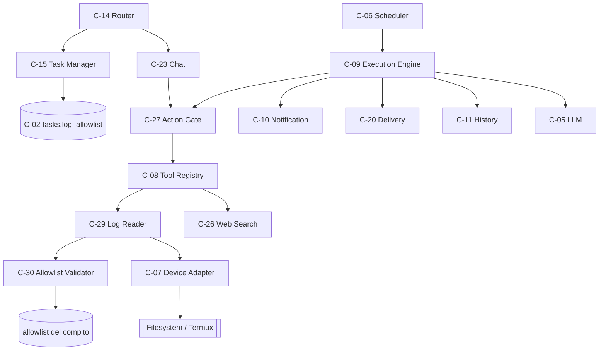
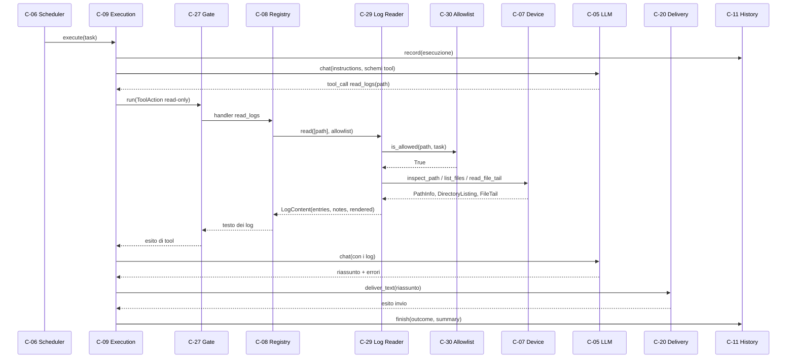
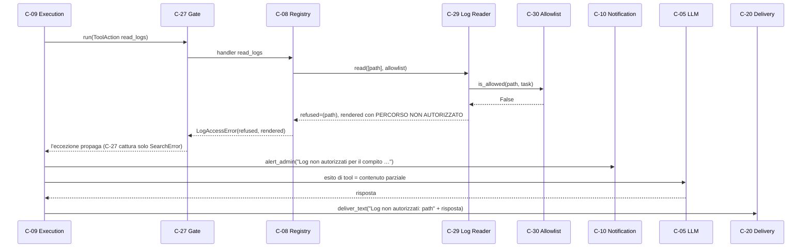
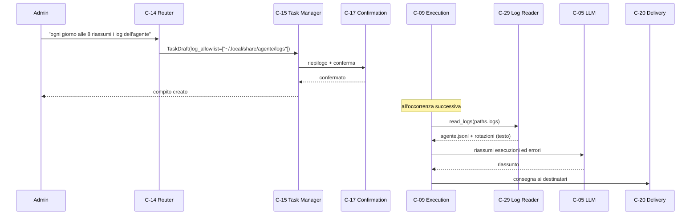

# Architettura 07 — FR-006 Lettura e riassunto dei log

- **Spec:** [07-fr006-riassunto-log.spec.md](../specs/07-fr006-riassunto-log.spec.md)
- **Voce roadmap:** `07 — FR-006 Lettura e riassunto log`
- **Piano:** [07-fr006-riassunto-log.plan.md](../plan/07-fr006-riassunto-log.plan.md)
- **Constitution:** [constitution.md](../specs/constitution.md)
- **Data:** 2026-10-29
- **Struttura dichiarata:** sezioni di spec 07 + blocco metadata, sezioni e stile dei documenti
  [03](../architecture/03-fr002-esecuzione-programmata.md),
  [04](../architecture/04-fr003-lancio-manuale.md),
  [05](../architecture/05-fr004-domande-libere.md) e
  [06](../architecture/06-fr005-ricerca-web-conferma.md).

> **Assunzione P-A-01:** in `docs/templates/` esistono solo `template.spec.md` e
> `template.constitution.md`, **nessun template per documenti di architettura**; la struttura è
> derivata dalla spec, dal piano e dai documenti 03–06.

## 1. Contesto e obiettivi

L'amministratore crea un compito (spec 02) che legge i log e ne produce un riassunto con l'elenco
degli errori. I log possono essere dell'agente stesso (`paths.logs/agente.jsonl` e rotazioni) o di
altri programmi eseguiti in Termux. L'agente legge **solo** i percorsi indicati dall'amministratore
alla creazione del compito (BR-13): un percorso non autorizzato non viene aperto, viene segnalato nel
risultato e l'amministratore riceve un avviso immediato.

Vincoli applicati: un solo processo e un solo file SQLite (Tech Stack); nessun accesso al filesystem
fuori da C-07; `read_logs` è read-only e non richiede conferma (BR-2/A4, spec 06); BR-4 (10 minuti)
racchiude lettura, riassunto e consegna; il riassunto è in italiano (BR-14). Nessuna nuova tabella e
nessuna migrazione: `tasks.log_allowlist` esiste dalla 001.

Dipendenze consegnate: item 01 (C-02, C-05, C-07, C-08, C-10, C-13), item 02 (C-15 con
`TaskDraft.log_allowlist`, C-14 che estrae i percorsi, C-17), item 03 (C-09 con tool loop e
consegna), item 05 (C-23 con `ChatToolContext` e cattura di `AgenteError`), item 06 (C-27 gate e
classificazione read-only). Dipendenze non consegnate: item 08 (utenti e privacy), item 09 (storico
strutturato), item 10 (avvisi di sistema).

## 2. Componenti

Due componenti nuovi e tre estensioni (C-07, C-08, C-09), tutti in-process.

### C-29 — Log Reader

- **Responsabilità:** leggere i percorsi consentiti, distinguere file/cartella/inesistente/vuoto/
  illeggibile, applicare i limiti e produrre il testo da riassumere con note esplicite.
- **Interfaccia pubblica:** `read(paths, allowlist) -> LogContent`; tipi `LogEntry(path, text, exists,
  size, truncated, note)` e `LogContent(entries, refused, notes, rendered)`.
- **Input/Output:** percorsi richiesti e allowlist del compito; file esaminati, rifiuti, note e testo
  reso.
- **Dipendenze:** C-07 (accesso fisico), C-30 (autorizzazione).
- **Error handling:** percorso non autorizzato → non letto, in `refused` e nel testo; file
  inesistente/vuoto → nota; file illeggibile o errore I/O → nota su un `LogEntry`; cartella vuota,
  sottocartelle e symlink ignorati → note; nessun percorso richiesto → contenuto vuoto con nota.
  Nessuna di queste condizioni solleva eccezioni.
- **Osservabilità:** log `log letto` (percorso, dimensione, caratteri, troncamento), `percorso log
  rifiutato`, `lettura log conclusa` (percorsi, voci, rifiuti).
- **Sicurezza:** nessuna lettura fuori dall'allowlist (BR-13); nessun parsing e nessuna esecuzione di
  contenuto.

### C-30 — Allowlist Validator

- **Responsabilità:** decidere se un percorso è autorizzato per un compito.
- **Interfaccia pubblica:** `is_allowed(path, task) -> bool`; helper `normalize_path`,
  `is_within`.
- **Input/Output:** percorso e contesto con `log_allowlist`; esito booleano.
- **Dipendenze:** il compito (o `ChatToolContext`) già caricato dal chiamante; nessun accesso SQL.
- **Error handling:** percorso vuoto, non assoluto, mancante o non risolvibile → non autorizzato;
  allowlist vuota → tutto non autorizzato; voci di allowlist non valide sono ignorate.
- **Osservabilità:** `validazione percorso log` con esito (`allowed`) e numero di radici per ogni
  percorso esaminato; `percorso log rifiutato` solo per percorso vuoto, non assoluto o non
  risolvibile (il rifiuto per allowlist è registrato dalla validazione con `allowed=False`).
- **Sicurezza:** normalizzazione `expanduser` + `resolve` prima del confronto, quindi `..` e symlink
  non aggirano l'allowlist; solo percorsi assoluti.

### Estensioni di componenti esistenti

- **C-07 Device Adapter:** `inspect_path` restituisce `PathInfo` (esiste, file, cartella, dimensione,
  leggibile) senza aprire il contenuto; `read_file_tail` legge gli ultimi `max_chars` caratteri con un
  budget di `4 × max_chars` byte e decodifica `utf-8` con `errors="replace"`; `list_files` elenca i
  soli file regolari, non ricorsivo, ignorando e contando symlink e sottocartelle. Tutti e tre
  applicano l'allowlist. `read_file` resta invariata.
- **C-08 Tool Registry:** `read_logs` passa da C-29, accetta un file o una cartella e ha schema
  `{"path": string}`; `default_registry(device, *, search=None, log_reader=None)` costruisce C-29 se
  non iniettato. Un percorso rifiutato solleva `LogAccessError` con il contenuto parziale.
- **C-09 Execution Engine:** `LogAccessError` è un esito di tool in entrambi i rami di
  `_invoke_tool` (con e senza gate); l'engine invia l'avviso `Log non autorizzati per il compito
  <nome>: <percorsi>`, restituisce il contenuto parziale al modello, accumula i percorsi rifiutati
  **per esecuzione** e antepone al testo consegnato la nota `Log non autorizzati: <percorsi>`.
  Tutti gli altri errori di tool restano fatali.
- **C-13 / C-02:** nessuna modifica. `paths.logs` è la **cartella** dei log applicativi
  (`agente.jsonl` e rotazioni, creata da C-13); `tasks.log_allowlist` è il dato letto da C-15 e
  inoltrato a C-09.

### Wiring di `AgentApp`

`AgentApp.build` e `app.py` **non cambiano**: C-29 è costruito dentro `default_registry`, che è già
chiamato dal wiring della voce 06; il gate C-27 resta l'unico punto di esecuzione e `read_logs` resta
read-only. Nessun nuovo job, nessuna nuova leva di configurazione.

### Componenti riusati

| Componente | Ruolo in questa voce |
|---|---|
| C-02 Storage | `tasks.log_allowlist`, `executions` |
| C-03 Telegram | consegna del riassunto e avviso di rifiuto |
| C-04 Role Guard | ruolo admin per creazione/modifica dei compiti |
| C-05 LLM | riassunto ed estrazione degli errori |
| C-06 Scheduler | occorrenza del compito log |
| C-08 Tool Registry | registrazione di `read_logs` |
| C-09 Execution Engine | tool loop, BR-4, esito e nota di rifiuto |
| C-10 Notification | avviso all'admin |
| C-11 History | registrazione dell'esito |
| C-14/C-15/C-17 | creazione del compito con allowlist e conferma |
| C-20 Delivery | destinatari del risultato |
| C-23 Chat | invariata: allowlist vuota, rifiuto |
| C-25 Progress | indicatore in chat |
| C-27 Action Gate | classificazione read-only |

### Componenti e capacità non disponibili

- **Lettura log in chat (D6):** `ChatToolContext.log_allowlist` è vuota; `read_logs` resta rifiutato
  e il modello lo comunica. Nessuna deroga per l'admin.
- **Storico esecuzioni strutturato (item 09):** AC-03 si soddisfa con il file C-13; la tabella
  `executions` non è esposta come strumento.
- **Parsing dei log (D3):** nessun formato preferito, nessuna estrazione regex.
- **Ricorsione (D2):** le sottocartelle non sono aperte; sono contate.

## 3. Riparto di responsabilità

| Componente | Possiede | Delega | Perché non è duplicazione |
|---|---|---|---|
| C-30 | policy per compito, normalizzazione, contenimento | nessuno | C-07 non conosce compiti né allowlist per compito |
| C-29 | classificazione degli esiti, limiti, note, rendering | C-07, C-30 | C-07 non conosce «log» né limiti; C-08 registra, non legge |
| C-07 | metadati, coda, elenco; ultima barriera di allowlist | sistema operativo | C-29 non apre file né enumera cartelle |
| C-08 | schema, metadati read-only, costruzione di C-29 | C-29 | C-08 non applica policy di percorso |
| C-09 | esito del compito, avviso, nota nel risultato, prosecuzione | C-10, C-27 | C-29 non invia notifiche |
| C-27 | classificazione read-only, tetto dell'output riuscito | C-08 | C-29 allinea il proprio tetto con un test, non con un import |

**Due controlli, due domande.** C-30 risponde a «questo compito può leggere questo percorso?»; C-07
risponde a «l'adapter può consegnare questo file?». Entrambi normalizzano prima di confrontare. Un
`GateError` dell'adapter su `inspect_path` di primo livello diventa un rifiuto registrato (nota
`rifiutato dall'adapter`); lo stesso errore da `read_file_tail`, da `list_files` o dall'ispezione di
un file dentro una cartella diventa una nota `illeggibile`, senza voce in `refused`: il compito
prosegue in entrambi i casi.

**C-29 non duplica C-09.** C-29 produce contenuto e note; C-09 decide esito, testo consegnato e
avviso. `LogAccessError` esiste solo per trasportare i rifiuti e il contenuto parziale da C-08 a C-09.

## 4. Modello di dominio

- **Compito log:** compito con `log_allowlist` non vuota; l'allowlist è la scelta esplicita
  dell'amministratore alla creazione (BR-13, A-01).
- **Percorso autorizzato:** percorso assoluto uguale a una voce dell'allowlist o contenuto in una
  cartella autorizzata, dopo risoluzione di `..` e symlink.
- **Contenuto log:** testo grezzo (coda) più flag `esiste`, `troncato` e note; nessuna
  interpretazione del formato.
- **Rifiuto:** percorso richiesto ma non autorizzato. Non produce contenuto; produce una voce in
  `refused`, una riga nel testo reso, un avviso all'admin e una nota nel risultato consegnato.
- **Esito del compito:** invariato rispetto a spec 03 (`ok`/`errore`/`interrotto`); un rifiuto non
  cambia l'esito.

## 5. Modello dati

Nessuna tabella nuova e nessuna migrazione. `tasks.log_allowlist` (JSON, migrazione 001) contiene i
percorsi indicati dall'amministratore; C-15 valida solo la forma (stringa non vuota) e C-30 applica la
policy a ogni lettura. Lo schema di `tasks` è documentato nell'ER di
[02-fr001-gestione-compiti.md](02-fr001-gestione-compiti.md#4-modello-dati); qui non viene
duplicato. I risultati dei compiti log finiscono in `executions` come per ogni altro compito, con il
riassunto troncato a 500 caratteri da C-09.

## 6. Limiti e strategia di lettura

| Parametro | Valore | Perché |
|---|---|---|
| Coda per file | ultimi **8.000 caratteri** | gli errori utili sono in coda; il file non viene caricato interamente |
| Byte letti per file | al massimo **32.000** (`4 × 8.000`) | copre 8.000 caratteri UTF-8 nel caso peggiore; la decodifica usa `errors="replace"` |
| Tetto per chiamata | **20.000 caratteri**, intestazioni e note comprese | coincide con `gate.MAX_OUTPUT_CHARS`: il gate non tronca a metà (test di uguaglianza) |
| File per cartella | **20**, ordine alfabetico | limita tempo e memoria; il troncamento è segnalato |
| Ricorsione | nessuna | sottocartelle e symlink contati e segnalati (D2) |
| Formato | testo libero | nessun parsing, JSONL compreso (D3) |
| Percorsi | solo assoluti | un relativo dipenderebbe dalla CWD del processo (P-A-18) |
| Budget esaurito | stop quando restano meno di **500 caratteri** (`MIN_REMAINING_CHARS`), nota `limite complessivo raggiunto: N file non letti` | il testo resta entro il tetto e dichiara cosa manca (P-A-22) |
| Riserva per le note | **300 caratteri** (`NOTES_RESERVE`) sottratti al budget di ogni file | le note finali non vengono tagliate dal tetto |
| Margine del messaggio di errore | `MAX_ERROR_PAYLOAD_CHARS = MAX_TOTAL_CHARS - 200` | lascia spazio ai prefissi dei chiamanti (`errore dello strumento: ` in C-23) |

Il testo reso ha un'intestazione per file — `== <percorso> (<dimensione> byte; coda di N
caratteri[; troncato]) ==` — seguita dal contenuto; i rifiuti compaiono come `== PERCORSO NON
AUTORIZZATO: <percorso> ==`; le note di cartella e di budget chiudono il testo. Se anche con la
riserva il testo superasse il tetto, viene troncato con il suffisso `[output troncato]`: le note
restano comunque in `LogContent.notes` per i chiamanti.

## 7. Flussi di dati

### 7.1 Lettura consentita (AC-01)

File inesistente, vuoto o illeggibile non interrompono questo flusso: C-29 li rappresenta con una
nota nel testo reso (flusso 4 di spec 07, assorbito qui).

### 7.2 Percorso rifiutato (AC-02)

L'azione non viene eseguita, il compito prosegue e resta `ok`. La nota anteposta al risultato è
prodotta da C-09, quindi non dipende dal fatto che il modello citi il rifiuto.

### 7.3 Log dell'agente (AC-03)

Il file C-13 contiene le righe `esecuzione conclusa`/`esecuzione fallita` con esito e i record
`ERROR`; non viene interpretato (D3) ma è testo leggibile dal modello. Lo storico strutturato su
SQLite resta item 09.

## 8. Concorrenza e ciclo di vita

- **C-29 e C-30 senza stato.** Non mantengono cache né connessioni: due compiti possono leggere log
  in parallelo senza coordinamento.
- **Rifiuti per esecuzione.** C-09 crea una lista `refusals` dentro `_work` e la passa a
  `_invoke_tool`; non usa un attributo del motore, quindi due esecuzioni concorrenti non mescolano i
  percorsi rifiutati.
- **Nessun lock aggiuntivo.** Resta il lock per compito di C-09; la lettura non acquisisce altri
  lock e non scrive stato.
- **Event loop.** L'handler gira dentro `asyncio.to_thread` di C-27; l'attesa del modello e la
  consegna restano nell'event loop. BR-4 racchiude lettura, riassunto e consegna.
- **Ciclo di vita di un compito log.** L'allowlist è fissata alla creazione o alla modifica con
  conferma C-17 e non cambia durante l'esecuzione; eliminare il compito non cancella i log letti, che
  restano dove sono.
- **Nessuno stato persistente nuovo.** Nessuna tabella, nessun marcatore: una lettura ripetuta
  produce lo stesso contenuto salvo ciò che i log nel frattempo contengono.

## 9. Integrazioni

| Integrazione | Direzione | Uso in questa voce |
|---|---|---|
| Filesystem (via C-07) | locale | metadati, coda dei file, elenco di cartella |
| SQLite | locale | `tasks.log_allowlist`, `executions` |
| Telegram | uscita | avviso di rifiuto e consegna del riassunto |
| DeepSeek | uscita | riassunto ed estrazione degli errori |

Contratti invariati: Telegram solo C-03, DeepSeek solo C-05, SQLite solo C-02, filesystem solo C-07.
`log_reader.py` e `log_allowlist.py` non aprono file né interrogano il database (asserzione AST in
`tests/test_boundaries.py`).

## 10. Sicurezza

- **BR-13:** ogni percorso è autorizzato da C-30 prima di essere toccato; C-07 ripete il controllo.
  Normalizzazione di `..` e symlink prima del confronto; solo percorsi assoluti.
- **Symlink:** risolti prima del confronto, quindi un symlink che esce dall'allowlist è rifiutato;
  in elenco i symlink non vengono aperti e sono contati. Un symlink che punta **dentro** l'allowlist
  è autorizzato, perché il percorso risolto resta dentro.
- **Nessuna azione modificante:** `read_logs` è read-only e non passa da C-28; nessuna conferma.
- **Rifiuto visibile:** avviso immediato all'admin più nota deterministica anteposta al risultato
  (AC-02). La nota è garantita sulla risposta finale; se il loop di tool calling esaurisce i cicli
  dopo un rifiuto, l'esecuzione chiude `errore` senza consegna (rischio dichiarato, §12).
- **Dati personali:** l'allowlist è una scelta esplicita dell'admin; i log restano sul telefono e il
  riassunto transita da DeepSeek e Telegram come ogni altro compito (informativa: spec 08).
- **Errori espliciti:** nessun percorso viene letto «per errore»; un file illeggibile è una nota, non
  un'eccezione silenziosa.

## 11. Requisiti non funzionali

| Requisito | Implementazione |
|---|---|
| Esecuzione ≤ 10 min (BR-4) | C-09; lettura limitata a 32.000 byte per file e 20 file per cartella |
| Lingua italiana (BR-14) | prompt di C-09 invariato |
| Read-only senza conferma (BR-2/A4) | C-08 `read_only=True`, C-27 esegue senza C-28 |
| Memoria ed event loop | coda limitata, `asyncio.to_thread`, nessun file intero in memoria |
| Osservabilità | log di validazione, letture, rifiuti, elenco e conclusione |
| Tetto del testo | `MAX_TOTAL_CHARS = 20.000` allineato a `gate.MAX_OUTPUT_CHARS` (test) |
| Un solo processo / SQLite | nessuno stato condiviso nuovo, nessun lock aggiuntivo |

## 12. Rischi e assunzioni

Rischi residui: la coda può non contenere un errore molto vecchio (dichiarato nella nota di
troncamento e nel piano); con molti file il budget si esaurisce e i file successivi non vengono letti
(nota P-A-22); un symlink è ignorato e contato, non seguito; un file illeggibile non blocca il
compito; l'avviso all'admin è best effort come ogni invio C-10; AC-03 dipende dal fatto che
l'amministratore autorizzi `paths.logs`; la lettura in chat resta non disponibile (D6); la latenza
reale su dispositivo non è misurabile in questo ambiente.

Assunzioni di piano: P-A-01…P-A-22 in [piano 07](../plan/07-fr006-riassunto-log.plan.md). In
sintesi: struttura documentale derivata; 8.000 caratteri di coda e 20.000 per chiamata; 20 file per
cartella; ordine alfabetico; formato del testo reso; rifiuto come esito di tool; avviso e nota
deterministica; solo percorsi assoluti; nessuna configurazione e nessuna migrazione; nessun ER nuovo;
`read([])` non è un errore.

Rischio aggiuntivo dichiarato: se il modello continua a chiamare strumenti dopo un rifiuto e
raggiunge `MAX_TOOL_ROUNDS`, l'esecuzione termina con esito `errore` e avviso admin, senza consegnare
il risultato e quindi senza la nota AC-02; l'avviso immediato all'admin è già partito al momento del
rifiuto.

## 13. Domande aperte di spec 07

Le tre domande tecniche sono state chiuse dall'operatore il 2026-10-29:

1. **Limite e strategia.** Coda di 8.000 caratteri per file, 20.000 per chiamata, nota e dimensione
   originale (D1/V-03).
2. **Ricorsione.** Nessuna: solo file regolari nella cartella, massimo 20, sottocartelle e symlink
   contati (D2).
3. **Formato.** Testo libero, nessun parsing, JSONL compreso (D3).

Sono chiuse anche le due questioni di comportamento: AC-02 con avviso e nota deterministica (D5),
AC-03 dal file C-13 autorizzato (D4). La chat resta senza autorizzazione (D6).

## 14. Fuori scope

- Lettura log in chat (D6) e qualsiasi allowlist implicita per l'admin.
- Strumento di storico esecuzioni su SQLite (item 09); AC-03 resta sul file C-13.
- Parsing, normalizzazione JSONL, estrazione regex degli errori (D3).
- Ricorsione, glob di inclusione/esclusione, lettura di file binari (D2/D3).
- Modifica dell'allowlist durante l'esecuzione; upload o invio dei file di log grezzi.
- **Vista di deployment:** la spec 07 non la dichiara e il comportamento non ne dipende; **gap
  registrato**. Nessun ER nuovo: `log_allowlist` è già nell'ER di
  [02-fr001-gestione-compiti.md](02-fr001-gestione-compiti.md).

## 15. Deviazioni dichiarate

| # | Deviazione | Fonte | Motivo |
|---|---|---|---|
| V-01 | C-07 espone `inspect_path`, `read_file_tail`, `list_files` e i tipi `PathInfo`/`FileTail`/`DirectoryListing` | spec 01 C-07 | servono a C-29 e il filesystem resta solo in C-07; `read_file` invariata |
| V-02 | `LogContent`/`LogEntry` con campi espliciti e lista `notes` | spec 07 C-29 | la spec dichiara il tipo di ritorno, non la forma; i campi rendono verificabili gli AC |
| V-03 | Limiti come costanti (`MAX_LOG_SLICE_CHARS`, `MAX_LOG_FILES`, `MAX_TOTAL_CHARS`) | spec 07 domande aperte | D1/D2, nessuna chiave di configurazione dichiarata |
| V-04 | `LogAccessError` è un esito di tool non fatale | spec 03 C-09 | un percorso non autorizzato è previsto; `SearchError` era già un esito |
| V-05 | `read_logs` accetta file o cartella; schema e descrizione aggiornati | spec 01 C-08 | AC-01 richiede una cartella autorizzata |
| V-06 | Nessuna autorizzazione per la chat: `read_logs` resta rifiutato | architettura 05 e spec 07 silente | D6: BR-13 vale anche in chat |
| V-07 | AC-03 dal file C-13, non dalla tabella `executions` | spec 07 §Modello dati | D4: un solo meccanismo di lettura; lo storico strutturato è item 09 |
| V-08 | C-29 accetta più percorsi, il tool ne espone uno per chiamata | spec 07 C-29 | modifica minima dello schema di C-08 |
| V-09 | `LogAccessError` attraversa C-27 invariato e viene intercettato da C-09 in entrambi i rami; in chat resta `AgenteError` e C-23 lo traduce | spec 06 C-27, spec 03/05 | il rifiuto è insieme esito di tool e avviso all'admin |
| V-10 | C-29/C-30 non aprono SQL: il compito arriva dal chiamante | spec 07 dipendenze C-02 | nessuna duplicazione di C-02 |

## 16. Tracciabilità

| Requisito / criterio | Evidenza |
|---|---|
| AC-01 riassunto + errori da cartella | `tests/test_log_ac.py::test_ac01_authorized_folder_is_summarized_with_errors` |
| AC-02 percorso non autorizzato | `tests/test_log_ac.py::test_ac02_unauthorized_path_is_refused_and_admin_is_alerted`, `tests/test_log_allowlist.py::test_path_outside_the_allowlist_is_refused` |
| AC-03 log dell'agente | `tests/test_log_ac.py::test_ac03_agent_logs_are_summarized` |
| BR-13 solo percorsi autorizzati | `tests/test_log_allowlist.py::test_file_inside_an_allowed_folder_is_allowed`, `::test_traversal_is_refused`, `::test_symlink_escape_is_refused`, `::test_relative_path_is_refused`, `::test_sibling_with_a_common_prefix_is_refused`, `tests/test_device_gate.py::test_read_file_tail_enforces_the_allowlist` |
| Classificazione file/cartella/inesistente | `tests/test_device_gate.py::test_inspect_path_classifies_file_folder_and_missing` |
| File inesistente/vuoto/illeggibile | `tests/test_log_reader.py::test_missing_file_is_reported`, `::test_empty_file_is_reported`, `::test_unreadable_file_is_reported`, `::test_read_error_is_reported_as_a_note`, `::test_inspect_error_is_reported`, `::test_directory_listing_error_is_reported`, `::test_adapter_gate_error_is_a_note` |
| Troncamento e UTF-8 | `tests/test_log_reader.py::test_large_file_is_truncated_to_the_tail`, `::test_utf8_boundary_is_not_broken`, `::test_utf8_multibyte_is_not_counted_as_bytes`, `::test_global_budget_is_respected` |
| Directory non ricorsiva | `tests/test_log_reader.py::test_directory_is_not_recursive_and_reports_subfolders`, `::test_symlinks_are_skipped_and_counted`, `::test_empty_directory_is_reported`, `::test_more_than_twenty_files_are_reported`, `tests/test_device_gate.py::test_list_files_is_not_recursive_and_counts` |
| Formato libero / JSONL | `tests/test_log_reader.py::test_jsonl_agent_log_is_passed_as_text` |
| Nessun percorso richiesto | `tests/test_log_reader.py::test_empty_request_is_not_an_error` |
| Tetto allineato al gate | `tests/test_log_reader.py::test_total_budget_matches_the_gate_limit` |
| Read-only senza conferma | `tests/test_device_gate.py::test_default_registry_marks_device_actions_as_gated`, `tests/test_gate.py::test_read_only_action_is_executed_without_approval` |
| Schema `read_logs` e iniezione | `tests/test_tools.py::test_read_logs_accepts_a_folder`, `::test_read_logs_schema_mentions_a_folder`, `::test_default_registry_accepts_an_injected_reader` |
| Rifiuto come esito + avviso + nota | `tests/test_tools.py::test_read_logs_refusal_raises_an_explicit_error`, `tests/test_execution.py::test_log_access_error_alerts_admin_and_execution_continues`, `::test_log_access_error_note_is_delivered` |
| Chat senza autorizzazione | `tests/test_chat.py::test_log_reading_stays_refused_in_chat`, `::test_real_read_logs_is_refused_in_chat` |
| C-30: percorso vuoto, allowlist vuota, voci non valide, `~` | `tests/test_log_allowlist.py::test_empty_path_is_refused`, `::test_empty_allowlist_refuses_everything`, `::test_invalid_allowlist_entries_are_ignored`, `::test_home_prefix_is_expanded` |
| Margine del messaggio di errore | `tests/test_tools.py::test_refusal_payload_is_capped` |
| Osservabilità | `tests/test_log_reader.py::test_reads_and_refusals_are_logged`, `tests/test_log_allowlist.py::test_validation_is_logged` |
| Confini: filesystem solo da C-07 | `tests/test_boundaries.py::test_log_modules_do_not_access_the_filesystem` |
