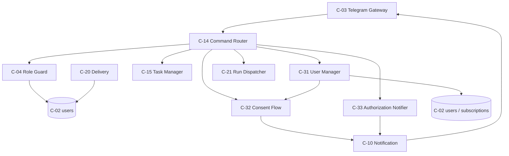
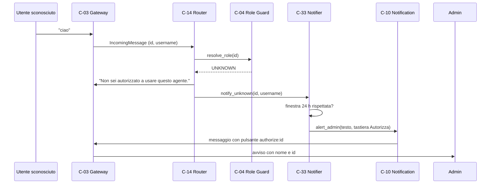
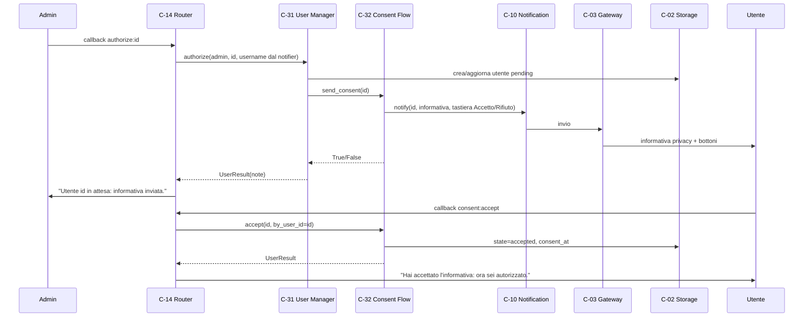
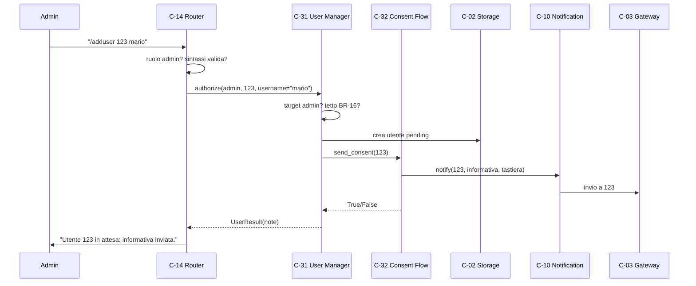
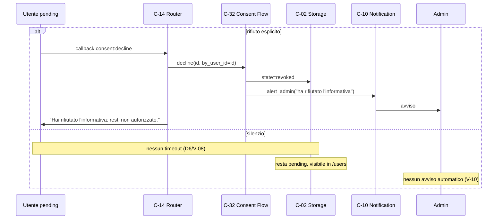
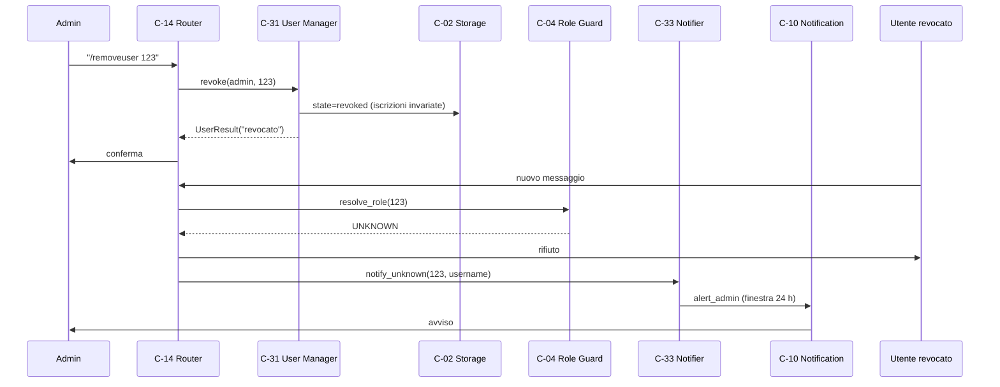
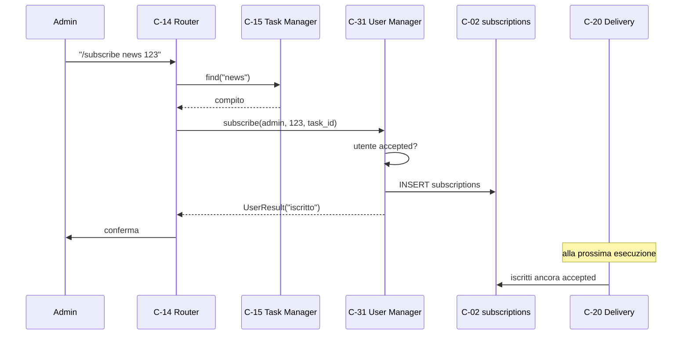

# Architettura 08 — FR-007 Gestione degli utenti

- **Spec:** [08-fr007-gestione-utenti.spec.md](../specs/08-fr007-gestione-utenti.spec.md)
- **Voce roadmap:** `08 — FR-007 Gestione utenti`
- **Piano:** [08-fr007-gestione-utenti.plan.md](../plan/08-fr007-gestione-utenti.plan.md)
- **Constitution:** [constitution.md](../specs/constitution.md)
- **Data:** 2026-11-01
- **Struttura dichiarata:** sezioni di spec 08 + blocco metadata, sezioni e stile dei documenti
  [03](../architecture/03-fr002-esecuzione-programmata.md),
  [04](../architecture/04-fr003-lancio-manuale.md),
  [05](../architecture/05-fr004-domande-libere.md),
  [06](../architecture/06-fr005-ricerca-web-conferma.md) e
  [07](../architecture/07-fr006-riassunto-log.md).

> **Assunzione P-A-01:** in `docs/templates/` esistono solo `template.spec.md` e
> `template.constitution.md`, **nessun template per documenti di architettura**; la struttura è
> derivata dalla spec, dal piano e dai documenti 03–07.
>
> **Governance:** piano e struttura approvati al checkpoint di Phase 2 (quattro passate); Phase 4
> **APPROVED** (due passate) su questo documento.

## 1. Contesto e obiettivi

Solo l'amministratore decide chi può usare l'agente e a quali compiti è iscritto. Uno sconosciuto che
scrive riceve un rifiuto e genera un avviso con il suo nome Telegram e il pulsante **Autorizza**.
Dopo l'autorizzazione l'utente riceve l'informativa privacy e deve accettarla esplicitamente: fino ad
allora resta `pending`, cioè non autorizzato (BR-18). Un rifiuto lo lascia non autorizzato e avvisa
l'admin. L'admin può revocare (`/removeuser`), iscrivere o disiscrivere da un compito ed elencare gli
utenti.

Vincoli applicati: l'amministratore esiste solo nella configurazione e non è un record `users`
(decisione #7); un solo processo e un solo file SQLite (Tech Stack); Telegram solo tramite C-03;
`pending` e `revoked` valgono `UNKNOWN` per C-04; fino a 5 utenti autorizzati (BR-16); testo
dell'informativa fornito dall'operatore (D1).

Dipendenze consegnate: item 01 (C-02 con `users`/`subscriptions`, C-03, C-04, C-10, C-23), item 02
(C-14, C-15, C-17), item 03/04 (C-20 e C-21 filtrano già gli `accepted`), item 06 (callback
`approval:`), item 07 (nessuna interazione). Dipendenze non consegnate: item 09 (storico), item 10
(avvisi di sistema), item 11 (riavvio).

## 2. Componenti

Tre componenti nuovi, tre estensioni e cinque componenti riusati invariati.

### C-31 — User Manager

- **Responsabilità:** creare, riaprire, revocare utenti; gestire iscrizioni ai compiti; elencare
  utenti; applicare il pre-check del tetto BR-16 e le transizioni di stato.
- **Interfaccia pubblica:** `authorize(actor_id, telegram_id, *, username=None) -> UserResult`
  (async), `revoke(actor_id, telegram_id) -> UserResult`, `subscribe(actor_id, user_id, task_id)`,
  `unsubscribe(actor_id, user_id, task_id)`, `list_users(actor_id) -> tuple[UserView, ...]`.
- **Input/Output:** id dell'attore, id Telegram dell'utente (e nome quando disponibile), id del
  compito; record utente aggiornato, viste di elenco e messaggio pronto (`UserResult.note`).
- **Dipendenze:** C-02 (persistenza: `users`, `subscriptions`, `tasks` per nome), C-04
  (ruolo dell'attore e riconoscimento dell'admin come target), C-32 (invio dell'informativa). La
  risoluzione del compito per nome resta di C-15, chiamata da C-14.
- **Error handling:** `UserAccessError` con `reason` in `forbidden`, `not_found`, `invalid_state`,
  `invalid_target`, `limit`; nessuna eccezione grezza verso il polling. Un utente già `accepted` non
  riceve una seconda informativa; un `pending` riceve un reinvio senza cambio di stato.
- **Osservabilità:** log `utente autorizzato` (id, stato, invio), `utente revocato`, `utente
  iscritto`, `utente disiscritto`, `autorizzazione già presente`, `operazione utenti rifiutata`.
- **Sicurezza:** solo l'amministratore (BR-12); l'admin non è un target; il tetto BR-16 è contato sugli
  `accepted`; nessun accesso diretto a SQL.

### C-32 — Consent Flow

- **Responsabilità:** inviare l'informativa privacy, registrare l'accettazione o il rifiuto, applicare
  il tetto BR-16 nell'istante in cui l'utente diventerebbe `accepted`, avvisare l'admin sul rifiuto.
- **Interfaccia pubblica:** `send_consent(user_id) -> bool` (async), `accept(user_id, *,
  by_user_id) -> UserResult` (async), `decline(user_id, *, by_user_id) -> UserResult` (async).
- **Input/Output:** id dell'utente e dell'attore; stato aggiornato e nota per l'utente.
- **Dipendenze:** C-10 (invio dell'informativa con tastiera e avviso; C-03 è raggiunto tramite C-10),
  C-02 (stato e `consent_at`).
- **Error handling:** invio fallito → `False`, utente `pending`, avviso all'admin, nessuna eccezione a
  C-14; stato diverso da `pending` → `invalid_state`; attore diverso dal destinatario →
  `invalid_target`; tetto raggiunto → `limit` con avviso all'admin.
- **Osservabilità:** log `informativa privacy inviata`, `informativa accettata`, `informativa
  rifiutata`, `informativa privacy non inviata`, `avviso all'admin non inviato`.
- **Sicurezza:** nessun uso dell'agente prima dell'accettazione (BR-18); solo il destinatario può
  accettare o rifiutare; `consent_at` registrato in UTC.

### C-33 — Authorization Notifier

- **Responsabilità:** avvisare l'admin al contatto di uno sconosciuto con nome Telegram e pulsante
  **Autorizza**; limitare i contatti ripetuti; conservare il nome per il callback.
- **Interfaccia pubblica:** `notify_unknown(telegram_id, username) -> bool`, `username_for(telegram_id)
  -> str | None`.
- **Input/Output:** id e nome Telegram dello sconosciuto; esito dell'invio.
- **Dipendenze:** C-10 (invio con tastiera), C-03 (bottoni, per composizione). **Non** usa C-04: il
  ruolo dell'attore è verificato da C-14 (P-A-11).
- **Error handling:** invio fallito → `False` e log; la finestra anti-spam avanza solo su invio
  riuscito; nessuna eccezione al chiamante.
- **Osservabilità:** log `avviso sconosciuto inviato`, `avviso sconosciuto soppresso`, `avviso
  sconosciuto non inviato`.
- **Sicurezza:** lo sconosciuto non riceve alcun contenuto utile; il nome è solo quello pubblico di
  Telegram.

### Estensioni di componenti esistenti

- **C-03 Telegram Gateway:** `IncomingMessage.username` popolato da `effective_user.username` per i
  messaggi e da `query.from_user.username` per i callback (V-01).
- **C-10 Notification Service:** `notify`/`alert_admin` accettano una tastiera opzionale, applicata
  all'ultimo chunk (V-09).
- **C-14 Command Router:** comandi utenti, callback `authorize:`/`consent:`, rifiuto agli sconosciuti,
  ordine callback-prima-del-rifiuto, `HELP_TEXT` aggiornato.
- **C-04, C-15, C-20, C-21, C-23:** invariati.

### Componenti e capacità non disponibili

- **Rilettura della chat di un utente revocato:** C-23 accetta il target admin e i soli utenti
  `accepted` (`transcript`), e `list_authorized` elenca solo gli `accepted`. I dati restano (D3), la
  rilettura di un revocato no: gap dichiarato, nessuna modifica a C-23 in questa voce.
- **Timeout dell'informativa (D6/V-08):** nessuna scadenza, nessun avviso automatico sul silenzio
  (V-10); i `pending` sono visibili in `/users`.
- **Avvisi di sistema e riavvio:** item 10/11.

### Wiring di `AgentApp`

`AgentApp.build` costruisce `ConsentFlow`, `AuthorizationNotifier` e `UserManager` con le dipendenze
già presenti (`repos.users`, `repos.subscriptions`, `repos.tasks`, `roles`, `notifications`) e li
inietta in C-14. `AgentApp` espone `user_manager`, `consent`, `notifier`. Nessun nuovo job, nessuna
nuova chiave di configurazione, nessuna migrazione; il gateway è lo stesso oggetto già condiviso.

## 3. Riparto di responsabilità

| Componente | Possiede | Delega | Perché non è duplicazione |
|---|---|---|---|
| C-31 | ciclo di vita del record, iscrizioni, elenco, transizioni, pre-check BR-16 | C-02, C-04, C-32 | C-04 risolve il ruolo e non scrive utenti; C-15 gestisce i destinatari di un compito |
| C-32 | informativa, accettazione, rifiuto, `consent_at`, tetto BR-16, avvisi | C-10, C-02 | C-31 decide *chi*, C-32 *quando* l'autorizzazione diventa efficace |
| C-33 | decisione e testo dell'avviso, antispam, nome per il callback | C-10, C-03 | C-14 instrada; C-31 autorizza |
| C-10 | invio, split, tastiera sull'ultimo chunk, retry | C-03 | C-33 decide *se*, C-10 *come* |
| C-04 | ruolo effettivo a ogni richiesta | C-02 | invariato: `pending`/`revoked` sono `UNKNOWN` |
| C-14 | parsing, ordine di instradamento, scelta del testo d'errore | C-31, C-32, C-33, C-17, C-23 | non scrive utenti e non legge il database |
| C-15 | destinatari di un compito, solo `accepted` | C-02 | C-31 `subscribe` applica la stessa politica |
| C-20 / C-21 | consegna e lancio | C-02 | già filtrano gli `accepted` |

**Un solo scrittore per stato.** Solo C-31 e C-32 scrivono `users.state` e `consent_at`; C-14 non
tocca il database e inoltra `UserResult.note`.

**Un solo tetto, una sola costante.** `MAX_AUTHORIZED_USERS` vive in `user_state.py`, importato da
C-31 e C-32. Con cinque `accepted`: la creazione di un nuovo utente e la riapertura `revoked →
pending` sono rifiutate subito; il reinvio a un `pending` esistente resta possibile; l'accettazione è
rifiutata con avviso all'admin.

**Stessa politica sulle iscrizioni.** C-15 rifiuta destinatari non `accepted`; C-31 `subscribe`
applica la stessa regola. `unsubscribe` è ammesso anche per un revocato, perché rimuovere è sicuro.

## 4. Modello di dominio

- **Utente:** `telegram_id`, `username` (opzionale), `state`, `consent_at`.
- **Stati:** `pending` (in attesa di accettazione), `accepted` (autorizzato), `revoked` (revocato).
- **Iscrizione:** relazione utente ↔ compito, usata da C-20 (consegna), C-21 (lancio) e item 09.
- **Amministratore:** definito in configurazione, non è un record utente e non è conteggiato.

| Stato attuale | `authorize` | `accept` | `decline` | `revoke` |
|---|---|---|---|---|
| assente | → `pending`, invia informativa | `not_found` | `not_found` | `not_found` |
| `pending` | resta `pending`, rinvia | → `accepted` con `consent_at` | → `revoked` | → `revoked` |
| `accepted` | resta `accepted`, «già autorizzato» | `invalid_state` | `invalid_state` | → `revoked` |
| `revoked` | → `pending` se BR-16 lo consente, `consent_at=None` | `invalid_state` | `invalid_state` | nessun cambio |

**Riattivazione delle iscrizioni (D3).** La revoca conserva le righe di `subscriptions`: un revocato
che viene riautorizzato e accetta di nuovo torna a ricevere i compiti a cui era iscritto, senza che
l'admin debba reiscriverlo. È un effetto voluto di D3.

## 5. Modello dati

Nessuna tabella nuova e nessuna migrazione: `users` (`telegram_id` PK, `username`, `state`,
`consent_at`, `created_at`, `updated_at`) e `subscriptions` (`user_id`, `task_id`, PK composta)
esistono dalla migrazione 001. Lo schema è documentato nel modello dati di
[01-agent-runtime.spec.md](../specs/01-agent-runtime.spec.md#modello-dati-sqlite); qui non viene duplicato.
`consent_at` è valorizzato solo all'accettazione; la revoca non lo tocca; la transizione `revoked →
pending` lo azzera perché serve una nuova accettazione.

Nessun ER nuovo: la spec 08 non introduce entità ulteriori e le due tabelle sono già nel modello
della fondazione.

## 6. Testo dell'informativa privacy

Testo approvato dall'operatore il 2026-11-01 (D1), inviato verbatim da C-32 e definito come costante
`consent.PRIVACY_NOTICE`:

> Privacy — come funziona l'agente. I tuoi messaggi a questo bot passano dai server di DeepSeek (per
> generare le risposte) e di Telegram (per il trasporto). Sono conservati nella memoria dell'agente
> sul telefono (S24) dell'amministratore e l'amministratore può rileggerli. Puoi chiedere in ogni
> momento all'amministratore di revocare il tuo accesso. Premi «Accetto» per usare l'agente;
> «Rifiuto» per non autorizzare l'accesso.

I bottoni sono `consent:accept` («Accetto») e `consent:decline` («Rifiuto»). Una modifica del testo è
un cambio di codice e di questo documento, non un valore di configurazione (V-03).

## 7. Anti-spam sui contatti sconosciuti

| Parametro | Valore | Note |
|---|---|---|
| Finestra per utente | **24 ore** (`UNKNOWN_ALERT_WINDOW_S`) | misurata dall'ultimo avviso **riuscito** |
| Ambito | per `telegram_id` | utenti diversi sono indipendenti |
| Memoria | dizionario in processo | un riavvio può produrre al più un avviso in più (V-04) |
| Rifiuto allo sconosciuto | **sempre tentato** | un errore Telegram è loggato e non blocca l'avviso; il limite riguarda solo l'avviso all'admin |
| Callback da sconosciuti | nessun avviso | solo i messaggi generano l'avviso (P-A-11) |

Un utente `pending` che scrive un messaggio è `UNKNOWN` per C-04: riceve lo stesso rifiuto di uno
sconosciuto e, se la finestra lo consente, genera un avviso all'admin. Non riceve contenuti utili e
resta `pending` finché non accetta (D6).

## 8. Flussi di dati

### 8.1 Contatto sconosciuto (flusso 1, AC-01)

### 8.2 Autorizzazione con pulsante e consenso (flusso 2, AC-02)

Da questo momento C-04 risolve l'utente come `AUTHORIZED`: chat, `/run` e `/tasks` funzionano come
per ogni utente autorizzato. Lo storico è la voce 09 e non è ancora disponibile.

### 8.3 Autorizzazione con `/adduser` (flusso 3)

Il flusso è identico a quello del pulsante dopo la creazione del `pending`; cambia solo l'innesco.

### 8.4 Rifiuto e silenzio (flusso 4, AC-03)

### 8.5 Revoca (flusso 5, AC-04)

L'effetto è immediato: nessuna cache di ruolo, C-04 rilegge lo stato a ogni richiesta.

### 8.6 Iscrizione e disiscrizione (flusso 6)

`/unsubscribe` segue lo stesso percorso con `DELETE`; è ammesso anche per un utente revocato.

## 9. Concorrenza e ciclo di vita

- **Stato per richiesta.** C-04 rilegge il ruolo dal database a ogni messaggio: la revoca non richiede
  invalidazioni.
- **C-31/C-32 senza cache.** Ogni operazione legge e scrive tramite C-02; nessun lock aggiuntivo oltre
  a quelli di SQLite.
- **Anti-spam in memoria.** Il dizionario di C-33 vive nel processo; al riavvio riparte vuoto (V-04).
- **Callback.** C-14 instrada i callback prima del rifiuto agli `UNKNOWN`, altrimenti `pending` e admin
  non potrebbero usare i bottoni. `confirm:` e `approval:` restano invariati.
- **Ciclo di vita dell'informativa.** Un `pending` può ricevere più reinvii; solo l'accettazione lo
  abilita. Un rifiuto chiude il ciclo (`revoked`) e una nuova autorizzazione lo riapre.
- **Nessuno stato persistente nuovo.** Nessuna tabella, nessun marcatore, nessuna migrazione.

## 10. Integrazioni

| Integrazione | Direzione | Uso in questa voce |
|---|---|---|
| Telegram (C-03) | ingresso/uscita | messaggi, callback, invio con tastiera |
| SQLite (C-02) | locale | `users`, `subscriptions` |
| DeepSeek | non usato | nessuna chiamata al modello in questa voce |

Contratti invariati: Telegram solo C-03, SQLite solo C-02. `user_manager.py`, `consent.py` e
`authorization_notifier.py` non importano `telegram` né `sqlite3`; l'asserzione di confine di
`tests/test_boundaries.py` resta valida.

## 11. Sicurezza

- **BR-12:** solo l'amministratore autorizza, revoca, iscrive ed elenca; C-14 e C-31 verificano
  entrambi. Un utente autorizzato che prova un comando di gestione riceve un rifiuto.
- **BR-18:** nessun uso dell'agente prima dell'accettazione; `pending` e `revoked` sono `UNKNOWN` per
  C-04.
- **Antispam:** un avviso per utente ogni 24 ore; lo sconosciuto riceve solo il rifiuto.
- **Callback:** `authorize:` richiede il ruolo admin; `consent:` richiede che l'attore sia il
  destinatario e che lo stato sia `pending`.
- **Admin:** non è un record utente, non è un target valido e non si conta nel tetto.
- **Dati:** restano sull'S24; l'informativa dice esplicitamente che transitano da DeepSeek e Telegram
  e che l'admin può rileggerli. Nessun segreto nei log.
- **Revoca:** immediata per ruolo, consegna e lancio; i dati restano per lo storico (D3).

## 12. Requisiti non funzionali

| Requisito | Implementazione |
|---|---|
| Fino a 5 utenti autorizzati (BR-16) | `MAX_AUTHORIZED_USERS`, tetto in C-31 e C-32 con messaggio esplicito |
| Antispam (spec 08 NFR) | finestra di 24 h per utente in C-33 |
| Un solo processo / SQLite (Tech Stack) | nessuno stato condiviso nuovo; anti-spam in memoria |
| Risposte in italiano (BR-14) | testi di C-31/C-32/C-14 in italiano |
| Osservabilità | log di autorizzazioni, revoche, iscrizioni, invii e soppressioni |
| Nessuna migrazione | schema 001 invariato |

## 13. Rischi e assunzioni

Rischi residui: un riavvio può duplicare un avviso (V-04); il nome Telegram si perde se il processo
si riavvia fra avviso e pulsante e resta l'id; un `pending` non ha scadenza (D6/V-08) e nessun avviso
automatico sul silenzio (V-10); la rilettura della chat di un revocato non è disponibile (gap); con
cinque autorizzati la riapertura di un revocato è rifiutata fino a una revoca; un invio Telegram
fallito è best effort e viene loggato.

Assunzioni di piano: P-A-01…P-A-26 in [piano 08](../plan/08-fr007-gestione-utenti.plan.md). In
sintesi: struttura documentale derivata; testo privacy come costante; finestra anti-spam di 24 h;
transizioni dichiarate e preservazione di `username`/`consent_at`; esiti `UserResult` con regola di
`changed`/`notice_sent`; ordine rifiuto→avviso; rendering di `/users` senza `(None)`; parsing dei
comandi per id finale; testi di errore mappati per `reason`.

## 14. Domande aperte di spec 08

Le tre domande tecniche sono state chiuse dall'operatore il 2026-11-01:

1. **Anti-spam.** Una finestra di 24 ore per utente, contatore in memoria (D2/V-04).
2. **Testo privacy.** Bozza approvata e riportata verbatim (D1/V-03).
3. **Dati dell'utente revocato.** Record e iscrizioni conservati (D3/V-05).

Sono chiuse anche le questioni implicite: comandi di iscrizione ed elenco (D4/V-02), tetto BR-16
(D5/V-06), nessun timeout dell'informativa (D6/V-08), nessun avviso sul silenzio (V-10).

## 15. Fuori scope

- Timeout dell'informativa e avviso automatico sul silenzio (D6/V-08/V-10).
- Eliminazione dei dati di un utente revocato (D3) e rilettura admin della sua chat (gap).
- Storico esecuzioni strutturato (item 09), avvisi di sistema (item 10), riavvio (item 11).
- Modifica del testo privacy a runtime (V-03).
- **Vista di deployment:** la spec 08 non la dichiara e il comportamento non ne dipende; **gap
  registrato**. Nessun ER nuovo: `users` e `subscriptions` sono già nella fondazione.

## 16. Deviazioni dichiarate

| # | Deviazione | Fonte | Motivo |
|---|---|---|---|
| V-01 | `IncomingMessage.username` popolato da C-03 | spec 01 C-03 | C-33 deve mostrare il nome Telegram (FR-007, AC-01) |
| V-02 | Nuovi comandi `/users`, `/subscribe`, `/unsubscribe` | spec 08 (nomina solo `/adduser` e `/removeuser`) | D4: iscrizioni ed elenco richiesti da FR-007 |
| V-03 | Testo privacy come costante `PRIVACY_NOTICE` | spec 01 C-01 (nessuna chiave `privacy.*`) | D1/A-02: testo fornito dall'operatore, nessuna configurazione nuova |
| V-04 | Antispam in memoria con finestra di 24 h | spec 08 «aggregazione/rate limit» | D2: nessuna tabella e nessuna migrazione; un riavvio può duplicare un avviso |
| V-05 | Revoca che conserva record e iscrizioni | spec 08 domanda aperta | D3: storico e audit restano leggibili; la chat del revocato **non** è rileggibile (gap) |
| V-06 | Tetto rigido di 5 utenti `accepted` | BR-16 e spec 08 NFR | D5: il limite è un requisito non funzionale |
| V-07 | C-31/C-32 verificano l'attore oltre a C-14 | spec 08 C-31 | difesa in profondità di BR-12 |
| V-08 | Nessun timeout dell'informativa | spec 08 flusso 4 e domanda aperta | D6: nessuna soglia dichiarata |
| V-09 | C-10 con tastiera opzionale | spec 01 C-10 | C-33 invia il pulsante Autorizza senza aggirare C-10 |
| V-10 | Nessun avviso automatico sul silenzio | spec 08 C-32 e flusso 4; FR-007; BR-18 | D6: senza scadenza non esiste l'istante in cui avvisare |
| V-11 | Firme estese di C-31/C-32 ed esito `UserResult` | spec 08 C-31/C-32 | il ruolo va verificato nel componente e C-14 non legge il database |
| V-12 | Rifiuto esplicito a sconosciuto e revocato | BR-12 («ignorato») | FR-007 flusso 1: «riceve un rifiuto»; ignorato = nessun contenuto utile |

## 17. Tracciabilità

| Requisito / criterio | Evidenza |
|---|---|
| AC-01 sconosciuto: rifiuto + avviso con Autorizza | `tests/test_users_ac.py::test_ac01_unknown_is_refused_and_admin_is_alerted` |
| AC-02 autorizzazione + consenso | `tests/test_users_ac.py::test_ac02_authorized_user_accepts_and_uses_the_agent` |
| AC-03 rifiuto dell'informativa | `tests/test_users_ac.py::test_ac03_declined_consent_keeps_the_user_unauthorized` |
| AC-04 revoca immediata | `tests/test_users_ac.py::test_ac04_revoked_user_is_ignored` |
| AC-05 `/adduser` da non admin | `tests/test_users_ac.py::test_ac05_authorized_user_cannot_add_users` |
| BR-12 solo admin | `tests/test_user_manager.py::test_non_admin_cannot_manage_users`, `tests/test_command_router.py::test_authorized_user_cannot_manage_users` |
| BR-18 nessun uso prima dell'accettazione | `tests/test_role_guard.py::test_pending_and_revoked_are_unknown`, `tests/test_consent.py::test_accept_enables_the_user` |
| BR-16 tetto 5 utenti | `tests/test_user_manager.py::test_sixth_user_is_refused`, `::test_already_authorized_user_does_not_hit_the_limit`, `::test_reopening_a_revoked_user_is_refused_at_the_limit`, `::test_pending_resend_is_allowed_at_the_limit`, `tests/test_consent.py::test_acceptance_is_refused_when_the_limit_is_reached` |
| Transizioni e campi preservati | `tests/test_user_manager.py::test_reauthorizing_a_revoked_user_clears_consent`, `::test_authorize_preserves_the_username`, `::test_already_authorized_user_is_not_reinvited` |
| Esiti `changed`/`notice_sent` | `tests/test_user_manager.py::test_resend_to_pending_is_not_a_change`, `::test_revoking_twice_is_not_a_change`, `::test_subscribing_twice_is_not_a_change`, `tests/test_consent.py::test_accept_reports_the_change` |
| Informativa non recapitata | `tests/test_user_manager.py::test_failed_notice_is_reported`, `tests/test_consent.py::test_failed_notice_keeps_the_user_pending` |
| Antispam 24 h | `tests/test_authorization_notifier.py::test_second_contact_within_the_window_is_suppressed`, `::test_alert_resumes_after_the_window`, `::test_failed_alert_does_not_advance_the_window` |
| Pulsante Autorizza e nome | `tests/test_authorization_notifier.py::test_alert_has_authorize_button_and_username`, `::test_alert_without_username_uses_the_id`, `tests/test_notifications.py::test_alert_admin_forwards_the_keyboard` |
| Tastiera sull'ultimo chunk | `tests/test_notifications.py::test_keyboard_goes_on_the_last_chunk` |
| Callback e comandi | `tests/test_command_router.py::test_authorize_callback_starts_the_consent_flow`, `::test_authorize_callback_refused_for_non_admin`, `::test_consent_callbacks_accept_and_decline`, `::test_consent_callback_for_unknown_user_does_not_alert`, `::test_adduser_command`, `::test_adduser_without_argument_reports_usage`, `::test_removeuser_command`, `::test_users_command_lists_states`, `::test_subscribe_and_unsubscribe_commands`, `::test_subscribe_requires_an_accepted_user`, `::test_subscribe_unknown_task` |
| Messaggi di errore per `reason` | `tests/test_command_router.py::test_user_errors_are_translated`, `::test_unknown_reason_has_a_generic_message` |
| `username` in ingresso | `tests/test_telegram_gateway.py::test_username_is_carried_in_the_incoming_message`, `::test_username_is_carried_in_callback_messages` |
| Revoca e iscrizioni conservate | `tests/test_user_manager.py::test_revoke_keeps_the_subscriptions`, `::test_unsubscribe_is_allowed_for_a_revoked_user` |
| Elenco utenti | `tests/test_user_manager.py::test_list_users_reports_state_and_tasks` |
| Utente `pending` che scrive resta non autorizzato (nessun timeout, D6) | `tests/test_users_ac.py::test_pending_user_stays_pending_until_acceptance` |
| Utente `pending` che scrive genera un avviso nella finestra | `tests/test_users_ac.py::test_pending_user_contact_alerts_the_admin_once` |
| Test aggiornati su sconosciuto e revocato | `tests/test_command_router.py::test_unknown_user_is_ignored`, `::test_revoked_user_is_ignored` |
| Reinvio fallito con testo integro | `tests/test_user_manager.py::test_failed_resend_reports_the_failure_clearly` |
| Callback preesistenti invariati | `tests/test_command_router.py::test_callback_button_resolves_confirmation`, `tests/test_approval_ac.py` |
| Nessuna migrazione | `tests/test_storage.py` invariato; nessun file aggiunto in `src/agente/storage/migrations/` |
