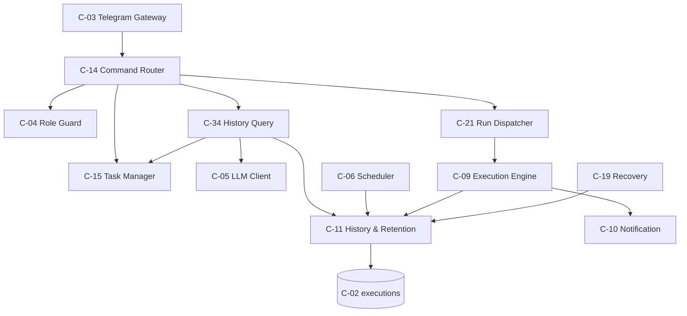
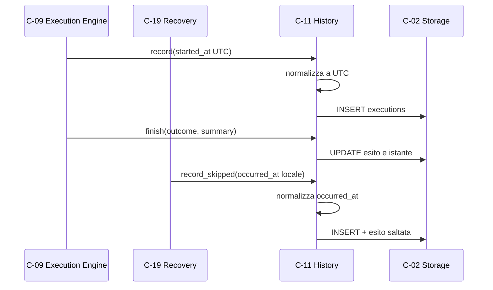
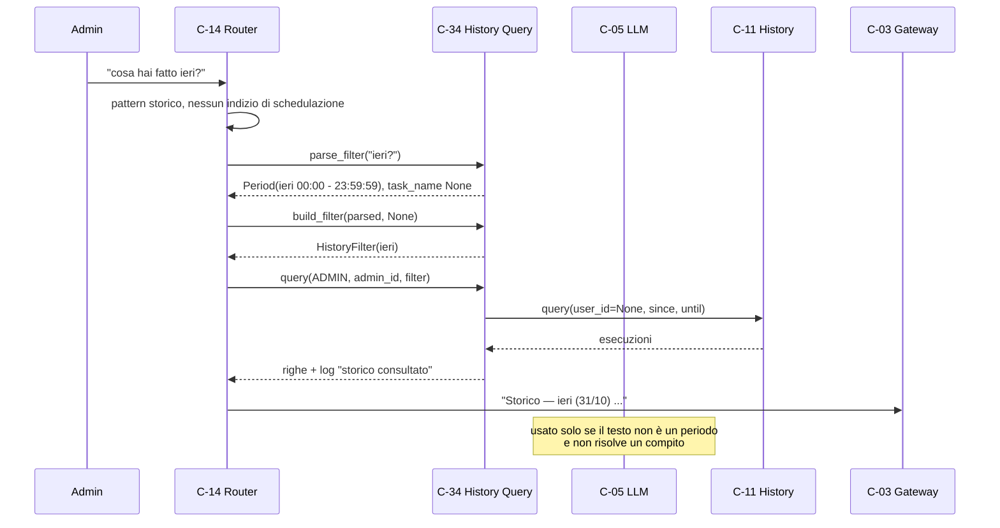
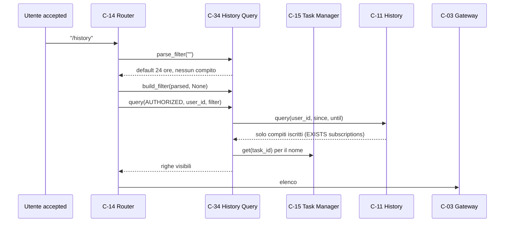
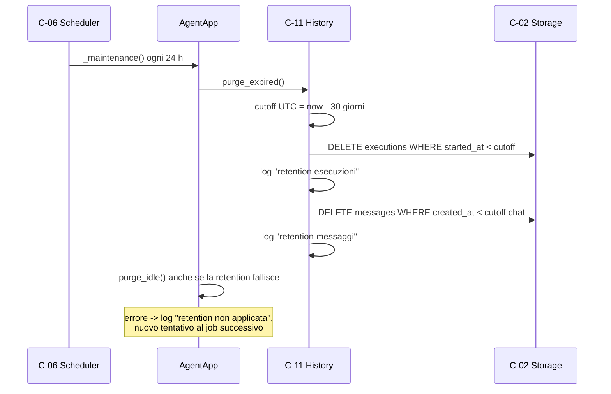

# Architettura 09 — FR-008 Storico delle esecuzioni

- **Spec:** [09-fr008-storico-esecuzioni.spec.md](../specs/09-fr008-storico-esecuzioni.spec.md)
- **Voce roadmap:** `09 — FR-008 Storico esecuzioni`
- **Piano:** [09-fr008-storico-esecuzioni.plan.md](../plan/09-fr008-storico-esecuzioni.plan.md)
- **Constitution:** [constitution.md](../specs/constitution.md)
- **Data:** 2026-11-02
- **Struttura dichiarata:** sezioni di spec 09 + blocco metadata e stile dei documenti
  [07](../architecture/07-fr006-riassunto-log.md) e
  [08](../architecture/08-fr007-gestione-utenti.md).

> **Assunzione P-A-01:** in `docs/templates/` esistono solo `template.spec.md` e
> `template.constitution.md`, **nessun template per documenti di architettura**; la struttura è
> derivata dalla spec, dal piano e dai documenti 07/08.

> **Assunzione P-A-26:** rispetto ai documenti 07/08 (flussi a §7/§8, senza sezioni autonome per
> «Componenti e capacità non disponibili» e «Wiring»), questo documento aggiunge due sezioni
> autonome (3 e 4) e porta i flussi a §10; la numerazione 1…19 è dichiarata qui.

> **Governance:** piano e struttura approvati al checkpoint di Phase 2; Phase 4 **APPROVED**
> (quattro passate) su questo documento.

## 1. Contesto e obiettivi

Ogni esecuzione, programmata o manuale, è tracciata e consultabile da Telegram. Per ogni esecuzione
si registrano compito, data e ora, esito (`ok`, `errore`, `interrotto`, `saltata`) e un breve
riassunto. L'utente consulta lo storico con `/history` o con una richiesta in linguaggio naturale
(«cosa hai fatto ieri?»).

Le voci più vecchie di **30 giorni** vengono eliminate (BR-7). Un utente autorizzato vede solo lo
storico dei compiti a cui è iscritto; l'amministratore vede tutto (BR-12). `saltata` (spec 03,
decisione D1) indica un'occorrenza mancata e recuperata solo nell'ultima occorrenza: non è
un'esecuzione avvenuta, ma resta nello storico per spiegare il buco.

Vincoli applicati: processo singolo e un file SQLite (Tech Stack); Telegram solo tramite C-03;
`pending` e `revoked` valgono `UNKNOWN` per C-04; fuso orario del telefono e lingua dell'utente (BR-14); fino a
5 utenti e 10 compiti attivi (BR-16); retention 30 giorni (BR-7).

Dipendenze consegnate: item 01 (C-02 con `executions`, C-04, C-05, C-06, C-11, C-13), item 02
(C-14, C-15), item 03 (C-19 `saltata`), item 04 (C-21), item 08 (C-14 con callback e `HELP_TEXT`).
Dipendenze non consegnate: item 10 (avvisi), item 11 (riavvio).

## 2. Componenti

Un componente nuovo (C-34), un adeguamento di C-11 (che assorbe C-35) e un'estensione di C-14.



### C-34 — History Query

- **Responsabilità:** interpretare il filtro (periodo e compito), applicare la visibilità per ruolo,
  delimitare la finestra alla retention, leggere C-11 e rendere l'elenco Telegram.
- **Interfaccia pubblica:** `parse_filter(text) -> ParsedFilter | AmbiguousPeriod` (puro e
  deterministico), `parse_window_with_llm(text) -> Period | AmbiguousPeriod` (puro rispetto a
  SQLite, unico punto di C-34 che chiama C-05), `resolve_task(name, *, role, user_id) -> Task | None`,
  `build_filter(parsed, task) -> HistoryFilter`, `query(role, user_id, filter) -> list[Execution]`,
  `render(executions, *, label, degenerate=False) -> str`.
- **Input/Output:** testo del filtro, ruolo e id del richiedente; elenco di esecuzioni e testo
  pronto per C-03.
- **Dipendenze:** C-11 (lettura), C-15 (compiti e visibilità), C-05 (solo fallback temporale),
  C-04 (ruolo già risolto da C-14). C-02 è raggiunto tramite C-11 e C-15, mai direttamente.
- **Error handling:** periodo non interpretabile → `AmbiguousPeriod` con `PERIOD_USAGE`; LLM
  assente, errore o risposta invalida → `AmbiguousPeriod`; compito non risolto → `None` da
  `resolve_task` (C-14 emette `Compito non trovato`); `build_filter` con nome senza task →
  `ValueError` (C-14 lo traduce in errore generico); nessun risultato → `EMPTY_HISTORY`; finestra
  precedente alla retention → `EMPTY_RETENTION`.
- **Osservabilità:** log `storico consultato` (ruolo, utente, `since`, `until`, `task_id`, righe
  mostrate, `truncated`) e `storico non interrogato` per il ramo difensivo `UNKNOWN`.
- **Sicurezza:** l'admin vede tutto, l'autorizzato solo i compiti iscritti; un compito altrui non è
  distinguibile da uno inesistente; `UNKNOWN` non interroga C-11.

### C-35 — Retention Job (assorbito da C-11)

- **Responsabilità:** eliminare giornalmente le esecuzioni più vecchie di 30 giorni (BR-7).
- **Interfaccia pubblica:** `HistoryService.purge_expired()`; l'interfaccia si chiama
  `purge_expired()` e non `purge()`.
- **Input/Output:** nessun input esterno; restituisce `PurgeStats(executions_deleted,
  messages_deleted)` e applica i `DELETE` su C-02.
- **Dipendenze:** C-02, C-06 per la schedulazione giornaliera.
- **Error handling:** i due `DELETE` (esecuzioni e messaggi oltre la finestra chat) sono nella
  stessa chiamata ma **non atomici**: ciascuno ha il proprio commit. Un errore viene convertito in
  `StorageError` da C-02; `AgentApp._maintenance` lo logga e lascia proseguire `purge_idle`; il job
  del giorno successivo ritenta.
- **Osservabilità:** log `retention esecuzioni` e `retention messaggi` con i conteggi,
  `retention applicata` in `AgentApp._maintenance`; in caso di errore `retention non applicata` e,
  per la chat, `pulizia chat non applicata`.
- **Sicurezza:** unico `DELETE` esplicito sulle esecuzioni; il cascade su `tasks` resta (V-08).

### Estensioni di componenti esistenti

- **C-11:** normalizzazione degli istanti a UTC in `record`/`record_skipped`/`finish`, cutoff di
  retention e reset in UTC, log dei conteggi.
- **C-14:** comando `/history`, riconoscimento NL dello storico prima dell'elenco compiti e della
  chat, `HELP_TEXT` aggiornato.
- **C-02:** helper `commit()` che converte gli errori SQLite in `StorageError` (usato dai `DELETE`
  di retention), così nessun altro layer importa `sqlite3`.
- **C-04, C-05, C-06, C-09, C-15, C-19, C-21:** invariati.

## 3. Componenti e capacità non disponibili

- **C-35 come componente separato:** non creato; C-11 ne assorbe comportamento, log ed error
  handling (V-01).
- **Dettaglio di una singola esecuzione / link al dettaglio:** non esiste un identificativo pubblico
  e non viene inventato (V-04).
- **Compito con nome che inizia con una cifra:** un testo come `3D printer` è trattato come periodo
  non valido (`AmbiguousPeriod`), quindi il compito non è filtrabile per nome; limite dichiarato.
- **Storico dei compiti eliminati:** il cascade `executions.task_id` elimina le righe con il compito
  (V-08); gap dichiarato.
- **Filtro per esito o innesco da Telegram:** C-11 supporta `outcome` ma **non** `trigger`; la spec
  non espone filtri di questo tipo e non vengono aggiunti.
- **Vista di deployment:** non dichiarata dalla spec 09 e non necessaria; **gap registrato**.
- **ER nuovo:** nessuno; `executions` è già nel modello dati di spec 01.

## 4. Wiring di `AgentApp`

`AgentApp.build` costruisce `HistoryQuery(history, tasks, retention_days=…, llm=…, clock=…, tz=…)`
dopo C-11 e C-15 e lo inietta in C-14. `AgentApp` espone `history_query`. `tz` è opzionale: default
`datetime.now().astimezone().tzinfo`, cioè il fuso del telefono, indipendente dal `clock` iniettato.
`_maintenance` esegue `history.purge_expired()` e `chat_memory.purge_idle()` in due passi isolati.
Nessun nuovo job, nessuna chiave di configurazione nuova, nessuna tabella o colonna nuova.

## 5. Riparto di responsabilità

| Componente | Possiede | Delega | Perché non è duplicazione |
|---|---|---|---|
| C-34 | parsing, finestra, risoluzione del compito visibile, resa, log | C-11, C-15, C-05 | C-11 resta l'unico lettore/scrittore di `executions`; C-14 instrada e invia |
| C-11 | scrittura normalizzata, query SQL, retention, log dei conteggi | C-02 | C-34 compone il filtro e presenta |
| C-14 | `/history`, intento NL, invio, messaggi d'uso | C-34 | non legge `executions` e non compone l'elenco |
| C-15 | compiti e visibilità per ruolo | C-02 | C-34 usa `find`/`list(role, user_id)`, non duplica la regola |
| C-05 | proposta di finestra per frasi non riconosciute | — | il valore è ri-validato in C-34 |
| C-06 | esecuzione giornaliera del job | C-11 | C-35 non esiste separatamente |
| C-04 | ruolo effettivo a ogni richiesta | C-02 | invariato |

**Un solo lettore di `executions`.** C-34 non importa `sqlite3` né `ExecutionRepository`: usa
`HistoryService.query`. **Un solo punto di retention.** `purge_expired` è l'unico `DELETE` esplicito
sulle esecuzioni; il cascade su `tasks` resta (V-08). **Un solo punto di normalizzazione.** C-11
converte a UTC prima di scrivere; la migrazione 005 allinea le righe esistenti.

**Confine dei thread.** `parse_filter` e `parse_window_with_llm` sono puri (nessun SQLite) e C-14 li
esegue in `asyncio.to_thread` sul ramo NL; `resolve_task`, `query` e `render` restano sul thread
dell'event loop, perché usano C-15/C-11 e la connessione SQLite ha `check_same_thread=True`.
`build_filter` non tocca SQLite (solo clock e clamp).

## 6. Modello di dominio

- **Esecuzione:** `task_id`, `requested_by`, `trigger`, `started_at`, `finished_at`, `outcome`,
  `summary` (spec 01).
- **Esiti:** `ok`, `errore`, `interrotto`, `saltata` (BR-15 + spec 03 D1). `outcome` NULL è
  un'esecuzione non conclusa e si mostra come `—`.
- **Periodo:** intervallo `since`–`until` nel fuso del telefono, con etichetta pronta per l'utente.
- **Filtro:** periodo in UTC ISO (secondi), compito opzionale, etichetta, flag `degenerate`.

## 7. Modello dati

Nessuna tabella e nessuna colonna nuova. `executions` esiste dalla migrazione 001 con `saltata`
aggiunto dalla 003; `idx_executions_task_started` copre le query per compito. La migrazione 005
aggiunge `idx_executions_started` e normalizza gli istanti esistenti:

```sql
UPDATE executions
SET started_at = strftime('%Y-%m-%dT%H:%M:%S+00:00', started_at)
WHERE datetime(started_at) IS NOT NULL;
```

Espressione identica per `finished_at`, con in più la guardia `finished_at IS NOT NULL` oltre a
`datetime(finished_at) IS NOT NULL`; poi
`CREATE INDEX idx_executions_started ON executions(started_at)`. Un istante naive è interpretato
come UTC; un valore non parsabile resta invariato ed è fuori contratto (P-A-25). La normalizzazione
è necessaria perché C-09 scrive UTC e C-19 scrive l'offset locale, mentre C-02 confronta stringhe:
senza di essa ordinamento, AC-01 e retention sarebbero errati. Lo schema completo è nel modello dati
di [01-agent-runtime.spec.md](../specs/01-agent-runtime.spec.md#modello-dati-sqlite); qui non viene
duplicato. Nessun ER nuovo.

## 8. Interpretazione del periodo

| Testo | `since` (locale) | `until` (locale) | `label` |
|---|---|---|---|
| *(assente)* | `now - 24h` | `now` | `ultime 24 ore` |
| `oggi` | oggi 00:00 | `now` | `oggi (GG/MM)` |
| `ieri` | ieri 00:00 | oggi 00:00 − 1s | `ieri (GG/MM)` |
| `questa settimana` / `settimana` | lunedì 00:00 | `now` | `questa settimana` |
| `settimana scorsa` | lunedì precedente 00:00 | lunedì corrente 00:00 − 1s | `settimana scorsa` |
| `questo mese` / `mese` | primo del mese 00:00 | `now` | `questo mese` |
| `mese scorso` | primo del mese precedente 00:00 | primo del mese corrente 00:00 − 1s | `mese scorso` |
| `ultimi N giorni` / `Ng` | `now - N giorni` | `now` | `ultimi N giorni` |
| `GG/MM` o `GG/MM/AAAA` | quel giorno 00:00 | giorno successivo 00:00 − 1s | `GG/MM` |
| altro | — | — | nome di compito, poi LLM (solo NL); un testo che inizia con una cifra e non è un periodo valido (es. `31/13`, `0g`, `3 news`) → `AmbiguousPeriod` |

**Ordine degli stadi, unico per comando e NL:** strip → periodo → nome compito → LLM. Lo strip
rimuove spazi, punteggiatura finale (`? ! . , ; :`), prefissi iniziali (`su`, `di`, `del`, `della`,
`dei`, `delle`, `degli`, `per`, `con`, `nel`, `nella`, `nelle`, `sull'`, `sul`, `sulla`, `sulle`,
`nell'`, `dall'`, `all'`, `dello`, `dell'`, `il`, `lo`, `la`, `i`, `gli`, `le`, `l'`) e nomi
generici residui (`compiti`, `compito`, `esecuzioni`, `esecuzione`, `storico`). Usa il prefisso più
lungo con confine di parola o apostrofo, ripetuto: `dell'ultima ora` → `ultima ora`; `della settimana
scorsa` → `settimana scorsa`. Un compito chiamato esattamente come una parola generica non è
filtrabile per nome (limite dichiarato).

**Precedenza:** periodo esplicito → nome di compito → fallback LLM (solo ramo NL e solo senza
periodo esplicito). Sul comando il modello non viene mai chiamato. `GG/MM` senza anno usa l'anno
corrente; se la data risulta nel futuro oltre 24 ore, l'anno precedente.

**Clamp:** calcolato una sola volta in `build_filter`, per entrambi i percorsi.
`since = max(since, now - retention_days)`, con nota ` (limitato agli ultimi N giorni)`; se
`until <= cutoff` la finestra diventa `since = cutoff`, `until = cutoff - 1s`, `degenerate=True` e
`label = periodo precedente alla conservazione`.

**Fuso:** i confini sono calcolati in `tz` (default `datetime.now().astimezone().tzinfo`,
indipendente dal `clock`) e convertiti in UTC ISO a secondi. Con `ZoneInfo` i confini seguono l'ora
legale; un offset fisso è accettato ma dichiarato come limite. Nei test si usa
`ZoneInfo("Europe/Rome")` con un caso DST.

**Limite dichiarato:** l'ordine «compito prima del periodo» («storico news ieri») non è supportato:
il periodo deve precedere il nome del compito.

**Fallback LLM:** il prompt chiede solo `{"since", "until", "label"}` in ISO 8601; la risposta è
ri-validata (date parsabili, `since <= until`, `until` non oltre 60 s nel futuro, etichetta 1–40
caratteri). Il modello non può cambiare compito né visibilità; `llm=None`, errore o JSON invalido
producono `AmbiguousPeriod`.

## 9. Formato dell'elenco

```
Storico — ieri (31/10)
• 31/10 08:00 — news — ok — rassegna delle notizie sull'IA…
• 31/10 09:15 — log — errore — TimeoutError: …
… (mostrate le 20 esecuzioni più recenti)
```

- Intestazione `Storico — <label>`; `GG/MM HH:MM` è `started_at` nel fuso delle query.
- Una riga per esecuzione: `• GG/MM HH:MM — <compito> — <esito> — <riassunto>`.
- Riassunto assente → `—`; oltre 120 caratteri → primi 120 + `…`. `outcome` NULL → `—`;
  `started_at` non parsabile → `??/?? ??:??`. Newline in riassunto e nome compito → spazio.
- Se il compito non è più leggibile da C-15 (caso teorico: il cascade elimina le righe), il nome è
  `compito #<id>`.
- Massimo 20 righe; con la ventunesima la coda è `… (mostrate le <max_rows> esecuzioni più
  recenti)`, nessun totale inventato.
- Nessun risultato → `Nessuna esecuzione nel periodo.`; clamp degenere →
  `Nessuna esecuzione conservata: il periodo precede la retention di N giorni.`; in entrambi i casi
  vuoti nessuna intestazione.
- L'ordinamento è quello di C-11: `started_at DESC, id DESC`.

## 10. Flussi di dati

### 10.1 Scrittura di un'esecuzione (flusso 2)



### 10.2 Domanda NL dell'admin (AC-01)



### 10.3 `/history` di un utente iscritto (AC-02)



### 10.4 Retention giornaliera (AC-03)



## 11. Concorrenza e ciclo di vita

- **Stato per richiesta.** C-04 rilegge il ruolo a ogni messaggio; nessuna cache da invalidare.
- **C-34 senza cache.** Ogni consultazione legge C-11; nessun lock aggiuntivo oltre a SQLite.
- **Thread.** Solo i due parser puri possono girare in `asyncio.to_thread`; nessun accesso SQLite
  dal worker, perché la connessione è `check_same_thread=True`.
- **Retention.** Job giornaliero di C-06; i due `DELETE` non sono atomici e il fallimento è isolato.
- **Ciclo di vita.** Le esecuzioni nascono da C-09/C-19, restano 30 giorni, poi sono eliminate; una
  consultazione non scrive nulla.

## 12. Integrazioni

| Integrazione | Direzione | Uso in questa voce |
|---|---|---|
| Telegram (C-03) | ingresso/uscita | comando, richiesta NL, elenco |
| SQLite (C-02) | locale | `executions`, `tasks`, `subscriptions` |
| DeepSeek (C-05) | uscita | solo fallback per il periodo NL |
| Scheduler (C-06) | interno | job giornaliero di retention |

Contratti invariati: Telegram solo C-03, SQLite solo C-02. `history_query.py`, `history.py` e
`command_router.py` non importano `telegram` né `sqlite3`; l'asserzione di confine di
`tests/test_boundaries.py` resta valida anche per il nuovo modulo.

## 13. Sicurezza

- **BR-12:** l'admin vede tutto; l'utente `accepted` solo i compiti iscritti, tramite il filtro
  `user_id` di C-11 (`EXISTS` su `subscriptions`). Un compito altrui non è distinguibile da uno
  inesistente.
- **`UNKNOWN`:** C-14 rifiuta prima; C-34, in difesa, restituisce `[]` senza interrogare C-11 e
  logga `storico non interrogato`.
- **Dati solo sull'S24:** nessuna copia altrove; l'informativa privacy di C-32 lo dichiara.
- **Retention:** le voci eliminate non sono recuperabili (BR-7).
- **Nessun segreto nei log:** si registrano ruolo, id, finestra e conteggi, mai contenuti.

## 14. Requisiti non funzionali

| Requisito | Implementazione |
|---|---|
| Retention 30 giorni (BR-7) | `purge_expired` + job giornaliero; `idx_executions_started` |
| Volumi BR-16 (≤ 5 utenti, ≤ 10 compiti attivi) | query indicizzata, massimo 21 righe lette; nessun test di carico (dimensionamento atteso, non misurato) |
| Fuso orario e italiano (BR-14) | confini e resa nel fuso del telefono, etichette italiane |
| Risposta pronta (BR-17 non si applica: query locale) | lettura SQLite locale, nessuna chiamata LLM sul comando |
| Un solo processo / SQLite (Tech Stack) | nessuno stato condiviso nuovo |
| Osservabilità | log di consultazione, filtri e conteggi di retention |

## 15. Rischi e assunzioni

Rischi residui: un offset misto è corretto dalla normalizzazione, ma una riga non parsabile resta
fuori contratto (P-A-25); un riavvio non perde lo storico; una richiesta NL che contiene «ogni» non
è una richiesta di storico e prosegue verso creazione o chat (P-A-13); il fallback LLM può essere assente e produce una richiesta di
precisazione; con molti risultati l'elenco è troncato a 20 righe.

Assunzioni: P-A-01…P-A-26 nel [piano 09](../plan/09-fr008-storico-esecuzioni.plan.md). In sintesi:
struttura documentale derivata; fuso iniettabile con default del telefono; testo del filtro
normalizzato; precedenza periodo → compito → LLM; clamp unico in `build_filter`; istanti naive =
UTC; `outcome` NULL reso `—`; retention non atomica ma isolata.

## 16. Domande aperte di spec 09

Le due domande tecniche sono state chiuse dall'operatore il 2026-11-01:

1. **Formato del riassunto e link al dettaglio.** Una riga per esecuzione, riassunto a 120
   caratteri, massimo 20 righe, nessun link (D1/V-04).
2. **Interpretazione dei riferimenti temporali NL.** Parser deterministico per un insieme chiuso,
   fallback LLM validato, ambiguità → precisazione (D2/V-05).

Sono chiuse anche le questioni implicite: sintassi `/history [periodo] [compito]` (D4), C-35
assorbito (D5), cascade mantenuto (D6).

## 17. Fuori scope

- C-35 come componente separato e nuovo job.
- Dettaglio di una singola esecuzione o link al dettaglio.
- Storico dei compiti eliminati (cascade).
- Filtri per esito o innesco da Telegram.
- Storico come tool della chat.
- Vista di deployment ed ER nuovo.
- Modifica della retention a runtime oltre `limits.history_retention_days`.

## 18. Deviazioni dichiarate

| # | Deviazione | Fonte | Motivo |
|---|---|---|---|
| V-01 | C-35 non creato: `HistoryService.purge_expired()` è la retention, con log ed error handling | spec 09 C-35 | D5: C-11 ha già il job giornaliero; nessuna duplicazione |
| V-02 | Migrazione 005 con indice `idx_executions_started` | spec 01 C-02 §Scalabilità | spec 09 richiede l'indice per la retention |
| V-03 | C-34 espone `parse_filter`/`parse_window_with_llm`/`resolve_task`/`build_filter`/`render` oltre a `query` | spec 09 C-34 | l'interfaccia dichiarata non copre parsing, risoluzione e resa; la separazione tiene l'LLM fuori dal thread SQLite |
| V-04 | Nessun link al dettaglio | spec 09 domanda aperta 1 | non esiste un identificativo pubblico |
| V-05 | Parser deterministico + fallback LLM validato | spec 09 domanda aperta 2 | D2: prevedibilità; il modello propone solo la finestra |
| V-06 | `/history [periodo] [compito]` e pattern NL deterministici | spec 09 | D4/P-A-13: senza sintassi il comando non è usabile |
| V-07 | Clamp alla retention con nota | BR-7 | una finestra più ampia non avrebbe dati |
| V-08 | Storico dei compiti eliminati assente (cascade) | FR-008 | D6: schema 001 invariato; gap dichiarato |
| V-09 | `saltata` compare nell'elenco | BR-15 / spec 03 D1 | le righe spiegano le occorrenze mancate |
| V-10 | Normalizzazione degli istanti a UTC in C-11 e nella 005; naive = UTC | spec 01 C-11 | C-09 scrive UTC, C-19 locale, C-02 confronta stringhe |
| V-11 | C-34 dipende anche da C-15 | spec 09 C-34 | la risoluzione per nome esiste già in C-15 |
| V-12 | `AgentApp._maintenance` cattura `StorageError`, non `sqlite3.Error` | spec 01 C-02; piano 09 D-04 | il confine impone `sqlite3` solo in C-02: `commit()` converte gli errori SQLite in `StorageError` |

## 19. Tracciabilità

| Requisito / criterio | Evidenza |
|---|---|
| FR-008 storico consultabile da Telegram | `tests/test_history_ac.py::test_ac01_admin_asks_about_yesterday`, `tests/test_command_router.py::test_history_command_default` |
| BR-16 volumi (indicativo, non test di carico) | `tests/test_history_query.py::test_render_truncates_summary_and_rows` (limite righe), `tests/test_storage.py::test_executions_started_index_exists` |
| AC-01 admin «cosa hai fatto ieri?» | `tests/test_history_ac.py::test_ac01_admin_asks_about_yesterday` |
| AC-02 utente filtrato sui propri compiti | `tests/test_history_ac.py::test_ac02_authorized_user_sees_only_subscribed_tasks` |
| AC-03 retention 30 giorni | `tests/test_history_ac.py::test_ac03_expired_execution_is_not_listed` |
| BR-7 retention | `tests/test_history.py::test_purge_removes_old_executions_and_messages`, `::test_purge_uses_utc_cutoff`, `::test_purge_logs_the_deleted_counts` |
| BR-12 visibilità | `tests/test_history_query.py::test_admin_sees_every_execution`, `::test_authorized_user_sees_only_visible_tasks`, `::test_unknown_role_gets_no_rows` |
| BR-15 esiti | `tests/test_history_query.py::test_render_format`, `::test_saltata_is_visible`, `::test_null_outcome_is_rendered_as_dash` |
| BR-14 fuso e italiano | `tests/test_history_query.py::test_period_vocabulary`, `::test_dst_boundary_uses_wall_clock`, `::test_render_format` |
| Cifra iniziale non-periodo | `tests/test_history_query.py::test_digit_start_is_ambiguous` |
| Periodo invalido deterministico | `tests/test_history_query.py::test_ambiguous_period_is_not_guessed` |
| Periodo deterministico | `tests/test_history_query.py::test_period_vocabulary`, `::test_default_period_is_last_24_hours`, `::test_explicit_day_and_week`, `::test_n_days`, `::test_day_without_year_in_the_future_uses_the_previous_year` |
| Punteggiatura e prefissi | `tests/test_history_query.py::test_trailing_punctuation_is_ignored`, `::test_leading_preposition_is_ignored`, `::test_strip_uses_the_longest_prefix`, `::test_generic_names_are_removed`, `::test_apostrophe_prefixes_are_removed`, `::test_plural_prefixes_are_removed` |
| Fallback LLM | `tests/test_history_query.py::test_llm_fallback_is_validated`, `::test_invalid_llm_answer_asks_for_precision` |
| Clamp e finestra degenere | `tests/test_history_query.py::test_period_is_clamped_to_retention`, `::test_llm_window_is_clamped_to_retention`, `::test_window_before_retention_is_empty`, `::test_build_filter_rejects_unresolved_name` |
| Formato elenco | `tests/test_history_query.py::test_render_format`, `::test_render_truncates_summary_and_rows`, `::test_render_empty`, `::test_unknown_task_falls_back_to_id`, `::test_render_sanitizes_newlines`, `::test_render_tolerates_unparsable_started_at` |
| Log consultazione | `tests/test_history_query.py::test_query_logs_the_result_count`, `::test_unknown_role_is_logged_without_query` |
| Normalizzazione e cutoff UTC | `tests/test_history.py::test_record_normalizes_offsets`, `::test_record_skipped_is_normalized`, `::test_skipped_note_is_preserved`, `::test_query_orders_across_offsets`, `::test_reset_uses_utc_cutoff` |
| Migrazione 005 | `tests/test_storage.py::test_executions_started_index_exists`, `::test_migration_005_normalizes_offsets_and_naive_timestamps`, `::test_migration_005_tolerates_unparsable_timestamps` |
| Comando `/history` | `tests/test_command_router.py::test_history_command_default`, `::test_history_command_with_period_and_task`, `::test_history_command_accepts_task_only`, `::test_history_usage_for_unknown_argument`, `::test_history_unknown_task`, `::test_history_degenerate_command`, `::test_history_empty_result` |
| Richieste NL | `tests/test_command_router.py::test_natural_history_request_does_not_reach_chat`, `::test_history_request_is_case_insensitive`, `::test_history_request_wins_over_task_list`, `::test_history_ambiguous_nl_asks_period`, `::test_history_degenerate_nl`, `::test_schedule_request_with_history_word_is_still_a_creation` |
| `HELP_TEXT` | `tests/test_command_router.py::test_help_lists_history` |
| Wiring | `tests/test_bootstrap.py::test_build_exposes_history_query`, `::test_build_accepts_tz`, `::test_maintenance_logs_purge_failure` |
| Confini e nessuna migrazione di modello dati | `tests/test_boundaries.py` invariato; `005_executions_started_index.sql` contiene solo normalizzazione e `CREATE INDEX` |
