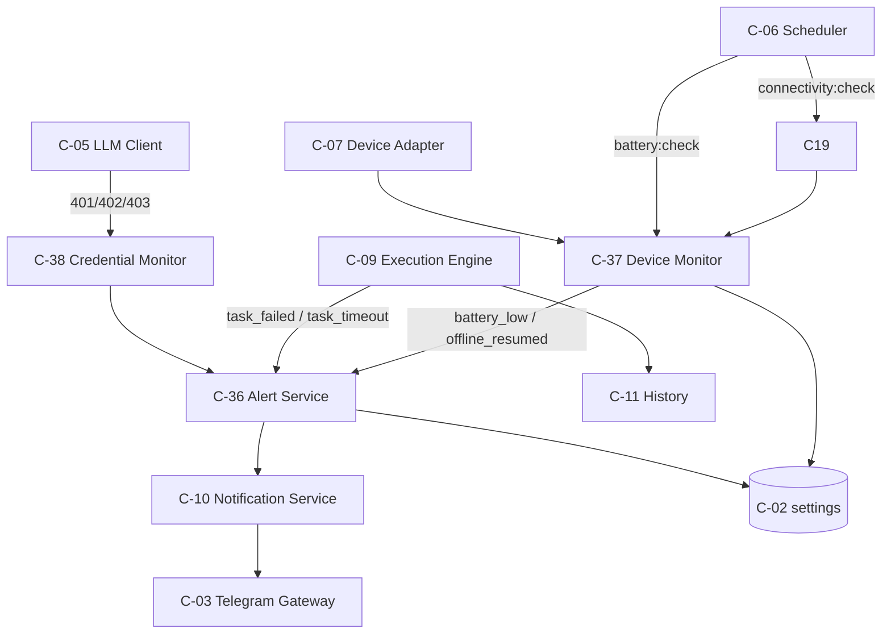
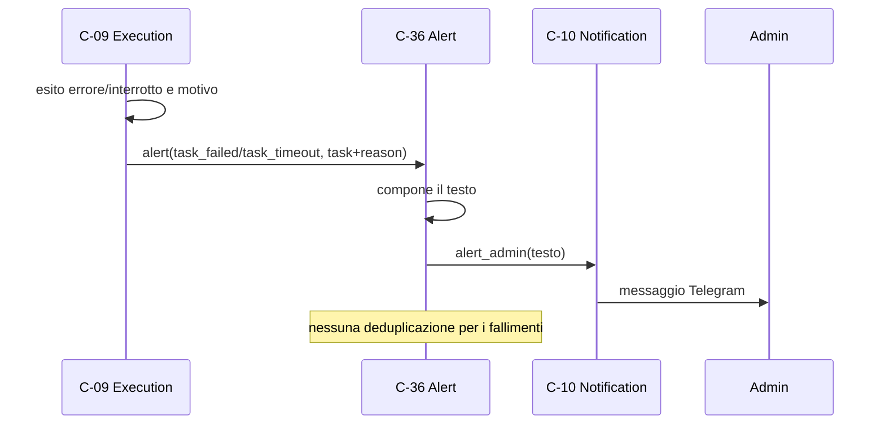
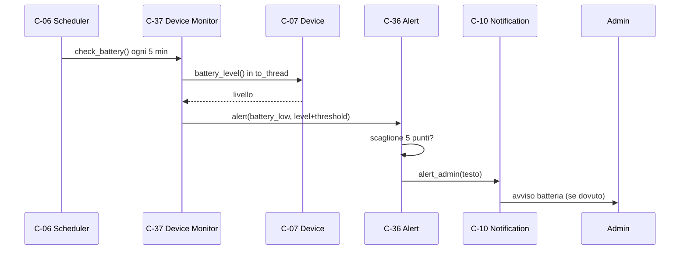
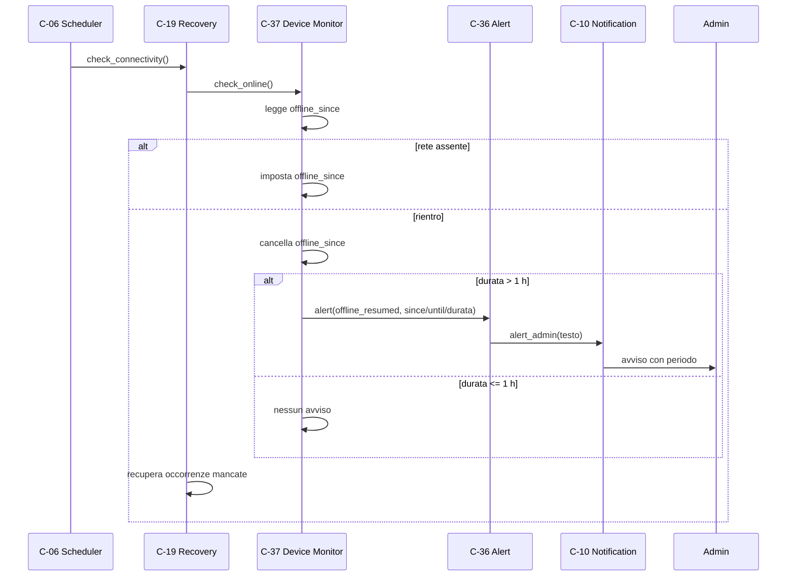
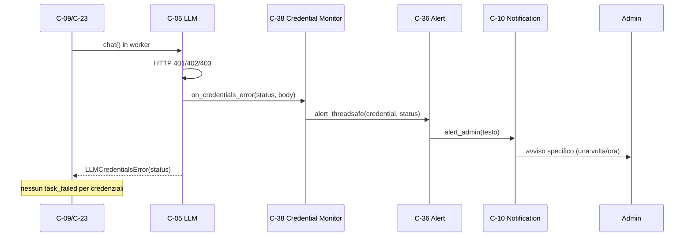

# Architettura 10 — FR-009 Avvisi all'amministratore

- **Spec:** [10-fr009-avvisi-admin.spec.md](../specs/10-fr009-avvisi-admin.spec.md)
- **Voce roadmap:** `10 — FR-009 Avvisi all'amministratore`
- **Piano:** [10-fr009-avvisi-admin.plan.md](../plan/10-fr009-avvisi-admin.plan.md)
- **Constitution:** [constitution.md](../specs/constitution.md)
- **Data:** 2026-11-03
- **Struttura dichiarata:** sezioni di spec 10 + blocco metadata e stile dei documenti
  [09](../architecture/09-fr008-storico-esecuzioni.md) e
  [03](../architecture/03-fr002-esecuzione-programmata.md).

> **Assunzione P-A-01:** in `docs/templates/` esistono solo `template.spec.md` e
> `template.constitution.md`, **nessun template per documenti di architettura**; la struttura è
> derivata dalla spec, dal piano e dai documenti 03/09.

> **Governance:** piano e struttura approvati al checkpoint di Phase 2; Phase 4 **APPROVED**
> (quattro passate) su questo documento.

## 1. Contesto e obiettivi

L'amministratore riceve un avviso Telegram quando un compito fallisce o supera i 10 minuti, quando
la batteria scende sotto il 15%, quando il telefono è rimasto offline più di un'ora e quando la
chiave DeepSeek è scaduta, non valida o senza credito (FR-009, BR-4/BR-8/BR-9/BR-10).

Il processo spento non è osservabile da C-37: è rilevato **per assenza** dal segnale di vita
quotidiano di spec 11. Questa voce scrive `last_online_at` e `offline_since`, i marcatori che spec 11
userà, ma non invia messaggi di ripartenza né segnali di vita (D1/V-10).

Vincoli applicati: processo singolo e un file SQLite (Tech Stack); Telegram solo tramite C-03;
DeepSeek solo tramite C-05; avvisi **solo** all'admin; nessun segreto nei log; fuso del telefono
(BR-14); volumi BR-16 (≤ 5 utenti, ≤ 10 compiti attivi).

Dipendenze consegnate: item 01 (C-01 `limits`, C-02 `settings`, C-03, C-05, C-06, C-07, C-10,
C-13), item 03 (C-09, C-19), item 07/08 (avvisi allowlist e sconosciuti, invariati).

## 2. Componenti

Tre componenti nuovi (C-36, C-37, C-38), cinque estensioni (C-05, C-09, C-19, C-06, C-01), una
chiave di configurazione (`battery_check_s`) e un job periodico.

### C-36 — Alert Service

- **Responsabilità:** comporre i cinque tipi di avviso, deduplicare batteria e credenziali, inviare
  solo all'admin tramite C-10, loggare inviati/deduplicati/scartati/non inviati.
- **Interfaccia pubblica:** `async alert(kind, detail) -> bool`, `alert_threadsafe(kind, detail)`,
  `bind_loop(loop)`, `unbind_loop()`, `async close()`.
- **Input/Output:** `kind` in `{task_failed, task_timeout, battery_low, offline_resumed,
  credential}` e un `detail` con i campi della tabella §8; output `True` se inviato, `False` se
  soppresso, scartato o non inviato. Nessun valore di ritorno è un errore di invio.
- **Dipendenze:** C-10 (invio), C-02 (`settings`). C-04 non è interrogato: l'admin è l'id di
  configurazione e C-10 invia solo a quello (V-09).
- **Error handling:** `kind` sconosciuto o `detail` incompleto → `avviso scartato`, `False`; invio
  fallito → log `avviso non inviato`, `False`, nessun marcatore di deduplicazione; servizio chiuso →
  log e `False`. Non solleva errori di invio.
- **Osservabilità:** log `avviso inviato` (kind, sent_at), `avviso batteria/credenziale deduplicato`,
  `marcatore batteria azzerato`, `marcatore batteria/credenziale non valido`, `avviso scartato`,
  `avviso non inviato`, `avviso non pianificato: loop assente`, `avvisi in volo non attesi`.
- **Sicurezza:** solo `NotificationService.alert_admin`; nessun contenuto sensibile oltre a nome
  compito, tipo errore, livello batteria, orari e status HTTP.

### C-37 — Device Monitor

- **Responsabilità:** leggere batteria e connettività, gestire `offline_since`/`last_online_at`,
  rilevare il rientro dopo un periodo prolungato, inoltrare gli avvisi a C-36.
- **Interfaccia pubblica:** `check_battery() -> int | None`, `check_online() -> OnlineStatus`,
  `is_online() -> bool | None` (asincrona, sola lettura), `offline_since() -> datetime | None`.
- **Input/Output:** stato da C-07; `OnlineStatus(online, resumed, offline_s)`; aggiorna i marcatori
  in `settings` e chiama C-36.
- **Dipendenze:** C-07 (`battery_level`, `is_online`, `record_last_contact`), C-36, C-02, C-06 (job
  che lo invoca; V-17).
- **Error handling:** batteria illeggibile → `None`, log, nessun avviso; rete illeggibile →
  `OnlineStatus(online=None)`, marcatori intatti, nessun avviso. Marcatore offline invalido/futuro:
  **online** → cancellato, log, `resumed=True` con `offline_s=None`, nessun avviso, recupero C-19;
  **offline** → cancellato e reimpostato a now (nuovo periodo), `resumed=False`.
- **Osservabilità:** log `batteria letta` (livello, soglia), `batteria non leggibile`, `periodo
  offline iniziato`, `rientro online` (durata, soglia), `rientro online dopo un periodo prolungato`,
  `stato di rete non leggibile`, `marcatore offline non valido`.
- **Sicurezza:** sola lettura di C-07; nessuna azione sul telefono.

### C-38 — Credential Monitor

- **Responsabilità:** classificare gli errori DeepSeek di autenticazione/credito e inoltrare
  l'avviso specifico.
- **Interfaccia pubblica:** `on_llm_error(http_status, body="") -> bool`.
- **Input/Output:** status HTTP e corpo (non usato); `True` se lo status è 401/402/403 e l'avviso è
  stato inoltrato (anche se dedup o loop assente lo sopprimono), `False` altrimenti.
- **Dipendenze:** C-36; riceve gli errori da C-05 tramite callback.
- **Error handling:** status non numerico → log, `False`; status non di credenziale → log, `False`.
- **Osservabilità:** log `credenziale DeepSeek non valida` (solo status), `errore LLM non di
  credenziale`, `status HTTP non valido`.
- **Sicurezza:** il corpo non viene usato né loggato; la chiave non compare mai.

### Estensioni di componenti esistenti

- **C-05:** callback opzionale `on_credentials_error(status, body)` invocato su 401/402/403 prima di
  `LLMCredentialsError`; il corpo è troncato a 500 caratteri e non entra nell'eccezione.
  `LLMCredentialsError.status` espone il codice.
- **C-09:** timeout → `task_timeout`; errore generico → `task_failed`; `LLMCredentialsError` non
  produce `task_failed` e non invia `credential` (V-08).
- **C-19:** `check_connectivity` usa `check_online`; `recover_missed` usa `await is_online()`;
  costruttore con `monitor` al posto di `device`, senza `settings`; `OFFLINE_SINCE` è riesportato.
- **C-06:** `schedule_battery(callback, *, interval_s)`, id `battery:check`, entry point
  module-level con errori isolati.
- **C-01:** `limits.battery_check_s = 300`.

| Componente | Stato |
|---|---|
| C-04 Role Guard | invariato |
| C-10 Notification Service | invariato (split, retry del gateway C-03) |
| C-07 Device Adapter | invariato |
| C-11 History | invariato |

## 3. Componenti e capacità non disponibili

- **Segnale di vita, messaggio di ripartenza, `liveness_last_sent`, boot recovery:** spec 11
  (V-10). C-37 scrive i marcatori che 11 userà, non invia messaggi di ripartenza.
- **Rilevamento del processo fermo:** non osservabile da C-37; coperto per assenza da spec 11 (D5).
- **Tabella `alerts`:** la spec la dichiara «eventualmente»; si usano i marcatori in `settings`
  (V-04).
- **Avvisi di allowlist log (spec 07), gate (spec 06), sconosciuti (spec 08):** restano nei
  rispettivi componenti; non sono `kind` di spec 10.
- **Retry BR-8:** già in C-05 (LLM) e nel gateway C-03 (Telegram); nessun nuovo retry.
- **Vista di deployment ed ER nuovo:** non dichiarati dalla spec 10 e non necessari; **gap
  registrato**. `settings` è già nel modello dati di spec 01.

## 4. Wiring di `AgentApp`

L'ordine di costruzione è: C-10 (`NotificationService`), C-36 (`AlertService`), C-38
(`CredentialMonitor`), C-37 (`DeviceMonitor`), C-05 (`LLMClient` con callback). `ExecutionEngine`
riceve `alerts`; `RecoveryHandler` riceve `monitor`. `AgentApp` espone `alerts`, `device_monitor` e
`credentials`.

`start()`: `db.migrate()`, `alerts.bind_loop(asyncio.get_running_loop())` **prima** di
`recover_missed()`; poi callback dei job (manutenzione, connettività, batteria con
`config.limits.battery_check_s`), `gateway.start()`, scheduler in pausa, sync dei job e
`recover_missed()`; infine `resume()`. Il bind precede `recover_missed`.

`stop()`: `scheduler.shutdown(wait=False)` → `await alerts.close()` → `await gateway.stop()` →
`db.close()`. `close()` dissocia il loop e attende gli avvisi già pianificati per al massimo
`CLOSE_TIMEOUT_S = 5` secondi; un avviso successivo è scartato. `_dispatch_task` continua a usare
C-07 direttamente per decidere se eseguire.

Nessuna nuova tabella, nessuna migrazione, nessun nuovo servizio esterno.

## 5. Riparto di responsabilità

| Componente | Possiede | Delega | Perché non è duplicazione |
|---|---|---|---|
| C-36 | composizione, dedup batteria/credenziali, invio, log | C-10, C-02 | C-09/C-37/C-38 decidono *quando*; C-36 *se* e *come* |
| C-37 | lettura batteria/rete, `offline_since`, `last_online_at` | C-07, C-36, C-02 | C-19 non scrive più marcatori; un solo scrittore |
| C-38 | classificazione 401/402/403 | C-36 | C-05 rileva l'HTTP; C-38 traduce in avviso |
| C-05 | chiamata DeepSeek, retry, `.status`, callback | C-38 | nessuna decisione di avviso dentro C-05 |
| C-09 | esito e motivo dell'esecuzione | C-36 (task), C-10 (allowlist), C-11 | non compone più i testi di sistema |
| C-19 | recupero occorrenze | C-37 | non scrive marcatori né invia avvisi |
| C-06 | esecuzione periodica batteria/connettività | C-37/C-19 | nessun orologio o soglia duplicata |
| C-10 | invio, split, tastiera | C-03 | C-36 non parla con Telegram |

**Un solo scrittore di `offline_since`.** C-37 imposta, valida e cancella il marcatore; C-19 riceve
solo `OnlineStatus`. **Un solo punto di deduplicazione.** C-36 possiede `battery_last_alert` e
`credential_last_alert`; C-37/C-38 non li toccano. **Un solo punto di invio.** Tutti gli avvisi
passano da `NotificationService.alert_admin`.

## 6. Modello di dominio

- **Avviso:** `Alert(kind, detail, sent_at)`; evento in memoria, non persistito. C-36 lo costruisce
  dopo un invio riuscito e lo usa per il log `avviso inviato`; `sent_at` è valorizzato in quel
  momento. Il testo composto resta interno a C-36.
- **Esiti delle esecuzioni:** `ok`, `errore`, `interrotto` (BR-15); `saltata` resta nello storico.
  Un errore di credenziale produce esito `errore` e l'avviso `credential`, non `task_failed`.
- **Tipi:** `task_failed`, `task_timeout`, `battery_low`, `offline_resumed`, `credential`
  (spec 10).
- **Soglie:** batteria < 15% (BR-9), offline > 1 h (BR-10), timeout 10 min (BR-4), fallimento dopo
  i retry BR-8 di C-05.
- **Stato rete:** `OnlineStatus.online` è `True`, `False` o `None` (non leggibile); `resumed` è
  `True` se `offline_since` esisteva (valido o invalido) e la rete è tornata; `offline_s` è la
  durata solo con marcatore valido.

## 7. Modello dati

Nessuna tabella nuova e nessuna migrazione. `settings` (chiave/valore) conserva:

| Chiave | Scritta da | Letta da | Formato | Note |
|---|---|---|---|---|
| `offline_since` | C-37 | C-37 (`_read_offline_since`); C-19 no | ISO 8601 con offset | un solo scrittore e validatore |
| `last_online_at` | C-37 | spec 11 | ISO 8601 con offset | nome autoritativo (V-02); C-37 scrive e non rilegge |
| `last_contact_at` | C-07 `record_last_contact` (da C-37) | nessuno in `src/` (solo test) | ISO 8601 con offset | mantenuta per compatibilità; in T13 arch 03 aggiorna la propria tabella §5 |
| `battery_last_alert` | C-36 | C-36 | JSON `{"at": ISO, "level": int}` | corrotto = nessun precedente |
| `credential_last_alert` | C-36 | C-36 | ISO 8601 con offset | solo dopo invio riuscito (V-15) |
| `liveness_last_sent` | spec 11 | spec 11 | — | **non toccata** |

Il marcatore offline è validato da un solo helper: `(esisteva, istante)`. Un valore invalido o nel
futuro viene cancellato e loggato. **Online:** è un periodo concluso senza durata,
`resumed=True`, `offline_s=None`, nessun avviso, recupero C-19 eseguito. **Offline:** il marcatore
è reimpostato a now (nuovo periodo), `resumed=False`.

## 8. Regole di deduplicazione e testi

| `kind` | Quando | Deduplicazione | Marcatore | Reset |
|---|---|---|---|---|
| `task_failed` | C-09 conclude `errore` (non credenziali) | nessuna | — | — |
| `task_timeout` | C-09 conclude `interrotto` per BR-4 | nessuna | — | — |
| `battery_low` | C-37 legge la batteria | scaglioni da 5 punti sotto soglia (`level < threshold`) | `battery_last_alert` | `level >= threshold` cancella |
| `offline_resumed` | C-37 rileva il rientro | un avviso per periodo | nessuno di C-36; `offline_since` di C-37 | nuovo periodo = nuovo avviso |
| `credential` | C-38 riceve 401/402/403 | una volta ogni 3600 s | `credential_last_alert` | finestra scaduta |

**Campi di `detail`:** `task_failed {task, reason}`; `task_timeout {task, timeout_s}`;
`battery_low {level, threshold}`; `offline_resumed {since, until, offline_s}`;
`credential {status}`.

**Testi** (italiano, solo dati non sensibili):

| `kind` | Testo |
|---|---|
| `task_failed` | `⚠️ Compito «{task}» fallito: {reason}` |
| `task_timeout` | `⏱️ Compito «{task}» interrotto: timeout dopo {minuti} minuti` |
| `battery_low` | `🔋 Batteria al {level}% (soglia {threshold}%)` |
| `offline_resumed` | `📡 Telefono di nuovo online dopo {durata}: offline dalle {inizio} alle {fine}.` |
| `credential` | `🔑 DeepSeek: {motivo} (HTTP {status}). Controlla la chiave o il credito.` |

- `reason` è il **tipo** dell'eccezione, non il messaggio; `minuti = max(1, round(timeout_s / 60))`
  (600 s → `10 minuti`).
- `credential` mappa `401 → chiave non valida`, `402 → credito esaurito`, `403 → accesso negato`.
- `offline_resumed` formatta inizio/fine nel fuso del telefono e la durata in `X h Y min`, `X h`
  (ore esatte; i secondi sono troncati) o `Y min` se meno di un'ora; sotto il minuto è `0 min`.
- `kind` sconosciuto o `detail` incompleto → log `avviso scartato`, nessun messaggio inventato.

## 9. Rilevamento offline e credenziali

**Offline.** `check_online` legge C-07 in `asyncio.to_thread`. Offline: se il marcatore manca o è
invalido, lo imposta a now. Online: aggiorna `last_online_at` e `last_contact_at`, legge il
marcatore, calcola la durata, **cancella sempre `offline_since`** (il periodo è concluso) e poi
tenta l'avviso se `durata > offline_threshold_s`. Un invio fallito non ripete l'avviso a ogni
campionamento: l'assenza è coperta da spec 11. Un `DeviceError` restituisce `online=None` senza
toccare i marcatori.

**Credenziali.** C-05 chiama il callback su 401/402/403 e poi solleva
`LLMCredentialsError(status=…)`. C-38 classifica e chiama `alert_threadsafe`, che pianifica
`alert` sul loop; il corpo non è usato né loggato. C-09 non invia `task_failed` per un errore di
credenziale: l'unico produttore dell'avviso è C-38 (V-08).

## 10. Flussi di dati

### 10.1 Fallimento/timeout di un compito (AC-01)

### 10.2 Batteria sotto soglia (AC-02)

### 10.3 Offline prolungato (AC-03)

### 10.4 Chiave DeepSeek non valida (AC-04)

## 11. Concorrenza e ciclo di vita

- **Loop e thread.** `alert` gira sull'event loop; `alert_threadsafe` è l'ingresso dai chiamanti
  sincroni di C-05, che possono stare sul loop o su un worker. `run_coroutine_threadsafe` è sicuro
  da entrambi.
- **Lock.** C-36 serializza sotto `asyncio.Lock` solo decisione e prenotazione della
  deduplicazione; l'invio con i retry BR-8 del gateway C-03 resta fuori dal lock. I tipi senza
  deduplicazione non entrano nel lock.
- **Thread e SQLite.** C-37 legge C-07 in `asyncio.to_thread`; i marcatori in `settings` sono
  toccati solo sul thread dell'event loop (`check_same_thread=True`). `is_online` è asincrona;
  `offline_since` è sincrona ma solo `settings`.
- **Chiusura.** `stop`: `scheduler.shutdown(wait=False)` → `await alerts.close()` → `gateway.stop()`
  → `db.close()`. `close()` dissocia e attende gli in-flight per `CLOSE_TIMEOUT_S`; allo scadere
  logga `avvisi in volo non attesi` e cancella le future.
- **Riavvio.** I marcatori sono persistenti: la deduplicazione batteria/credenziali sopravvive;
  `offline_since` sopravvive e il primo `check_online` produce l'avviso se la durata supera la
  soglia. `recover_missed` non invia avvisi.

## 12. Integrazioni

| Integrazione | Direzione | Uso in questa voce |
|---|---|---|
| Telegram (C-03 via C-10) | uscita | avvisi all'admin |
| SQLite (C-02) | locale | marcatori in `settings` |
| Termux:API (C-07) | locale | batteria e connettività |
| DeepSeek (C-05) | uscita | errori 401/402/403 |
| Scheduler (C-06) | interno | job batteria e connettività |

Contratti invariati: Telegram solo C-03, SQLite solo C-02. `alerts.py`, `device_monitor.py` e
`credential_monitor.py` non importano `telegram` né `sqlite3`; le asserzioni di
`tests/test_boundaries.py` restano valide.

## 13. Sicurezza

- **Solo admin:** C-36 usa `NotificationService.alert_admin`, che invia all'id di configurazione;
  C-04 non è interrogato e nessun altro destinatario è possibile.
- **Nessun segreto:** i testi contengono nome compito, tipo errore, livello batteria, orari e status
  HTTP. C-38 non logga il corpo; C-05 non lo include nell'eccezione.
- **Dati solo sull'S24:** nessuna copia altrove.
- **Sola lettura:** C-37 legge batteria/rete, non esegue azioni.

## 14. Requisiti non funzionali

| Requisito | Implementazione |
|---|---|
| Tempestività fallimento/timeout/batteria/credenziali | avviso immediato al termine dell'esecuzione, al campionamento batteria o all'errore LLM |
| Tempestività offline | avviso al rientro, entro il ciclo di connettività da 60 s |
| Deduplicazione | batteria a scaglioni; credenziali a 1 h; fallimenti per esecuzione |
| Volumi BR-16 | non pertinente: avvisi occasionali, ≤ 10 compiti attivi |
| Processo singolo / SQLite | nessuno stato condiviso nuovo |
| Osservabilità | log di invio/dedup/scarto, batteria, rete e credenziali |

## 15. Rischi e assunzioni

Rischi residui: un invio offline può fallire e il periodo non viene ritentato (coperto da liveness);
un'oscillazione 14→15→14 al valore di soglia azzera e ricrea il marcatore e produce un nuovo avviso
a ogni campionamento (comportamento dichiarato, nessuna isteresi);
i retry del gateway possono ritardare il recupero C-19; un marcatore offline corrotto perde la
durata ma non il recupero; un `LLMClient` iniettato nei test non riceve il callback di C-38; il job
batteria dipende da Termux:API.

Assunzioni: P-A-01…P-A-29 nel [piano 10](../plan/10-fr009-avvisi-admin.plan.md). In sintesi: struttura
documentale derivata; soglie da `limits`; `battery_check_s=300`; dedup batteria a 5 punti e
credenziali a 1 h; `resumed` su marcatore esistente; `last_online_at` autoritativo; `Alert` in
memoria; `body` non usato; DB solo sul loop; `close()` con tetto di 5 s.

## 16. Domande aperte chiuse

Le domande tecniche sono state chiuse dall'operatore il 2026-11-03:

1. **Frequenza di campionamento.** Batteria ogni 5 minuti (`limits.battery_check_s = 300`);
   connettività sul job esistente da 60 s (D2).
2. **Soglia di deduplicazione.** Batteria a scaglioni di 5 punti con reset sopra soglia; credenziali
   una volta all'ora; fallimenti per esecuzione (D3/D4/D6).
3. **Definizione di offline.** Solo rete assente da C-07; il processo spento è coperto da spec 11
   (D5).

Sono chiuse anche le questioni implicite: C-36/C-37/C-38, nessuna tabella `alerts`, marcatori
`last_online_at`/`last_contact_at`.

## 17. Fuori scope

- Segnale di vita, messaggio di ripartenza, `liveness_last_sent`, boot recovery (spec 11).
- Rilevamento del processo fermo.
- Tabella `alerts` e migrazioni.
- Avvisi di allowlist, gate e sconosciuti (spec 07/06/08).
- Retry BR-8 aggiuntivi.
- Vista di deployment ed ER nuovo.
- Modifica delle soglie a runtime oltre `limits`.

## 18. Deviazioni dichiarate

| # | Deviazione | Fonte | Motivo |
|---|---|---|---|
| V-01 | C-37 è l'unico scrittore di `offline_since`; C-19 delega | spec 03 C-19 / spec 10 C-37 | evita due scrittori e due avvisi sullo stesso rientro |
| V-02 | `last_online_at` autoritativo accanto a `last_contact_at` legacy | spec 01 C-07, arch 03 | riconcilia il naming senza rompere i lettori |
| V-03 | `alert(kind, detail)` con mapping e `bool` | spec 10 C-36 | C-36 compone e deduplica; il tipo di `detail` non è dichiarato |
| V-04 | Nessuna tabella `alerts` | spec 10 §Modello dati | i marcatori sono già il meccanismo dichiarato |
| V-05 | Callback C-05 → C-38 e ponte thread-safe | spec 10 flusso 4 | C-05 è sincrona e può girare su worker |
| V-06 | Job batteria ogni 300 s | spec 10 domanda 1 | D2; connettività invariata a 60 s |
| V-07 | `task_failed`/`task_timeout` via C-36; allowlist diretta | spec 07 / spec 10 | l'allowlist non è un `kind` di spec 10 |
| V-08 | Credenziale senza `task_failed`; C-38 unico produttore | AC-01/AC-04 | evita raffiche e doppioni |
| V-09 | C-04 non interrogato da C-36 | spec 10 C-36 | l'admin è l'id di configurazione, C-10 invia solo a quello |
| V-10 | Ripartenza/liveness a spec 11 | spec 10 dipendenza 11 | D1 |
| V-11 | Batteria/rete illeggibili → nessun avviso spurio; rete `None` | spec 10 C-37; spec 03 | un guasto Termux:API non simula una batteria scarica o un offline |
| V-12 | Dedup batteria a 5 punti e credenziali a 1 h | spec 10 domanda 2 | D3/D4; nessuna chiave oltre al campionamento |
| V-13 | Nessuna vista deployment/ER | spec 10 | non dichiarati; `settings` è già nel modello |
| V-14 | C-37 espone `is_online()` pura | spec 10 C-37 | C-19 ha bisogno di una lettura senza marcatori |
| V-15 | `credential_last_alert` in `settings` | spec 10 §Modello dati | dedup persistente senza tabella `alerts` |
| V-16 | `RecoveryHandler(monitor=…)` senza `settings`; `OFFLINE_SINCE` riesportato | spec 03 C-19 | un solo scrittore; re-export per compatibilità |
| V-17 | C-06 invoca C-37; C-37 non pianifica sé stesso | spec 10 C-37 | la dipendenza C-06 è soddisfatta dal job |

## 19. Tracciabilità

| Requisito / criterio | Evidenza |
|---|---|
| AC-01 compito fallito (cause non-credenziali) | `tests/test_alerts_ac.py::test_ac01_failed_task_alerts_admin` |
| AC-02 batteria 14% | `tests/test_alerts_ac.py::test_ac02_low_battery_alerts_admin` |
| AC-03 offline 2 h | `tests/test_alerts_ac.py::test_ac03_offline_period_alerts_on_return` |
| AC-04 credenziale | `tests/test_alerts_ac.py::test_ac04_credential_error_alerts_admin` |
| FR-009 nessun messaggio di ripartenza/liveness | `tests/test_alerts_ac.py::test_no_restart_or_liveness_message` |
| BR-4 timeout | `tests/test_execution.py::test_timeout_uses_alert_service`, `tests/test_alerts.py::test_task_timeout_text` |
| BR-8 retry | `tests/test_llm.py::test_transient_error_is_retried_three_times`, `::test_failure_after_three_attempts`; `tests/test_telegram_gateway.py::test_retry_three_times_on_transient_error` |
| BR-9 soglia batteria | `tests/test_device_monitor.py::test_battery_below_threshold_alerts`, `::test_battery_at_threshold_does_not_alert`, `::test_battery_at_threshold_resets_marker` |
| BR-10 offline | `tests/test_device_monitor.py::test_long_offline_alerts_on_return`, `::test_short_offline_does_not_alert`, `::test_one_alert_per_offline_period` |
| Dedup batteria | `tests/test_alerts.py::test_battery_escalates_every_five_points`, `::test_battery_marker_resets_above_threshold`, `::test_battery_uses_the_threshold_from_detail` |
| Dedup credenziali | `tests/test_alerts.py::test_credential_is_deduplicated_within_one_hour`, `::test_credential_dedup_survives_a_new_service` |
| Fallimenti per esecuzione | `tests/test_alerts.py::test_task_failure_is_not_deduplicated` |
| Testi e admin-only | `tests/test_alerts.py::test_alert_texts`, `::test_alerts_go_only_to_admin`, `::test_timeout_minutes_are_integers` |
| Errori di invio | `tests/test_alerts.py::test_failed_send_does_not_mark_dedup`, `::test_send_happens_outside_the_lock` |
| `kind` sconosciuto/detail incompleto | `tests/test_alerts.py::test_unknown_kind_is_discarded`, `::test_missing_detail_is_discarded` |
| Marcatore batteria corrotto | `tests/test_alerts.py::test_corrupted_battery_marker_is_ignored` |
| Ponte thread | `tests/test_alerts.py::test_alert_threadsafe_requires_a_bound_loop`, `::test_alert_threadsafe_schedules_on_loop`, `::test_unbind_stops_scheduling`, `::test_close_waits_for_inflight_alerts`, `::test_close_times_out_pending_alerts` |
| Log C-36/C-37/C-38 | `tests/test_alerts.py::test_logs_sent_and_deduplicated`, `::test_logs_marker_reset_and_unplanned`, `::test_logs_discarded_alerts`, `tests/test_device_monitor.py::test_logs_level_and_threshold`, `::test_logs_network_state`, `::test_logs_unreadable_and_invalid_marker`, `tests/test_credentials.py::test_logs_status_only`, `::test_logs_invalid_status` |
| C-37 batteria | `tests/test_device_monitor.py::test_battery_unreadable_is_silent`, `::test_battery_reading_is_returned` |
| C-37 offline | `tests/test_device_monitor.py::test_offline_marker_is_written_and_cleared`, `::test_unknown_state_does_not_touch_markers`, `::test_invalid_marker_is_cleared_and_recovers`, `::test_future_marker_is_cleared_and_recovers`, `::test_offline_marker_is_cleared_after_a_failed_alert` |
| C-37 marcatori | `tests/test_device_monitor.py::test_last_online_and_last_contact_are_written`, `::test_offline_since_getter`, `::test_is_online_does_not_write_markers`, `::test_is_online_unreadable_returns_none` |
| Recupero con marcatore invalido | `tests/test_recovery.py::test_invalid_marker_still_recovers`, `::test_connectivity_uses_the_monitor` |
| Boot senza avvisi | `tests/test_recovery.py::test_boot_does_not_alert` |
| C-38 classificazione | `tests/test_credentials.py::test_credential_statuses_are_classified`, `::test_transient_status_is_ignored`, `::test_body_is_not_logged`, `::test_credential_is_produced_once` |
| Marcatore credenziale corrotto | `tests/test_alerts.py::test_corrupted_credential_marker_is_ignored` |
| C-05 callback | `tests/test_llm.py::test_credentials_error_calls_the_monitor`, `::test_credentials_error_exposes_status` |
| C-09 credenziale | `tests/test_execution.py::test_credential_error_does_not_alert_task_failed`, `::test_generic_failure_uses_alert_service` |
| Job batteria | `tests/test_scheduler.py::test_battery_job_is_registered`, `::test_battery_job_error_is_isolated`, `::test_battery_interval_must_be_positive` |
| Configurazione | `tests/test_config.py::test_loads_valid_config`, `::test_invalid_battery_check_is_rejected` |
| Wiring | `tests/test_bootstrap.py::test_build_exposes_alert_components`, `::test_start_binds_alert_loop_and_schedules_battery`, `::test_stop_closes_alert_service` |
| Nessuna migrazione | `tests/test_storage.py::test_migration_creates_spec_tables` (schema 005 invariato) |
| Confini | `tests/test_boundaries.py` invariato |

## Aggiornamento 2026-11-04 (voce 11)

`liveness_last_sent` è ora scritto da C-40 solo dopo un invio riuscito e letto da C-39 per il
segnale mancato; `human_duration` di C-36 è pubblica e riusata da C-41. L'invio di un avviso offline
fallito resta coperto dalla liveness per assenza: il segnale mancato con processo vivo e rete
assente è riportato al prossimo avvio, non al rientro di rete.
