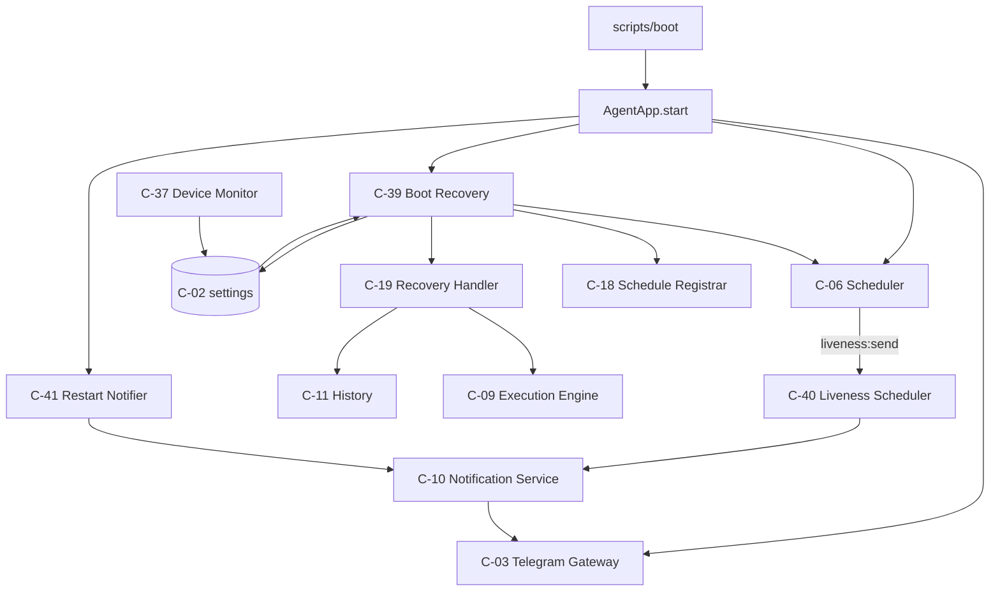
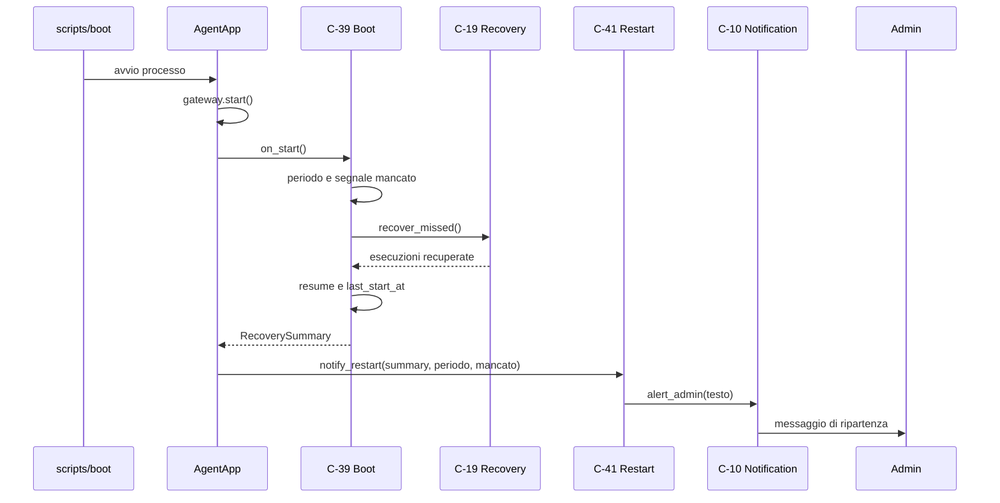
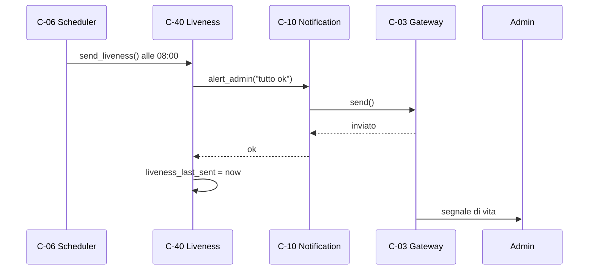
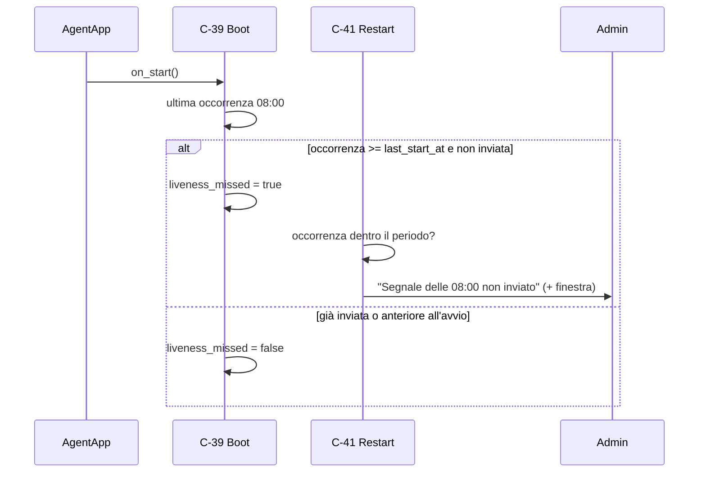
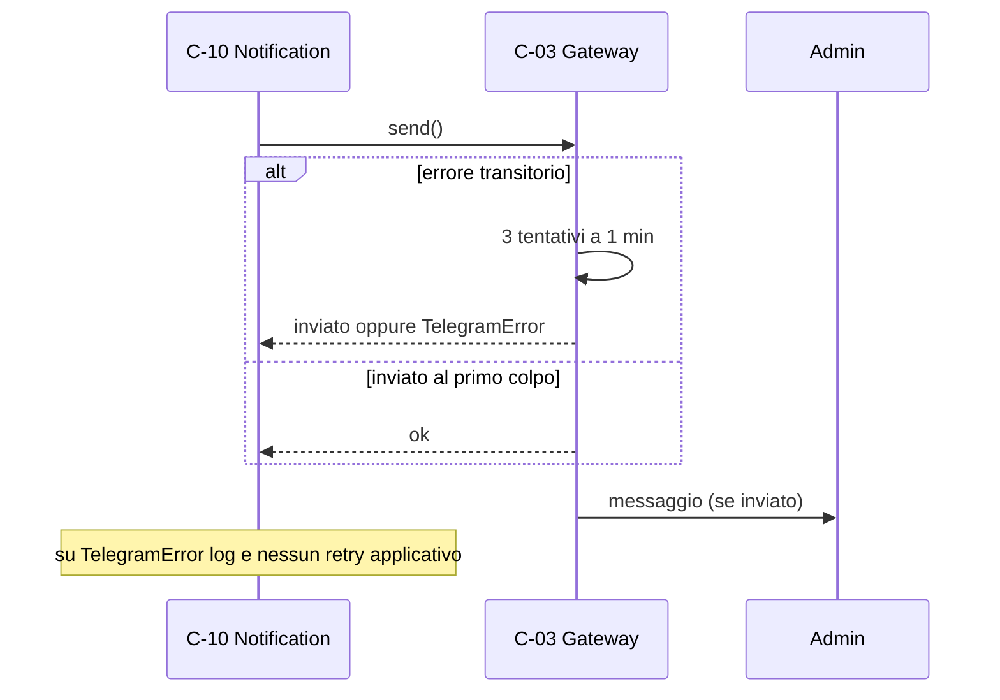

# Architettura 11 — FR-010 Riavvio automatico e segnale di vita

- **Spec:** [11-fr010-riavvio-liveness.spec.md](../specs/11-fr010-riavvio-liveness.spec.md)
- **Voce roadmap:** `11 — FR-010 Riavvio e liveness`
- **Piano:** [11-fr010-riavvio-liveness.plan.md](../plan/11-fr010-riavvio-liveness.plan.md)
- **Constitution:** [constitution.md](../specs/constitution.md)
- **Data:** 2026-11-04
- **Struttura dichiarata:** sezioni di spec 11 + blocco metadata e stile dei documenti
  [10](../architecture/10-fr009-avvisi-admin.md), [09](../architecture/09-fr008-storico-esecuzioni.md)
  e [03](../architecture/03-fr002-esecuzione-programmata.md).

> **Assunzione P-A-01:** in `docs/templates/` esistono solo `template.spec.md` e
> `template.constitution.md`, **nessun template per documenti di architettura**; la struttura è
> derivata dalla spec, dal piano e dai documenti 10/09/03.

> **Governance:** piano e struttura approvati al checkpoint di Phase 2 (2026-11-04); Phase 4
> **APPROVED** su questo documento.

## 1. Contesto e obiettivi

L'agente deve restare attivo per settimane senza interventi manuali. Dopo un crash o un riavvio del
telefono riparte da solo, recupera le occorrenze mancate (BR-5, una sola per compito) e invia
all'amministratore un messaggio di ripartenza con il periodo di assenza e il numero di compiti
recuperati. Ogni giorno alle `limits.liveness_at` (default 08:00, BR-11) invia un segnale di vita.
Se era offline alle 8:00, il segnale mancato è riportato nel messaggio di ripartenza.

Il processo spento non è osservabile da nessun componente in esecuzione: è rilevato **per assenza**
del segnale quotidiano. Il wake-lock e l'autostart restano nello script di boot (V-01), perché un
processo non può avviarsi da solo prima di esistere.

Vincoli applicati: processo singolo e un file SQLite (Tech Stack); Telegram solo tramite C-03;
nessuna azione privilegiata implicita; solo l'amministratore riceve i messaggi di sistema; fuso del
telefono (BR-14); il dimensionamento BR-16 resta quello di spec 01 (≤ 5 utenti, ≤ 10 compiti): la
voce non introduce utenti né compiti.

Dipendenze consegnate: item 01 (C-01, C-02, C-03, C-06, C-10, C-11, C-12), item 03 (C-18, C-19),
item 10 (C-36, C-37, `last_online_at`, `offline_since`, `alerts.close()`).

## 2. Componenti

Tre componenti nuovi (C-39, C-40, C-41), quattro estensioni (C-19, C-06, C-01, C-36) e nessuna
tabella nuova.

### C-39 — Boot Recovery

- **Responsabilità:** all'avvio calcolare il periodo di assenza e il segnale mancato, caricare i job
  in pausa, sincronizzare i marcatori, recuperare le occorrenze con C-19, riattivare lo scheduler e
  scrivere `last_start_at`.
- **Interfaccia pubblica:** `async on_start() -> RecoverySummary`.
- **Input/Output:** legge `last_start_at`, `last_online_at`, `liveness_last_sent`; restituisce
  `RecoverySummary`; effetti su job store, `settings` ed esecuzioni `recovery`.
- **Dipendenze:** C-06 (start/resume), C-18 (sync), C-19 (recupero), C-02 (marcatori). C-12 è il
  supervisor/script di boot, non invocato qui (V-01).
- **Error handling:** `AgenteError` dal recupero → log `avvio parziale` e rilancio; il loop esterno
  riavvia il processo e `last_start_at` resta vecchio (V-13). Marcatori invalidi o nel futuro →
  trattati come assenti, log.
- **Osservabilità:** log `avvio completato` con secondi di assenza, mancate, recuperate e segnale
  mancato; log `marcatore non valido`; log `avvio parziale`.
- **Sicurezza:** legge i marcatori e scrive solo `last_start_at`; nessuna azione sul telefono,
  nessun comando.

### C-40 — Liveness Scheduler

- **Responsabilità:** inviare il segnale quotidiano all'admin e registrare l'esito in `settings`.
- **Interfaccia pubblica:** `async send_liveness() -> bool` (V-11).
- **Input/Output:** testo con `limits.liveness_at`; `liveness_last_sent` scritto solo dopo un invio
  riuscito.
- **Dipendenze:** C-10 (invio), C-03 (retry BR-8 tramite C-10), C-02 (marcatore), C-06 (quando).
- **Error handling:** `AgenteError`/`TelegramError` → log `segnale di vita non inviato`, `False`,
  marcatore intatto (V-11/§8). Nessuna eccezione di invio propagata; un errore di storage successivo
  all'invio resta un errore esplicito.
- **Osservabilità:** log `segnale di vita inviato` (orario e istante), `segnale di vita non inviato`.
- **Sicurezza:** solo `NotificationService.alert_admin`; nessun destinatario arbitrario.

### C-41 — Restart Notifier

- **Responsabilità:** comporre e inviare il messaggio di ripartenza con periodo, durata e compiti
  recuperati; aggiungere la riga del segnale mancato, con la finestra solo se pertinente.
- **Interfaccia pubblica:** `async notify_restart(recovery_summary, offline_period,
  liveness_missed) -> bool`.
- **Input/Output:** dati già calcolati da C-39; testo inviato via C-10; `False` se non inviato.
- **Dipendenze:** C-10 (invio), C-03 (retry BR-8). Le dipendenze dichiarate C-39/C-40/C-02 sono
  soddisfatte dai parametri (V-07).
- **Error handling:** `AgenteError` → log `ripartenza non inviata`, `False`, nessun retry
  applicativo. Periodo assente (primo avvio) → nessun invio.
- **Osservabilità:** log `ripartenza inviata` con secondi, recuperati e mancate; `ripartenza non
  inviata`; `ripartenza non inviata: nessun avvio precedente`.
- **Sicurezza:** solo admin; nessun contenuto dei compiti nel testo.

### Estensioni di componenti esistenti

- **C-19:** `last_summary` additivo (`RecoveryStats`: mancate, recuperate, fallite, saltate,
  rinviate), azzerato all'ingresso di `recover_missed`/`check_connectivity` (V-03). Ritorno
  `list[ExecutionResult]` e idempotenza invariati.
- **C-06:** `schedule_liveness(callback, *, at)`, id `liveness:send`, `CronTrigger(hour, minute,
  timezone=scheduler.timezone)`, `replace_existing=True`, `misfire_grace_time=None` (V-04/V-05).
- **C-01:** `limits.liveness_at` validato in modo stretto `HH:MM` con intervalli (V-08); nessuna
  chiave nuova.
- **C-36:** `human_duration` diventa pubblica e riusata da C-41 (V-10).

**Componenti invariati:** C-02 (storage), C-03 (gateway e retry BR-8), C-07 (device), C-09
(execution), C-10 (notification), C-11 (history), C-12 (supervisor), C-18 (registrar), C-37
(device monitor).

## 3. Componenti e capacità non disponibili

- **Wake-lock e autostart:** in `scripts/boot/start-agent.sh` e `scripts/boot/90-agent.sh`
  (`termux-wake-lock`, trap di unlock, loop di riavvio con backoff). C-39 non li duplica (V-01).
- **Distinzione riavvio telefono vs crash processo:** nessun segnale affidabile in Termux; un solo
  testo (V-06).
- **Segnale mancato al rientro di rete senza riavvio:** non inviato; l'avviso `offline_resumed` di
  item 10 copre il rientro e il segnale mancato è riportato al prossimo avvio (V-09).
- **Invio di ripartenza ritentato dopo un fallimento persistente:** BR-8 nel gateway; poi log e
  nessun retry (gap).
- **Vista di deployment ed ER nuovo:** non dichiarati da spec 11 e non necessari; `settings`,
  `executions` e `apscheduler_jobs` esistono già.

## 4. Wiring di `AgentApp`

Ordine di `start()`:

1. `db.migrate()`, `alerts.bind_loop`, `approvals.recover_pending`, handler, inbound, dispatcher.
2. Callback dei job: manutenzione, connettività, batteria e **liveness**
   (`schedule_liveness(at=config.limits.liveness_at)`); lo scheduler non è ancora avviato.
3. `gateway.start()` in `try/except Exception`: log `avvio gateway fallito` e rilancio (V-13).
4. `summary = await boot.on_start()`: start in pausa → sync → recupero → resume → `last_start_at`.
5. `await restart_notifier.notify_restart(summary, summary.offline_period,
   summary.liveness_missed)`.
6. `supervisor.heartbeat()`, `_started = True`.

`stop()` resta invariato: `scheduler.shutdown(wait=False)` → `alerts.close()` → `gateway.stop()` →
`db.close()`. Dopo `stop()` l'istanza non è riutilizzabile (database chiuso): un nuovo avvio è un
nuovo processo/istanza del loop esterno.

## 5. Riparto di responsabilità

| Componente | Possiede | Delega | Perché non è duplicazione |
|---|---|---|---|
| C-39 | periodo, booleano segnale mancato, orchestrazione, `last_start_at` | C-06, C-18, C-19, C-02 | C-19 resta l'unico che recupera |
| C-40 | testo e invio liveness, `liveness_last_sent` | C-10, C-06, C-02 | C-06 decide quando, C-40 cosa |
| C-41 | testo ripartenza e finestra del segnale mancato | C-10 | C-39 decide *se*, C-41 *come* |
| C-19 | recupero e conteggi | C-06, C-09, C-18 | C-39 non ricalcola le occorrenze |
| C-06 | job liveness e periodici | C-40, C-19, C-37 | nessun orologio duplicato |
| C-01 | validazione `liveness_at` | — | un solo validatore di merito |
| C-10 | invio, split | C-03 | C-40/C-41 non parlano con Telegram |
| C-12 | watchdog, loop esterno | script di boot | C-39 non duplica il watchdog |

**Un solo scrittore** per `last_start_at` (C-39) e `liveness_last_sent` (C-40). **Un solo recupero**
(C-19). **Un solo punto di invio** (`alert_admin`).

## 6. Modello di dominio

- **OfflinePeriod:** `since`, `until`, `seconds`; misura il periodo senza contatto dell'agente
  (processo fermo e/o rete assente).
- **RecoverySummary:** `missed_count` (recuperate + fallite + saltate + rinviate), `recovered`
  (esiti `ok`), `offline_period`, `liveness_missed`.
- **RecoveryStats:** conteggi interni di C-19 (`missed`, `recovered`, `failed`, `skipped`,
  `deferred`).
- **Segnale di vita:** evento quotidiano alle `liveness_at`; il marcatore registra l'ultimo invio
  riuscito.
- **Sessione agente:** intervallo fra `last_start_at` e l'avvio corrente; il processo precedente è
  considerato terminato all'ultimo contatto (`last_online_at`).

## 7. Modello dati

Nessuna tabella nuova e nessuna migrazione (schema 005). `settings` conserva:

| Chiave | Scritta da | Letta da | Formato | Note |
|---|---|---|---|---|
| `last_start_at` | C-39 | C-39 | ISO 8601 con offset | istante d'ingresso, scritto a fine `on_start` |
| `liveness_last_sent` | C-40 | C-39 | ISO 8601 con offset | solo dopo invio riuscito |
| `last_online_at` | C-37 | C-39 | ISO 8601 (UTC) | sorgente del periodo |
| `offline_since` | C-37 | C-37; C-19 via `OnlineStatus` | ISO 8601 | rete assente; **non letta da C-39** |
| `last_contact_at` | C-07 | solo test | ISO 8601 | compatibilità |
| `battery_last_alert`, `credential_last_alert` | C-36 | C-36 | — | voce 10 |

Job ripristinati: `apscheduler_jobs`. Esecuzioni di recupero: `executions` con trigger `recovery` e
occorrenze `saltata`.

## 8. Regole di liveness e testi

| Evento | Regola | Marcatore |
|---|---|---|
| Liveness quotidiana | cron alle `liveness_at`; invio riuscito → marcatore; fallito → nessun marcatore | `liveness_last_sent` |
| Job in ritardo | dentro il processo viene eseguito (`misfire_grace_time=None`); fra processi il trigger è ricalcolato all'avvio | — |
| Avvio con `last_start_at` valido | messaggio di ripartenza sempre | `last_start_at` |
| Primo avvio assoluto | nessun messaggio | `last_start_at` |
| Segnale mancato | ultima occorrenza di `liveness_at` ≤ now, ≥ `last_start_at`, non coperta da un invio | — |
| Finestra del segnale mancato | inclusa solo se `since <= occorrenza <= until` | — |
| Avvio senza Telegram | `gateway.start()` fallisce: log e riavvio esterno; nessun messaggio | — |
| C-07 offline ma gateway avviato | recupero rinviato, messaggio con 0 recuperati; recupero al rientro | — |

**Testi** (`at` = `limits.liveness_at`):

| Evento | Testo |
|---|---|
| Liveness | `✅ Segnale di vita: tutto ok ({at}).` |
| Ripartenza | `🔄 Sono di nuovo attivo — offline dalle {since:%d/%m %H:%M} alle {until:%d/%m %H:%M} ({durata}), recuperati {n} compiti.` |
| Ripartenza, `n=1` | `… recuperato 1 compito.` |
| Segnale mancato | `⏰ Segnale delle {at} non inviato.`; se l'occorrenza è nel periodo, la riga intera è `⏰ Segnale delle {at} non inviato — offline dalle {since:%d/%m %H:%M} alle {until:%d/%m %H:%M}.` |

La durata usa `human_duration` di C-36 (`X h Y min`, `X h`, `Y min`, `0 min`). Il conteggio `n` è
quello dei recuperi riusciti; gli esiti puntuali restano nello storico.

## 9. Rilevamento dell'assenza e del riavvio

Il periodo si calcola all'ingresso di `on_start`: `since` è `last_online_at` (aggiornato da C-37
ogni 60 s quando la rete è disponibile), altrimenti `last_start_at`; `until` è l'istante d'ingresso;
`seconds = max(0, until-since)`.

**Semantica di «offline».** Nel messaggio di ripartenza «offline dalle X alle Y» significa
**assenza di contatto dell'agente**: include sia il processo fermo sia un'assenza di rete mentre il
processo era vivo. È distinto da `offline_since` di item 10, che descrive la sola rete assente e
produce l'avviso `offline_resumed`. `last_start_at` invalido annulla periodo e messaggio; un
`last_online_at` invalido usa il fallback. I marcatori senza offset sono letti in UTC.

Il segnale mancato si valuta prima di `resume()` per non correre con il job delle 8:00. Se
l'occorrenza delle 8:00 è anteriore al precedente avvio, non è imputabile a questa assenza.

## 10. Flussi di dati

### 10.1 Riavvio (AC-01)

### 10.2 Segnale di vita (AC-02)

### 10.3 Segnale mancato (AC-03)

### 10.4 Retry BR-8

## 11. Concorrenza e ciclo di vita

- **Un solo avvio per ciclo.** `AgentApp.start` è protetto da `_started`; dopo `stop()` l'istanza non
  è riutilizzabile e un nuovo avvio è un nuovo processo. `BootRecovery` gira sul thread dell'event
  loop.
- **Recupero una volta.** C-19 avanza `next_run` dopo l'esecuzione o subito su `LockHeldError`
  (`deferred`); un nuovo avvio non recupera due volte la stessa occorrenza.
- **Job persistiti.** `schedule_liveness` è registrato prima di `scheduler.start(paused=True)`; i
  job si caricano in pausa, il recupero avviene, poi `resume()`.
- **Chiusura.** `stop()` invariato; C-39/C-40/C-41 non tengono risorse proprie.
- **Riavvio.** I marcatori sono persistenti: periodo e deduplicazione sopravvivono al processo.

## 12. Integrazioni

| Integrazione | Direzione | Uso |
|---|---|---|
| Termux:Boot / wake-lock | locale | autostart e continuità (`scripts/boot/`) |
| Termux:API (C-07) | locale | stato rete per C-19/C-37 |
| APScheduler (C-06) | interno | job liveness e recupero |
| Telegram (C-03 via C-10) | uscita | ripartenza e segnale di vita |
| SQLite (C-02) | locale | marcatori in `settings` |
| APScheduler job store | locale | tabella `apscheduler_jobs` nello stesso file SQLite, gestita dalla libreria |

I nuovi moduli non importano `telegram`, `sqlite3`, `httpx` né `apscheduler` direttamente: i confini
di `tests/test_boundaries.py` restano validi.

## 13. Sicurezza

- **Solo admin:** C-40 e C-41 usano `NotificationService.alert_admin`; nessun altro destinatario.
- **Nessun segreto:** i testi contengono solo orari, durata e conteggi.
- **Ripristino fedele:** C-39 legge i marcatori e non riscrive stato non proprio; `last_start_at` è
  l'unico valore nuovo.
- **Nessuna azione privilegiata implicita:** nessun comando o modifica al telefono; wake-lock e
  autostart restano nello script (V-01).

## 14. Requisiti non funzionali

| Requisito | Implementazione |
|---|---|
| Attivo per settimane (FR §12) | riavvio esterno con backoff, job persistiti, recupero idempotente |
| Segnale ogni giorno alle 8:00 (BR-11) | cron su `liveness_at`, marcatore persistente |
| Recupero una sola occorrenza (BR-5) | C-19 invariato, marcatore `next_run` |
| Retry 3×1 min (BR-8) | gateway C-03, invariato |
| Volumi BR-16 | invariato: la voce non introduce utenti né compiti (≤ 5 utenti, ≤ 10 compiti) |

## 15. Rischi e assunzioni

Rischi residui: Android può terminare il processo nonostante il wake-lock (mitigato da autostart e
supervisor, da validare sul dispositivo); A1 (S24 sempre acceso e connesso) non è garantito; crash e
riavvio non sono distinguibili; un invio di ripartenza fallito non viene ritentato; un segnale
mancato con processo vivo e rete assente è riportato solo al prossimo avvio; un'occorrenza può
andare persa se `next_run` avanza prima di un rientro `resumed`; un crash-loop produce molti
messaggi ravvicinati.

Assunzioni: P-A-01…P-A-25 nel [piano 11](../plan/11-fr010-riavvio-liveness.plan.md). In sintesi:
periodo da `last_online_at` con fallback; messaggio solo con un avvio precedente; nessuna soglia di
silenzio; `liveness_at` unica sorgente; `misfire_grace_time=None`; `last_start_at` scritto a fine
`on_start`; nessuna migrazione.

## 16. Domande aperte chiuse

Le domande tecniche di spec 11 sono state chiuse dall'operatore il 2026-11-04:

1. **Rilevamento riavvio/periodo di assenza.** Periodo calcolato da `last_online_at` (fallback
   `last_start_at`); nessuna distinzione fra crash e riavvio (D4/D6). Limite: il periodo include
   un'eventuale assenza di rete mentre il processo era vivo.
2. **Autostart su Android.** Deciso: `~/.termux/boot/` e `termux-wake-lock` restano nello script
   esistente; la validazione delle limitazioni OEM è sul dispositivo (D1, criterio 6 del piano).
3. **Definizione condivisa di offline.** Resta quella di item 10 (rete assente da C-07) per
   `offline_since`; nel messaggio di ripartenza «offline» indica l'assenza di contatto dell'agente
   (§9).

## 17. Fuori scope

- Wake-lock e autostart nel codice applicativo (restano negli script; §3).
- Distinzione crash/riavvio e messaggi differenziati.
- Segnale mancato al rientro di rete senza riavvio.
- Retry della ripartenza oltre BR-8.
- Installazione automatica di Termux:Boot.
- Vista di deployment ed ER nuovo (§3).

## 18. Deviazioni dichiarate

| # | Deviazione | Fonte | Motivo |
|---|---|---|---|
| V-01 | Wake-lock, autostart e supervisor restano in `scripts/boot/` e `AgentApp.run`; C-39 non chiama C-07/C-12 | spec 11 C-39 | un processo non può avviarsi da solo; le dipendenze dichiarate non includono C-07 |
| V-02 | Periodo da `last_online_at`, fallback `last_start_at`; `offline_since` non letto | spec 11 §Modello dati | `last_start_at` da solo non dice quando l'agente si è fermato |
| V-03 | C-19 `last_summary` additivo | spec 03 C-19 | conteggi esatti senza interrogare lo storico |
| V-04 | `schedule_liveness` con `CronTrigger`, ri-registrato a ogni avvio | spec 11 C-40/C-06 | orario da `liveness_at`; trigger ricalcolato |
| V-05 | `misfire_grace_time=None` | spec 11 flusso 2 | un job in ritardo dentro il processo non perde il giorno |
| V-06 | Un solo testo di ripartenza | spec 11 rischi | crash e riavvio non distinguibili |
| V-07 | C-41 riceve i dati precalcolati | spec 11 C-41 | dipendenze soddisfatte dai parametri della firma |
| V-08 | `liveness_at` validato `HH:MM` stretto | spec 01 C-01 | l'orario guida un cron |
| V-09 | Segnale mancato solo al riavvio | spec 11 BR-11 | legato al messaggio di ripartenza; item 10 copre il rientro di rete |
| V-10 | `human_duration` pubblico da C-36 | spec 10 C-36 | un solo formato di durata |
| V-11 | `send_liveness() -> bool` | spec 11 C-40 | C-40 logga l'esito e non marca un invio fallito |
| V-12 | Primo avvio assoluto silenzioso | spec 11 AC-01 | senza avvio precedente non c'è assenza da riportare |
| V-13 | Fallimento di avvio loggato e rilanciato; retry = riavvio esterno | spec 11 C-39 | il gateway non solleva `AgenteError`; il loop esterno è il retry |

## 19. Tracciabilità

| Requisito / criterio | Evidenza |
|---|---|
| AC-01 ripartenza | `tests/test_restart_ac.py::test_ac01_restart_sends_message` |
| AC-02 liveness | `tests/test_restart_ac.py::test_ac02_liveness_at_eight` |
| AC-03 segnale mancato | `tests/test_restart_ac.py::test_ac03_missed_liveness_is_reported` |
| AC-04 nessun riavvio manuale | `tests/test_restart_ac.py::test_ac04_repeated_boots_are_idempotent` |
| C-39 primo avvio | `tests/test_boot.py::test_first_start_has_no_period_and_no_message` |
| C-39 periodo | `tests/test_boot.py::test_absence_period_uses_last_online_at`, `::test_absence_period_falls_back_to_last_start` |
| C-39 ordine | `tests/test_boot.py::test_period_is_captured_before_recovery`, `::test_last_start_is_written_after_recovery` |
| C-39 segnale mancato | `tests/test_boot.py::test_liveness_missed_before_and_after_eight`, `::test_liveness_not_missed_when_already_sent`, `::test_liveness_before_previous_start_is_not_missed` |
| C-39 avvio parziale | `tests/test_boot.py::test_recovery_error_fails_start` |
| C-39 marcatori | `tests/test_boot.py::test_invalid_last_online_falls_back_to_start`, `::test_invalid_markers_are_ignored`, `::test_naive_marker_is_read_as_utc`, `::test_boot_ignores_offline_since` |
| C-39 log | `tests/test_boot.py::test_start_logs_period_and_recovery` |
| C-40 invio | `tests/test_liveness.py::test_liveness_sends_and_marks`, `::test_liveness_failure_keeps_marker` |
| C-40 testo e admin | `tests/test_liveness.py::test_liveness_text`, `::test_liveness_goes_only_to_admin` |
| C-40 log | `tests/test_liveness.py::test_liveness_logs_send_and_failure` |
| C-41 testo | `tests/test_restart.py::test_restart_text_with_period_and_count`, `::test_restart_singular_task` |
| C-41 segnale mancato | `tests/test_restart.py::test_restart_text_includes_missed_liveness`, `::test_missed_line_omits_window_when_not_in_period`, `::test_missed_window_is_inclusive` |
| C-41 primo avvio | `tests/test_restart.py::test_no_message_without_period` |
| C-41 errori | `tests/test_restart.py::test_failed_send_is_logged`, `::test_restart_logs_successful_send` |
| P-A-09 ripartenza fallita non ritentata | `tests/test_restart_ac.py::test_failed_restart_is_not_retried` |
| C-41 admin e precedenza | `tests/test_restart.py::test_restart_goes_only_to_admin`, `::test_explicit_parameters_win_over_summary` |
| C-19 `last_summary` | `tests/test_recovery.py::test_last_summary_counts_outcomes`, `::test_last_summary_counts_deferred`, `::test_last_summary_resets_on_postponed_recovery` |
| BR-5 una occorrenza | `tests/test_recovery.py::test_only_last_occurrence_is_recovered` |
| BR-8 retry | `tests/test_llm.py::test_transient_error_is_retried_three_times`; `tests/test_telegram_gateway.py::test_retry_three_times_on_transient_error` |
| BR-11 segnale | `tests/test_restart_ac.py::test_ac02_liveness_at_eight`, `tests/test_liveness.py::test_liveness_sends_and_marks` |
| Job liveness | `tests/test_scheduler.py::test_liveness_job_is_registered`, `::test_liveness_job_is_replaced_with_a_fresh_trigger`, `::test_liveness_job_has_no_misfire_grace`, `::test_liveness_job_uses_the_scheduler_timezone`, `::test_liveness_job_error_is_isolated`, `::test_liveness_time_must_be_valid` |
| Configurazione | `tests/test_config.py::test_loads_valid_config`, `::test_invalid_liveness_time_is_rejected` |
| `human_duration` | `tests/test_alerts.py::test_human_duration_is_public` |
| Wiring | `tests/test_bootstrap.py::test_build_exposes_boot_components`, `::test_start_schedules_liveness_and_notifies_restart`, `::test_start_uses_boot_recovery`, `::test_start_stops_when_gateway_fails`, `::test_c07_offline_with_gateway_up_reports_zero`, `::test_start_is_idempotent` |
| Fake scheduler | `tests/test_scheduled_ac.py::test_ac02_start_recovers_before_resuming_jobs`, `tests/test_bootstrap.py::test_start_migrates_starts_polling_and_scheduler` |
| Nessuna migrazione | `tests/test_storage.py::test_migration_creates_spec_tables` |
| Confini | `tests/test_boundaries.py` |
